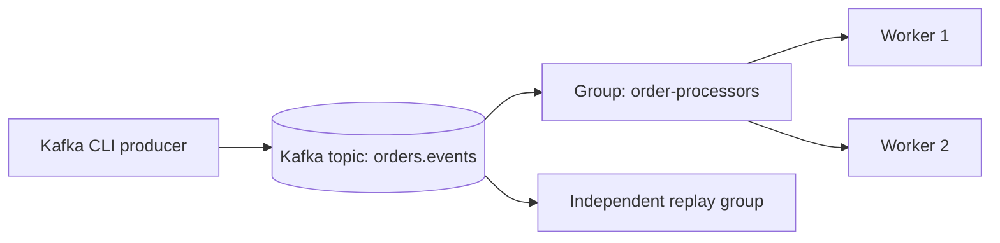
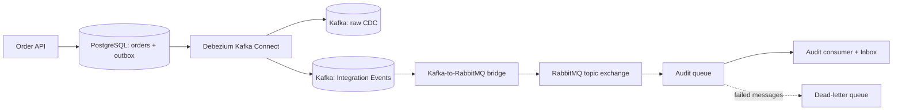

# Event-Driven Architecture — Examples (Chapter 5)

Hands-on examples for **Event-Driven Architecture**, Chapter 5 of the **Information Systems Design and Big Data** course (Polytechnic University of Bari).

The two independent laboratories follow the slides: **Apache Kafka fundamentals** (topics, partitions, consumer groups, offsets and replay), followed by **PostgreSQL Change Data Capture with Debezium, Kafka and RabbitMQ integration**. Both examples are self-contained, have their own README and Makefile, and keep the Python components in a compact **Hexagonal (Ports & Adapters)** design.

The DDD Aggregate and Domain Events laboratory is in [Chapter 4 — Microservices Coordination and Orchestration](../microservices-coordination-and-orchestration/ddd-aggregates/), where those topics are taught. **This block does not implement Event Sourcing.**

## Recommended lab sequence

| # | Directory | Main architectural concept |
|---|---|---|
| 1 | [`kafka-fundamentals/`](kafka-fundamentals/) | Apache Kafka topic, 3 partitions, message keys (`orderId`), partition offsets, independent consumer groups, work distribution, and replay within retention |
| 2 | [`cdc-debezium-rabbitmq/`](cdc-debezium-rabbitmq/) | PostgreSQL WAL → Debezium Kafka Connect → Kafka; raw row-level CDC versus Outbox Integration Events; Kafka → RabbitMQ bridge, Audit Inbox and DLQ |

## How the two labs connect to the slides

**Lab 1: Kafka Fundamentals** — after **“Apache Kafka: A Durable Distributed Log”** and **“Kafka Consumer Groups and Partition Keys”**. Start with partitions and keyed messages, show two workers with the same group ID, and then replay with a different group ID.

**Lab 2: CDC with Debezium, Kafka and RabbitMQ** — introduce the first part after **“CDC with PostgreSQL, Debezium and Kafka”**; resume with the bridge and Audit subscriber after **“Integrating Message Queues and Event Streams”**. The previous Chapter 4 Outbox and RabbitMQ lessons are prerequisites, not topics to re-teach.

These are **two separate Docker Compose stacks**, not one application that depends on both labs running. The CDC lab embeds its own Kafka instance. See [`SLIDE_LINKS.md`](SLIDE_LINKS.md) for links to paste into the Markdown slides.

## Architecture: from topics to CDC integration



The first lab demonstrates **consumer-group partition ownership**: records with the same key normally map to the same partition under a stable partitioning scheme, and a partition is consumed by only one active worker per group at a time. A different group maintains its own offsets.



The second lab uses **two separate Debezium connectors**: one captures committed changes to the `orders` table as raw database-change records; the other routes rows inserted into the transactional Outbox into Kafka **Integration Events**. The bridge translates Kafka messages into RabbitMQ deliveries. The Audit consumer uses an Inbox to handle duplicate `eventId` values and demonstrates dead-letter handling.

## Key architectural distinctions

- **Kafka topic vs RabbitMQ topic exchange:** Kafka retains ordered, partitioned records and supports replay by offset; a RabbitMQ topic exchange routes to queues using routing keys and bindings. The term *topic* does not imply the same semantics.
- **Offset vs replication slot:** Kafka group offsets describe the consumer's progress within topic partitions. PostgreSQL logical replication slots track a CDC client's progress in the WAL. Neither is a business-transaction identifier.
- **CDC vs Integration Event:** An `UPDATE` to `orders.status` produces a database change record; it is **not automatically** the business event `OrderApproved`. A domain/application decision can write an explicit `integration_outbox` row, which Debezium's Outbox Event Router forwards separately.
- **Outbox:** Business state and an outgoing publication intention are saved atomically. The relay and downstream consumers remain at least-once in effect; duplicates and failures are possible. This reuses Chapter 4's reliable-messaging theory.
- **Event Sourcing:** Neither lab reconstructs an Order aggregate by replaying Domain Events. The Order's authoritative current state stays in SQL tables. Kafka retention/replay is not, by itself, Event Sourcing.
- **Reliability:** The bridge uses publisher confirmation and Kafka offset tracking; the Audit consumer uses an Inbox and a dead-letter path. These mechanisms illustrate design boundaries, not end-to-end exactly-once business execution.

## Getting started

Clone the repository and run **one** lab at a time:

```bash
git clone https://github.com/saverioieva/information-systems-design-big-data-examples.git
cd information-systems-design-big-data-examples/event-driven-architecture

# Lab 1: Kafka fundamentals
cd kafka-fundamentals
make up
make produce COUNT=12
make partitions
make replay LIMIT=12
make down

# Lab 2: Debezium, Kafka and RabbitMQ
cd ../cdc-debezium-rabbitmq
make up
make register
make status
make create
make raw COUNT=1
make integration COUNT=1
make audit
make down
```

Most examples require Docker Compose, `make`, `curl`, and Python 3. Kafka and Debezium images need more resources than the Chapter 4 labs. Several independent stacks expose overlapping host ports, so **run one at a time**. Observe readiness and connector status after `make register` before running the CDC commands; see individual READMEs for troubleshooting and exact endpoints.

### Lab 1: consumer groups and replay

In two separate terminals inside `kafka-fundamentals/`, run `make worker` to start two consumers with the **same** group ID (`shared-workers`), then publish `make produce COUNT=12` from a third terminal. Use `make groups` and `make partitions` to inspect the group and partition assignments. To read retained records independently, run `make replay LIMIT=12` (a new group ID). Stop the workers with Ctrl+C.

### Lab 2: observe CDC, then the bridge

Run `make create` to write an Order through the application; inspect `make raw COUNT=1` and `make integration COUNT=1` to contrast a Debezium change envelope with a selected Integration Event. Then run `make db-update` to make a direct SQL update, and observe that **raw CDC** sees it without creating a new domain Integration Event. Finally, inspect `make audit`, `make slots` and, when appropriate, the failure demonstration `make poison` / `make dlq`.

## What to observe

1. In Kafka, compare topic partition IDs and increasing offsets. Verify that ordering is **per partition**, not a global ordering of the whole topic.
2. Compare a single consumer group with independent groups: adding subscribers to the same group divides partitions; a new group can reread retained records.
3. In Debezium, identify the committed PostgreSQL row change and the separate Outbox integration-event payload.
4. Follow the Integration Event's `eventId` from Kafka through RabbitMQ to the Audit Inbox, noting where a delivery might be repeated.
5. Distinguish Kafka consumer offsets, PostgreSQL replication slot LSNs, RabbitMQ ACKs and business-state SQL commits.

## Scope and verification

These are **teaching exercises, not production-ready templates**. Local credentials, simplified observability and selected failure paths are deliberate. The two labs have offline Python unit tests and validated configuration files; full broker-to-database Docker end-to-end execution still needs verification in the target classroom environment. Consult [`VERIFICATION.md`](VERIFICATION.md) and each lab's README before demonstrating.

## Architecture: Domain, Application, Ports & Adapters

- `kafka-fundamentals/`: Pure event-record contract in `app/domain/`, publisher use case in `app/application/`, producer port in `app/ports/` and Kafka CLI/`confluent-kafka` outbound adapter.
- `cdc-debezium-rabbitmq/`: Order use cases and domain event contract, PostgreSQL persistence adapter, Kafka-to-RabbitMQ bridge with a pure routing function and publisher port, and an Audit subscriber with a local idempotent Inbox.

## Related Chapter 4 example

[DDD Aggregates and Domain Events](../microservices-coordination-and-orchestration/ddd-aggregates/) shows **why** an Aggregate records business facts and how current-state persistence is separated from a publication intent. Chapter 5 starts with **how records are carried and consumed** by Kafka, then shows **how database changes are streamed** with Debezium.
