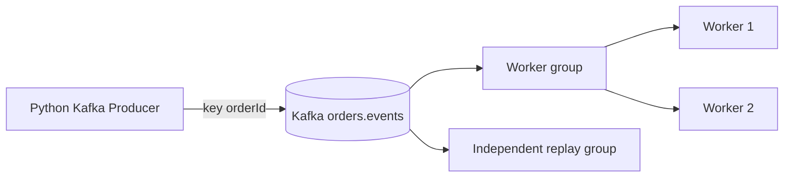
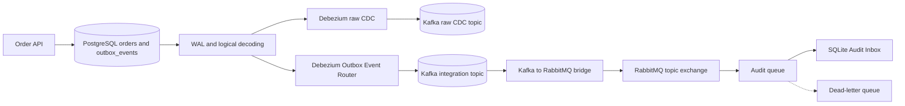
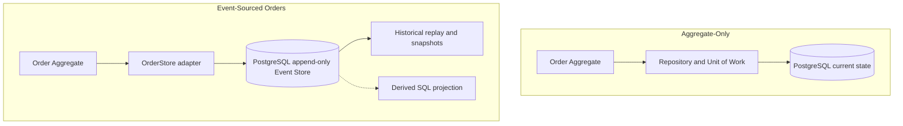

# Event-Driven Architecture - Examples (Chapter 5)

Runnable examples for **Chapter 5 - Event-Driven Architecture** of the **Information Systems Design and Big Data** course (Polytechnic University of Bari). The laboratories follow the slides and use a compact **Hexagonal (Ports & Adapters)** structure wherever appropriate.

**Six independent laboratories** are organized into two complementary tracks: **Kafka and CDC integration**, then **current-state versus event-sourced persistence**. Each has its own `README.md`, `Makefile`, Docker Compose stack and runnable examples.

The **DDD Aggregates and Domain Events** example remains in [Chapter 4 - Microservices Coordination and Orchestration](../microservices-coordination-and-orchestration/ddd-aggregates/). Chapter 5 builds on those aggregate boundaries but does **not** move the Chapter 4 lab into this folder.

## Recommended lab sequence

| # | Directory | Main architectural concept | Related course topic |
|---|---|---|---|
| 1 | [`kafka-fundamentals/`](kafka-fundamentals/) | Topics, three partitions, keys, consumer groups, offsets and replay | **CDC with PostgreSQL, Debezium and Kafka** (slide 5); Kafka concepts from Chapter 3 |
| 2 | [`cdc-debezium-rabbitmq/`](cdc-debezium-rabbitmq/) | PostgreSQL WAL, Debezium raw CDC vs Outbox Integration Events, Kafka-to-RabbitMQ bridge, SQLite Audit Inbox and DLQ | **CDC with PostgreSQL, Debezium and Kafka** (slide 5) |
| 3 | [`aggregate-only/`](aggregate-only/) | `Order` invariants, PostgreSQL current-state storage and atomic optimistic version check | **The Trouble with Traditional Persistence** (slide 8) |
| 4 | [`event-sourced-orders/`](event-sourced-orders/) | One Order Service, Python `eventsourcing` library, snapshots, history replay and version checks | **Aggregate-Only vs Event-Sourced Order** (slide 23) |
| 5 | [`event-sourced-saga-orchestration/`](event-sourced-saga-orchestration/) | Event-sourced Saga Orchestrator and participants, four PostgreSQL databases, atomic Outbox/Inbox | **Sagas and Event Sourcing** (slides 24–30) |
| 6 | [`event-sourced-cqrs-query-service/`](event-sourced-cqrs-query-service/) | External `findOrder` Query Service; live API Composition versus CQRS read model, **fifth PostgreSQL** | **CQRS and Query-Only Services** (slides 31–43) |

**Additional example within the Event-Sourced Orders lab:** [`PostgreSQL vs MongoDB Idempotency`](event-sourced-orders/IDEMPOTENCY_POSTGRES_MONGODB.md). It complements **Reliable Publishing and Idempotent Consumers** (slide 13) and runs as part of the Event-Sourced Orders lab.

The labs run as **separate Docker Compose stacks**. The CDC example includes its own Kafka instance and does not depend on Kafka Fundamentals. Run one stack at a time to simplify resource use. Both Kafka-based stacks include **Kafbat UI** for inspecting topics, partitions, messages and consumer groups; the CDC UI also shows Debezium Kafka Connect connectors. The interfaces are bound to localhost: **<http://localhost:8085>** for Kafka Fundamentals and **<http://localhost:8086>** for CDC.

## How the examples fit together

**Labs 1-2: Event streaming, CDC and message integration.** The first example covers keyed Kafka messages, partition ownership, offsets and replay. The second compares raw PostgreSQL row changes with explicit Outbox business facts and follows an Integration Event through Debezium, Kafka, the RabbitMQ bridge and the SQLite Audit Inbox. These examples **do not implement Event Sourcing**.

**Lab 3: Traditional persistence.** The aggregate applies business rules while SQL tables retain the **latest current state**. A stale expected version fails with HTTP **409**, preventing lost updates.

**Lab 4: Event-Sourced persistence.** Use the *same kind of Order operations*, but reconstruct state from events instead of loading current-state rows. The example includes snapshots, a historical read, an expected-version conflict, and a separate idempotency comparison using PostgreSQL and MongoDB.

**Lab 5: Event-sourced Saga.** Four services, each with an independent PostgreSQL Event Store: Order, Accounting, Kitchen, and Saga Orchestrator. RabbitMQ carries commands and replies; event-sourced Saga events and local Outbox/Inbox records enable recovery and safe duplicate deliveries. The explicit SQL implementation makes the course slides' `process()`/`apply()` mechanics visible.

**Lab 6: External CQRS Query Service.** This includes the full Lab 5 workflow and adds an independent Order Query Service with its own PostgreSQL. Compare `/find-order/{id}/composition` (three internal HTTP calls per query) with `/find-order/{id}/cqrs` (one materialized read-model lookup). `make demo-outage` illustrates the runtime dependency problem of API Composition; `make rebuild-projection` demonstrates rebuilding the read side from retained integration notifications. No circuit breaker is implemented here; those resilience patterns were introduced previously.

## Architecture: Kafka and CDC integration



The Kafka example demonstrates that a partition is assigned to **at most one active member of a group at a time**, while a different group can read its own offsets independently. Topic retention determines how much history is available for replay.



The CDC example uses **two connectors**, one for `orders` raw changes and one for `outbox_events` with Debezium's Event Router. Only the selected **Integration Event** stream is forwarded to RabbitMQ. MongoDB is **not** a consumer in this lab.

## Architecture: Aggregate-Only versus Event-Sourced Orders



The **Aggregate-Only** approach overwrites current state (with optimistic concurrency protection). The **Event-Sourced** approach appends accepted events and reconstructs the current state from their versioned history. The two demos enforce comparable business invariants; their storage models differ.

The MongoDB example in lab 4 illustrates **atomic, single-document message deduplication**. PostgreSQL demonstrates a unique processed-message marker and event append in **one local SQL transaction**. Neither backend claims globally exactly-once message delivery.

## Key architectural distinctions

- **Kafka topics versus RabbitMQ topic exchanges:** Kafka records are partitioned, retained and replayable by offset. RabbitMQ exchanges route messages to queues using bindings and routing keys.
- **Kafka offsets versus PostgreSQL replication slots:** group offsets track progress in Kafka partitions; replication slots keep required database WAL positions. Neither is a business transaction ID.
- **Raw CDC versus Integration Events:** an SQL `UPDATE` produces a row-change event; it is **not automatically** an `OrderApproved` business fact. The Outbox records selected business intent.
- **Outbox/Inbox versus Event Sourcing:** atomic Outbox recording and consumer deduplication improve messaging reliability. Event Sourcing instead makes **domain-event history** authoritative for the aggregate state.
- **Expected-version checks versus idempotency:** version checks detect concurrent writes to an aggregate. Persistent message IDs suppress duplicate effects from repeated deliveries. These are distinct safeguards.
- **Snapshots and projections:** snapshots optimize event replay; projections are derived query models, not replacements for the authoritative Event Store.
- **NoSQL scope:** MongoDB is used only in the lab 4 idempotency comparison, **not** in the Kafka/CDC stack, and it is **not** presented as a complete MongoDB Event Store.

## Getting started

Prerequisites: **Docker Compose**, `make`, `curl` and Python 3 (for selected host-side scripts). Kafka/Debezium need more RAM and initial startup time than the basic FastAPI examples. Each directory has its own ports and setup instructions.

Clone the main repository:

```bash
git clone https://github.com/saverioieva/information-systems-design-big-data-examples.git
cd information-systems-design-big-data-examples/event-driven-architecture
```

### Lab 1 - Kafka Fundamentals

```bash
cd kafka-fundamentals
make up
make partitions
make produce COUNT=12
make replay LIMIT=12
make down
```

Kafka UI: <http://localhost:8085>. Open **Topics → orders.events** and **Consumer Groups** to inspect messages, partitions and offsets.

To inspect partition ownership, start two `make worker` processes in separate terminals and publish records from a third terminal. Inspect `make groups` and `make partitions`; terminate workers with Ctrl+C.

### Lab 2 - CDC with Debezium, Kafka and RabbitMQ

```bash
cd ../cdc-debezium-rabbitmq
make up
make register
make status
make create
make raw COUNT=1
make integration COUNT=1
make audit
make down
```

Kafka UI: <http://localhost:8086>. Inspect both `cdc_orders.public.orders` and `orders.integration`, then open **Kafka Connect** to view connector status after registration.

Then create a direct SQL change with `make db-update` (raw CDC only), and optionally the failure path with `make poison` and `make dlq`. `make register` waits for Kafka Connect and should report both tasks as `RUNNING`.

### Lab 3 - Aggregate-Only Order Service

```bash
cd ../aggregate-only
make up
make demo
make inspect
make down
```

The script creates an Order, mutates current-state rows, attempts a stale expected-version write, and shows the resulting **409 Conflict**.

### Lab 4 - Event-Sourced Orders and idempotency comparison

```bash
cd ../event-sourced-orders
make up
make demo
make inspect
make inspect-snapshots
make idempotency-postgres
make idempotency-mongo
make down
```

The Event-Sourced demo shows historical version retrieval and an expected-version conflict. The *separate* Inbox demonstrations deliver two message IDs twice each, verifying that only two business effects persist.

### Lab 5 - Event-Sourced Saga Orchestration

```bash
cd ../event-sourced-saga-orchestration
make up
make demo-happy
make demo-compensation
make inspect-saga
make down
```

### Lab 6 - Event-Sourced Saga + CQRS Query Service

```bash
cd ../event-sourced-cqrs-query-service
make up
make demo-comparison
make demo-outage
make rebuild-projection
make down
```

The Query Service is externally available at <http://localhost:8215/docs>. It owns a fifth database; the other services keep separate Event Stores. Run one of Labs 5 or 6 at a time because their demo host ports overlap.

## What to observe

1. Kafka ordering and offsets are **per partition**, while independent consumer groups have separate progress.
2. The CDC pipeline carries **raw database changes** separately from explicit **business Integration Events**.
3. The bridge and subscriber illustrate **at-least-once delivery**, publisher confirmation and durable Inbox deduplication.
4. Aggregate-Only stores the latest `orders` / `order_line_items` state with a numeric version.
5. Event-Sourced Orders stores **versioned append-only events**; snapshots and the SQL projection are derived artifacts.
6. PostgreSQL and MongoDB implement idempotency through **different local atomicity boundaries**.

## Hexagonal Architecture: Domain, Application, Ports and Adapters

| Lab | Domain / Application | Port and outbound adapter | Inbound entry point |
|---|---|---|---|
| Kafka Fundamentals | `app/domain/`, `app/application/` | `app/ports/event_bus.py`, `app/adapters/outbound/kafka_producer.py` | `app/main.py` CLI |
| CDC / Debezium | `app/domain/`, `app/application/`, `bridge/application/` | `app/ports/storage.py`, `app/adapters/outbound/postgres_store.py`, bridge publisher port and RabbitMQ adapter | FastAPI plus Kafka bridge and Audit consumer |
| Aggregate-Only | `app/domain/`, `app/application/` | Repository / Unit of Work ports and SQLAlchemy adapters | FastAPI adapter in `app/adapters/inbound/` |
| Event-Sourced Orders | `app/domain/`, `app/application/` | `OrderStore` and MessageInbox ports; Event Store, PostgreSQL Inbox and MongoDB Inbox adapters | FastAPI adapter and standalone idempotency demo |

**Pragmatic exception:** the Event-Sourced aggregate uses the Python `eventsourcing` library's base class and event decorator. This is documented in its own README rather than hidden behind a claim of fully framework-independent domain code.

## Scope, verification and cleanup

These are **teaching demonstrations, not production-ready service templates**. Local credentials, single-node infrastructure, selected failure paths, intentionally simple monitoring, and limited transaction boundaries are deliberate. Run `make test` in each lab to execute its available local tests; Event-Sourced Orders also has `make test-integration` for PostgreSQL-backed checks.

The source and Docker Compose configurations are intended to be runnable, but full end-to-end behavior still needs verification in an actual Docker environment. The new Saga and CQRS labs include unit tests (`make test`), and each README lists the expected results. Every stack has `make down`; `make reset` additionally **deletes persistent volumes**.

## Related Chapter 4 laboratory

[DDD Aggregates and Domain Events](../microservices-coordination-and-orchestration/ddd-aggregates/) demonstrates Aggregate Roots, local business invariants, Repository, Unit of Work and the relation between domain facts and Outbox intents. It stays **in Chapter 4**. Chapter 5 proceeds from **event transport and CDC** to **Event Sourcing as an alternative persistence model**.
