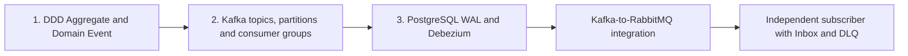

# Event-Driven Architecture — Examples (Chapter 5)

Hands-on examples for **Event-Driven Architecture**, Chapter 5 of the **Information Systems Design and Big Data** course (Polytechnic University of Bari).

The labs follow the slides: **DDD Aggregates and Domain Events → Kafka fundamentals → Change Data Capture with Debezium → integration with RabbitMQ**. Each folder is **self-contained** with its own Compose project, Makefile and detailed README. The executable Python code follows the **Domain / Application / Ports / Adapters (Hexagonal Architecture)** separation introduced in earlier chapters.

## Recommended lab sequence

| # | Directory | Main learning objective |
|---|---|---|
| 1 | [`ddd-aggregates/`](ddd-aggregates/) | `Order` Aggregate Root; invariants, local SQL transaction, immutable Domain Events, selected integration-event intents in an Outbox (no broker required) |
| 2 | [`kafka-fundamentals/`](kafka-fundamentals/) | Topic, partition, keyed records, offsets, consumer groups, independent subscriptions and replay within retention |
| 3 | [`cdc-debezium-rabbitmq/`](cdc-debezium-rabbitmq/) | PostgreSQL **WAL → Debezium → Kafka**: raw row changes vs business Integration Events; **Kafka → RabbitMQ** bridge; Audit Inbox and DLQ |

**Event Sourcing is not implemented in these laboratories.** They deliberately keep the current Order state in regular SQL tables. Kafka provides brokered event streams, not an application-specific event store for reconstructing an aggregate.

## How the labs connect



The three labs are **separate runnable systems**, not modules that must run together. The conceptual order matters: learn what business events mean before looking at how a broker transports records and how CDC captures database changes.

## Key architectural distinctions

- **Domain Event:** a business fact determined by a domain model, such as `OrderApproved`.
- **Integration Event:** the selected message contract that another service may consume. It can be derived from a Domain Event; not every internal event must be published.
- **Raw CDC record:** describes a committed database row change (`INSERT`, `UPDATE`, `DELETE`) captured by a connector. It does **not** automatically carry business semantics.
- **Transactional Outbox:** the local write stores current-state changes and an outgoing publication intent atomically; Chapter 4 already explained the reliability pattern.
- **Kafka topic vs RabbitMQ topic exchange:** a Kafka topic stores partitioned records with offsets; a RabbitMQ topic exchange routes messages to queues through bindings. The word *topic* does not mean the same implementation in both systems.
- **Kafka offset vs PostgreSQL replication slot:** a Kafka consumer offset tracks where a group is reading a topic partition; a PostgreSQL replication slot retains the WAL position needed by its CDC consumer.
- **At-least-once effects:** duplicate delivery remains possible across relays and brokers; downstream consumers need idempotent handling. The Audit Inbox demonstrates this concretely.

## Getting started

Clone the repository and run **one laboratory at a time**:

```bash
git clone https://github.com/saverioieva/information-systems-design-big-data-examples.git
cd information-systems-design-big-data-examples/event-driven-architecture

# First: local business consistency and events
cd ddd-aggregates
make up
make create
make events
make down

# Next: Kafka fundamentals
cd ../kafka-fundamentals
make up
make produce
make partitions
make replay
make down

# Finally: CDC and broker integration
cd ../cdc-debezium-rabbitmq
make up
make register
make status
make create
make audit
make down
```

**Prerequisites:** Docker Engine/Compose, Make, curl, Python 3. The two Kafka-based labs pull relatively large images; plan several GB of free RAM. Lab-local credentials are intentionally simple. Host ports are listed in the respective README files; although the stacks have distinct Compose project names, running several simultaneously is not necessary.

## What to observe during the lecture

1. **DDD:** compare `orders` / `order_line_items` with `integration_outbox` in Adminer; business state and notification are different responsibilities.
2. **Kafka:** `orderId` is the message key; same key → stable partition while the topic partitioning setup is unchanged. Observe offsets and workers in a consumer group.
3. **CDC:** compare the raw Debezium change envelope with the integration-event payload; test a direct SQL update and check that it does not magically become a Domain Event.
4. **Bridge:** follow the same `eventId` through Kafka and the RabbitMQ topic exchange; inspect Audit Inbox and the DLQ.
5. **Recovery:** identify the failure boundary (local SQL commit, Kafka offset, RabbitMQ confirmation, downstream ACK) and where duplication can occur.

## Architecture and reading order

| Lab | Domain/Application | Ports | Inbound/Outbound Adapters |
|---|---|---|---|
| `ddd-aggregates` | `Order` rules and use cases | Repository and UoW | FastAPI, SQLAlchemy, PostgreSQL |
| `kafka-fundamentals` | Sample event contract and publisher use case | Event producer | CLI, `confluent-kafka` |
| `cdc-debezium-rabbitmq` | Order use cases; pure bridge routing | Storage and publisher | FastAPI, PostgreSQL, Debezium Connect, Kafka consumer, Pika publisher, SQLite Inbox |

The code is **didactic**, not a production-ready deployment. PostgreSQL and Kafka/RabbitMQ credentials are for local use; security, monitoring, back-pressure and complete failure recovery would require additional engineering.

## Links to the slides

Use the paths from this block in the end-of-slide **See example** links:

- [DDD Aggregates and Domain Events](ddd-aggregates/)
- [Kafka Fundamentals](kafka-fundamentals/)
- [PostgreSQL CDC with Debezium, Kafka and RabbitMQ](cdc-debezium-rabbitmq/)

A copy-pasteable set of GitHub links is provided in [`SLIDE_LINKS.md`](SLIDE_LINKS.md).
