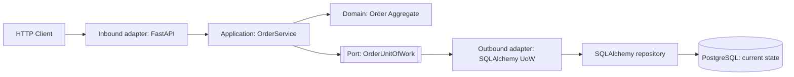
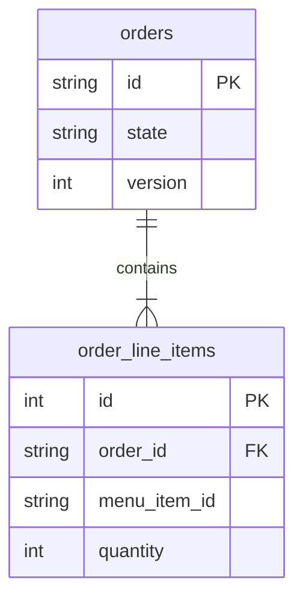
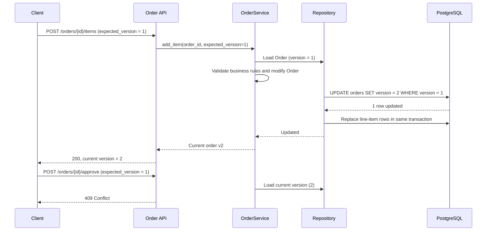

# Example 01 — Aggregate-Only Order Service

A small runnable **FastAPI + PostgreSQL** Order service using **Hexagonal (Ports & Adapters) Architecture**. An `Order` Aggregate enforces business invariants, while a Repository and Unit of Work persist the **latest current state** in SQL. An explicit numeric `version` field demonstrates **atomic optimistic locking**.

This is the **current-state baseline** for the Event Sourcing comparison in [Chapter 5 - Event-Driven Architecture](../README.md). It uses aggregate concepts introduced in the Chapter 4 DDD laboratory, but **does not store or replay domain events**.

## What to learn

- Load and update an `Order` through a Repository rather than making database calls inside the domain.
- Enforce `approve()` and `cancel()` invariants through the same aggregate business rules as Example 02.
- Observe the difference between **current-state tables** and an **append-only event stream**.
- Detect a stale write with a **version compare-and-swap** during a local SQL transaction.
- Identify the Domain, Application, Ports, inbound API and outbound SQL adapter layers.

## Architecture




**Dependency direction:** `adapters/inbound → application → ports`; concrete storage is selected only in `app/main.py` (composition root). The transaction covers the version compare-and-swap and the item-row replacement.

## Current-state schema



## Sequence diagram: current-state update and optimistic conflict



## Start and inspect

```bash
make up
make demo
make inspect
```

API documentation: http://localhost:8101/docs; PostgreSQL: `localhost:55431`; optional Adminer: http://localhost:8181 (server `db`, database/user/password `ftgo`).

`make demo` automatically creates an order, adds an item, attempts an update with a stale version (expected **409**), then approves the current version. Each operation prints the resulting response; no user prompts are needed.

## Current-state persistence: what is stored?

| SQL object | Purpose | Key fields |
|---|---|---|
| `orders` | One latest row per order | `id`, `state`, `version` |
| `order_line_items` | Latest line items | `order_id`, `menu_item_id`, `quantity` |
| **No event store** | Historical revisions are not automatically available | Add a dedicated audit/history mechanism if needed |

## Code map

| Layer | File | Responsibility |
|---|---|---|
| Domain | [`app/domain/models.py`](app/domain/models.py) | `Order` invariants and state transitions |
| Application | [`app/application/order_service.py`](app/application/order_service.py) | Framework-free use cases |
| Ports | [`app/ports/`](app/ports/) | Repository and Unit of Work contracts |
| Inbound adapter | [`app/adapters/inbound/http_api.py`](app/adapters/inbound/http_api.py) | FastAPI transport and HTTP error mapping |
| Outbound adapters | [`app/adapters/outbound/`](app/adapters/outbound/) | SQLAlchemy Repository and Unit of Work |
| Infrastructure | [`app/infrastructure/`](app/infrastructure/) | SQL tables and session factory |
| Composition root | [`app/main.py`](app/main.py) | Wires ports to the SQLAlchemy adapter |
| Demo | [`scripts/demo.py`](scripts/demo.py) | Automated example flow |

## API summary

`POST /orders` creates an order; `GET /orders/{id}` returns the latest state; `POST /orders/{id}/items` modifies an item; `POST /orders/{id}/approve` and `/cancel` perform state transitions. Updates can supply `expected_version`, returning **409** if stale.

## What is intentionally simplified?

The application uses a numeric `version` column rather than PostgreSQL `xmin`, for portability and easier inspection. The SQL tables contain only the **latest state**; previous revisions are not recorded unless an audit/history mechanism is added. Monetary amounts use floating point values in this teaching example; real financial code should use fixed precision / `Decimal`. Local credentials are not production-safe.


## Test and cleanup


```bash
make test    # domain + SQLite-backed repository tests in Docker
make logs
make down    # retains data
make reset   # WARNING: deletes the database volume
```


