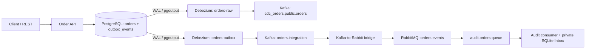
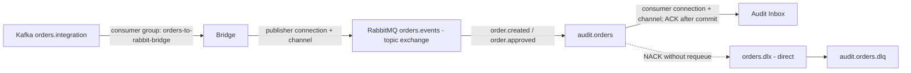

# PostgreSQL CDC with Debezium, Kafka and RabbitMQ

A complete but compact **Change Data Capture** lab for Chapter 5. Students can inspect **raw PostgreSQL row changes** in Kafka and compare them with **business integration events** carried through an append-only Outbox, Debezium, Kafka and a small Kafka→RabbitMQ bridge. The downstream Audit consumer demonstrates a local **Inbox** and RabbitMQ DLQ. There is no Event Sourcing in this exercise.

This builds on the Chapter 4 Transactional Outbox labs. The same local transaction writes current business data and the outgoing integration-event intent; **Debezium reads the committed PostgreSQL WAL**, not a polling loop.

## Architecture overview



### Message topology



| Layer | Name | Role |
|---|---|---|
| Raw CDC connector | `orders-raw` | Reads only `public.orders` |
| Raw CDC Kafka topic | `cdc_orders.public.orders` | `op`, `before`, `after`: database facts |
| Outbox connector | `orders-outbox` | Reads only `public.outbox_events`; Event Router SMT |
| Integration Kafka topic | `orders.integration` | `OrderCreated` / `OrderApproved` business contracts |
| Kafka consumer group | `orders-to-rabbit-bridge` | Commits offsets after RabbitMQ publisher confirm |
| RabbitMQ topic exchange | `orders.events` | Routing keys `order.created`, `order.approved` |
| RabbitMQ queue | `audit.orders` | One downstream subscriber |
| RabbitMQ DLX + DLQ | `orders.dlx`, `audit.orders.dlq` | Reject malformed messages |
| Audit Inbox | `/audit_data/audit.sqlite3` | **Separate local data store**, dedupe by `eventId` |

*Only the RabbitMQ queue receives deliveries; a topic exchange routes messages and does not itself act as a queue.* The bridge and Audit consumer each have their own AMQP connection and channel. A Kafka consumer group is a different concept from an AMQP channel.

## Start

Requirements: Docker Compose (recent version with `service_completed_successfully` support), Make, Python 3 and curl. This stack is heavier than the Chapter 4 RabbitMQ exercises; allow several GB of RAM.

```bash
make up
make register
make status
make slots
```

`make register` is **idempotent**: it waits for Kafka Connect REST and registers both connectors if absent, then checks that connector tasks are `RUNNING`. Existing connector offsets are preserved if you run it again. Schema and publications are installed by `db/001_schema.sql` on the first PostgreSQL volume initialization.

- FastAPI: <http://localhost:8004/docs>
- Adminer: <http://localhost:8084> (PostgreSQL; Server `postgres`; Database `orders`; User/Password `demo`/`demo`)
- Debezium Kafka Connect: <http://localhost:18083/connectors>
- RabbitMQ Management: <http://localhost:15675> (`student` / `student`)
- Kafka from host: `localhost:29094`; Kafka in Compose: `kafka:19092`

## Experiment A — Raw CDC versus business events

Create one order:

```bash
make create
make orders
make outbox
make raw COUNT=1
make integration COUNT=1
```

Compare the results. `cdc_orders.public.orders` contains a **Debezium change envelope** for the `orders` row. `orders.integration` contains the business payload from `outbox_events` after the Debezium **Outbox Event Router** transformation. Kafka keys are based on `aggregate_id` (the order ID).

Now change one order **directly in SQL**, bypassing the Order application:

```bash
make db-update
make orders
make outbox
make raw COUNT=2
```

You should see the raw `UPDATE` in the CDC topic, but **no new Outbox row or business Integration Event**. This is why a database change record is not automatically equivalent to a Domain Event. Note: `make raw COUNT=2` starts from the beginning and reads the original `INSERT` and the `UPDATE`.

For an application-level approval instead, first create a fresh order and copy its `orderId` from the response:

```bash
make create
make approve ORDER_ID=<new-order-id>
make outbox
make audit
```

This route changes `orders` and inserts a matching `OrderApproved` publication intent in **one local SQL transaction**. The Kafka-to-Rabbit bridge and Audit consumer process both `OrderCreated` and `OrderApproved`.

## Experiment B — Follow Kafka → RabbitMQ and test delivery safeguards

```bash
make logs         # [bridge] publish/commit; [audit] stored / duplicate
make audit        # inspect deduplicated events in Audit's own SQLite database
make poison       # publish intentionally malformed JSON to RabbitMQ
make dlq          # see audit.orders.dlq count
```

The **bridge** consumes Kafka events and publishes them to the RabbitMQ topic exchange `orders.events` using the routing keys `order.created` and `order.approved`. It waits for RabbitMQ **publisher confirms before committing the Kafka offset**. If it crashes between the publish confirmation and offset commit, the event might be sent twice. The Audit Inbox stores unique `eventId` values, then ACKs the AMQP delivery after its local commit.

The Audit service is an **independent teaching subscriber** that records what it observes; it does not share the Order Service's database or participate in the Order write transaction. Its small SQLite Inbox is sufficient to show uniqueness and persistence independently of the main PostgreSQL database.

The intentionally malformed message fails Audit parsing and is dead-lettered through `orders.dlx` to `audit.orders.dlq`; it is not retried forever.

## What is the replication slot doing?

`postgres` uses the standard built-in **`pgoutput`** decoding plugin (no `wal2json` installation or output-plugin allowlist configuration). A PostgreSQL **publication** selects which tables have changes available for replication. A **replication slot** remembers the WAL position required by its connector and prevents PostgreSQL from discarding WAL still needed by that consumer. Two connectors use distinct slots and publications:

| Connector | Publication | Slot | Kafka topic |
|---|---|---|---|
| `orders-raw` | `raw_orders_publication` | `raw_orders_slot` | `cdc_orders.public.orders` |
| `orders-outbox` | `integration_outbox_publication` | `integration_outbox_slot` | `orders.integration` |

Run `make slots` to observe `slot_name`, `active` and `restart_lsn`; stopped/lagging connectors can **retain WAL files** and consume disk space. In this lab `snapshot.mode=initial` handles startup snapshots; source WAL streaming continues after the snapshot. Resetting volumes destroys connector offsets and slots: intended only for exercises.

## Where to read the code

| Directory / file | Purpose |
|---|---|
| `app/domain/`, `app/application/`, `app/ports/` | Event contract, Order use cases and storage port |
| `app/adapters/outbound/postgres_store.py` | Atomic Order + Outbox INSERT; no publishing call |
| `db/001_schema.sql` | Current-state tables and publications |
| `connector/orders-raw.json` | Raw CDC connector settings |
| `connector/outbox-postgres.json` | Outbox Event Router SMT and separate slot |
| `bridge/domain/routing.py` | Event-type to RabbitMQ routing-key mapping |
| `bridge/adapters/rabbitmq_transport.py` | AMQP exchange, queue, DLQ and publisher confirms |
| `bridge/main.py` | Kafka offset committed after RabbitMQ confirmation |
| `audit/inbox.py`, `audit/main.py` | Persistent Inbox, ACK and DLQ handling |
| `tests/` | Offline contract/unit tests (`make test`) |

## Reliability, limitations and cleanup

This example provides **at-least-once effects**, not a global transaction or universal exactly-once delivery. Kafka retention and broker/RabbitMQ persistence have different settings and lifecycles. The demo uses a single Kafka broker, one Connect worker, default plaintext connections and local passwords, so it is **not production-ready**. For production, handle schema evolution, connector recovery, retention/WAL growth, authentication and bridge failures.

```bash
make test
make down
make reset  # WARNING: deletes ALL local lab volumes, including outbox and offsets
```

### References

- [Apache Kafka in Docker](https://github.com/apache/kafka/tree/trunk/docker)
- [Debezium PostgreSQL connector](https://debezium.io/documentation/reference/3.3/connectors/postgresql.html)
- [Debezium Outbox Event Router SMT](https://debezium.io/documentation/reference/3.3/transformations/outbox-event-router.html)
