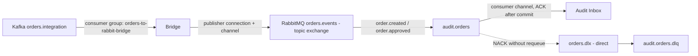
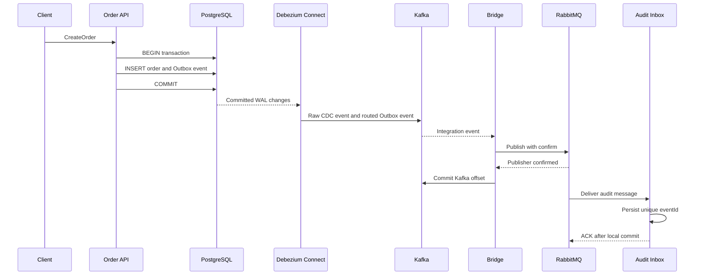

# PostgreSQL CDC with Debezium, Kafka and RabbitMQ

A runnable **FastAPI + PostgreSQL + Debezium + Kafka + RabbitMQ** integration laboratory with **Hexagonal (Ports & Adapters) Architecture** in the Python components. It contrasts raw row-level CDC with explicit business Integration Events. A bridge forwards selected Kafka events to RabbitMQ, where an independent **SQLite Audit Inbox** records deliveries.

This is the second independent lab in [Chapter 5 - Event-Driven Architecture](../README.md). It builds on **Chapter 4 Transactional Outbox** concepts without repeating the earlier publisher implementation. The authoritative order state remains in PostgreSQL; **this is not Event Sourcing**. MongoDB is deliberately **not** part of this lab.

## What to learn

- Separate **row-level changes** (`INSERT`, `UPDATE`) from explicitly chosen **business Integration Events**.
- Persist an order and its outgoing event intent in **one local PostgreSQL transaction**.
- Use **Debezium logical decoding** to stream committed changes and route Outbox events.
- Understand **Kafka topic/offset** versus **RabbitMQ topic exchange/queue** semantics.
- Observe the bridge, **at-least-once forwarding**, persistent Inbox deduplication and dead-letter handling.
- Identify the Domain, Application, Ports and Adapters in the Order API and message bridge.

## Architecture

```mermaid
flowchart LR
    API["Order API"] --> TX["One local SQL transaction"]
    SQL["Direct SQL UPDATE"] -->|"updates orders only"| ORD

    subgraph PG["PostgreSQL - authoritative current state and Outbox"]
        direction TB
        ORD[("public.orders<br/>current-state rows")]
        OUT[("public.outbox_events<br/>publication intents")]
    end
    TX -->|"persist order state"| ORD
    TX -->|"persist selected business event intent"| OUT

    subgraph RAW["Path A - RAW CDC: database changes"]
        direction LR
        DR["Debezium orders-raw<br/>raw_orders_slot"]
        KR[("Kafka<br/>cdc_orders.public.orders")]
        DR -->|"change envelope: INSERT or UPDATE"| KR
    end

    subgraph EVENTS["Path B - INTEGRATION EVENTS: business facts"]
        direction LR
        DE["Debezium orders-outbox<br/>integration_outbox_slot"]
        SMT["Outbox Event Router SMT"]
        KE[("Kafka<br/>orders.integration")]
        BR["Kafka to RabbitMQ bridge"]
        EX["RabbitMQ topic exchange<br/>orders.events"]
        Q["Queue: audit.orders"]
        AUD[("Audit consumer<br/>SQLite Inbox")]
        DE --> SMT -->|"OrderCreated / OrderApproved"| KE
        KE --> BR --> EX --> Q --> AUD
    end

    ORD -->|"WAL via pgoutput"| DR
    OUT -->|"WAL via pgoutput"| DE

    classDef source fill:#edf5ff,stroke:#427cc7,color:#163b66
    classDef raw fill:#fff0db,stroke:#c07b28,color:#75470f
    classDef integration fill:#e5f6eb,stroke:#429268,color:#17533b
    classDef stream fill:#f2ebff,stroke:#8260ba,color:#4e3479
    class API,TX,SQL,ORD,OUT source
    class DR,KR raw
    class DE,SMT,BR,EX,Q,AUD integration
    class KE stream
```




**Two different event semantics:** `orders-raw` reads changes to `public.orders` and produces **storage-level CDC records** (`INSERT` / `UPDATE`). `orders-outbox` reads `public.outbox_events`, applies Debezium's **Outbox Event Router**, and emits **selected business integration events**. The two connectors use different PostgreSQL publications and replication slots, but both stream committed WAL changes from the same database.

**What the diagram proves:** `make create` writes an Order row and its Outbox intent in **one local transaction**, so both paths receive data. `make db-update` updates **only** `orders`, so only the raw CDC path receives a new event. RabbitMQ and the SQLite Audit Inbox receive **only integration events** forwarded from `orders.integration`; the raw CDC topic is not bridged.

### Message topology



| Layer | Name | Role |
|---|---|---|
| Raw CDC connector | `orders-raw` | Reads only `public.orders` |
| Raw CDC Kafka topic | `cdc_orders.public.orders` | `op`, `before`, `after`: database facts |
| Outbox connector | `orders-outbox` | Reads only `public.outbox_events`; Event Router SMT |
| Integration Kafka topic | `orders.integration` | `OrderCreated` / `OrderApproved` business contracts |
| Kafka consumer group | `orders-to-rabbit-bridge` | Commits offsets after RabbitMQ publisher confirm |
| RabbitMQ topic exchange | `orders.events` | Routing keys `order.created`, `order.approved` |
| RabbitMQ queue | `audit.orders` | One downstream subscriber |
| RabbitMQ DLX + DLQ | `orders.dlx`, `audit.orders.dlq` | Reject malformed messages |
| Audit Inbox | `/audit_data/audit.sqlite3` | **Separate local data store**, dedupe by `eventId` |

*Only the RabbitMQ queue receives deliveries; a topic exchange routes messages and does not itself act as a queue.* The bridge and Audit consumer each have their own AMQP connection and channel. A Kafka consumer group is a different concept from an AMQP channel.

## Sequence diagram: business event delivery



## Start and inspect


Requirements: Docker Compose (recent version with `service_completed_successfully` support), Make, Python 3 and curl. This stack is heavier than the Chapter 4 RabbitMQ exercises; allow several GB of RAM.

```bash
make up
make register
make status
make slots
```

`make register` is **idempotent**: it waits for Kafka Connect REST and registers both connectors if absent, then checks that connector tasks are `RUNNING`. Existing connector offsets are preserved if you run it again. Schema and publications are installed by `db/001_schema.sql` on the first PostgreSQL volume initialization.

- FastAPI: <http://localhost:8004/docs>
- Adminer: <http://localhost:8084> (PostgreSQL; Server `postgres`; Database `orders`; User/Password `demo`/`demo`)
- Debezium Kafka Connect: <http://localhost:18083/connectors>
- **Kafka UI:** <http://localhost:8086> (Kafbat UI; starts with `make up`, or use `make ui`)
- RabbitMQ Management: <http://localhost:15675> (`student` / `student`)
- Kafka from host: `localhost:29094`; Kafka in Compose: `kafka:19092`

In **Kafka UI → Topics**, compare `cdc_orders.public.orders` (raw row-level changes) with `orders.integration` (business integration events): inspect message key, value, partition and offset. After `make register`, use **Kafka Connect** in the same UI to inspect the `orders-raw` and `orders-outbox` connectors. Connector registration and restarts are still managed by the existing scripts; the UI is an observation tool, not a replacement for the CDC pipeline. The browser connects to port `8086`, while the UI container reaches Kafka at `kafka:19092` and Connect at `http://connect:8083`.

## Guided inspection: Adminer, Kafka UI, RabbitMQ and the Audit Inbox

This example has four **different observable stages**. The goal is to follow **the same business action** through each stage rather than treating every record as the same kind of event.

1. **PostgreSQL with Adminer:** `make up` starts Adminer automatically. Open **<http://localhost:8084>**, select **PostgreSQL**, then enter **Server:** `postgres`, **Username:** `demo`, **Password:** `demo`, **Database:** `orders`.
2. Click **`orders` → Select data** to see the current Order row and its `CREATED`/`APPROVED` status. Click **`outbox_events` → Select data** to see the explicit business event record committed by the application. These are **two different tables written in the same SQL transaction**.
3. Open Adminer's **SQL command** and run:

   ```sql
   SELECT id, amount, status, created_at FROM orders ORDER BY created_at DESC;
   SELECT event_id, aggregate_id, event_type, payload, created_at
   FROM outbox_events ORDER BY created_at DESC;
   ```

4. **Debezium and Kafka:** first run `make register`, then open **<http://localhost:8086> → Kafka Connect** and confirm both `orders-raw` and `orders-outbox` connectors are running. Under **Topics**, inspect `cdc_orders.public.orders` (storage-level change envelope) and `orders.integration` (business record emitted from the Outbox Router). Use `make raw COUNT=1` and `make integration COUNT=1` as CLI alternatives.
5. **RabbitMQ and Audit:** open **<http://localhost:15675>** (user/password `student`/`student`), inspect the `orders.events` topic exchange and the `audit.orders` queue; then run `make audit`. The Audit Service stores processed event IDs in its **own SQLite database**, not in the PostgreSQL instance viewed via Adminer. `make poison` and `make dlq` demonstrate its error route.

### Follow the two possible database writes

| Action | `orders` table | `outbox_events` table | Kafka consequence |
|---|---|---|---|
| `make create` (application API) | Inserts a current-state Order | Inserts `OrderCreated` intent in the same transaction | Raw CDC `INSERT` **and** business Integration Event |
| `make db-update` (direct SQL) | Updates an existing row to `APPROVED` | **No additional Outbox row** | Raw CDC `UPDATE` but **no** new business Integration Event |
| `make approve ORDER_ID=<id>` (application API) | Updates state via application logic | Inserts `OrderApproved` intent | Both raw CDC and a new business Integration Event |

**Interpretation:** Debezium tails PostgreSQL's WAL; it does **not** invent `OrderApproved` from an SQL `UPDATE`. Only the application can decide which business facts to record in its Outbox. This is **Transactional Outbox + CDC**, not Event Sourcing: the `orders` table remains the authoritative **current state**.

## Scenario A - Raw CDC versus Integration Events

Create one order:

```bash
make create
make orders
make outbox
make raw COUNT=1
make integration COUNT=1
```

Compare the results. `cdc_orders.public.orders` contains a **Debezium change envelope** for the `orders` row. `orders.integration` contains the business payload from `outbox_events` after the Debezium **Outbox Event Router** transformation. Kafka keys are based on `aggregate_id` (the order ID).

Now change one order **directly in SQL**, bypassing the Order application:

```bash
make db-update
make orders
make outbox
make raw COUNT=2
```

You should see the raw `UPDATE` in the CDC topic, but **no new Outbox row or business Integration Event**. This is why a database change record is not automatically equivalent to a Domain Event. Note: `make raw COUNT=2` starts from the beginning and reads the original `INSERT` and the `UPDATE`.

For an application-level approval instead, first create a fresh order and copy its `orderId` from the response:

```bash
make create
make approve ORDER_ID=<new-order-id>
make outbox
make audit
```

This route changes `orders` and inserts a matching `OrderApproved` publication intent in **one local SQL transaction**. The Kafka-to-Rabbit bridge and Audit consumer process both `OrderCreated` and `OrderApproved`.

## Scenario B - Kafka to RabbitMQ and delivery safeguards

```bash
make logs         # [bridge] publish/commit; [audit] stored / duplicate
make audit        # inspect deduplicated events in Audit's own SQLite database
make poison       # publish intentionally malformed JSON to RabbitMQ
make dlq          # see audit.orders.dlq count
```

The **bridge** consumes Kafka events and publishes them to the RabbitMQ topic exchange `orders.events` using the routing keys `order.created` and `order.approved`. It waits for RabbitMQ **publisher confirms before committing the Kafka offset**. If it crashes between the publish confirmation and offset commit, the event might be sent twice. The Audit Inbox stores unique `eventId` values, then ACKs the AMQP delivery after its local commit.

The Audit service is an **independent teaching subscriber** that records what it observes; it does not share the Order Service's database or participate in the Order write transaction. Its small SQLite Inbox is sufficient to show uniqueness and persistence independently of the main PostgreSQL database.

The intentionally malformed message fails Audit parsing and is dead-lettered through `orders.dlx` to `audit.orders.dlq`; it is not retried forever.

## What is the replication slot doing?

`postgres` uses the standard built-in **`pgoutput`** decoding plugin (no `wal2json` installation or output-plugin allowlist configuration). A PostgreSQL **publication** selects which tables have changes available for replication. A **replication slot** remembers the WAL position required by its connector and prevents PostgreSQL from discarding WAL still needed by that consumer. Two connectors use distinct slots and publications:

| Connector | Publication | Slot | Kafka topic |
|---|---|---|---|
| `orders-raw` | `raw_orders_publication` | `raw_orders_slot` | `cdc_orders.public.orders` |
| `orders-outbox` | `integration_outbox_publication` | `integration_outbox_slot` | `orders.integration` |

Run `make slots` to observe `slot_name`, `active` and `restart_lsn`; stopped/lagging connectors can **retain WAL files** and consume disk space. In this lab `snapshot.mode=initial` handles startup snapshots; source WAL streaming continues after the snapshot. Resetting volumes destroys connector offsets and slots: intended only for exercises.

## What to observe

| Observation | Raw CDC path | Outbox integration path |
|---|---|---|
| Origin | `orders` row change | `outbox_events` insertion |
| Debezium connector | `orders-raw` | `orders-outbox` with Event Router |
| Kafka topic | `cdc_orders.public.orders` | `orders.integration` |
| Payload meaning | Storage operation / changed fields | Business fact such as `OrderCreated` |
| RabbitMQ delivery | Not used | Bridge -> `orders.events` exchange -> `audit.orders` queue |
| Failure control | Connector offset and WAL slot | Publisher confirm, Inbox dedupe and DLQ |

## Code map


| Directory / file | Purpose |
|---|---|
| `app/domain/`, `app/application/`, `app/ports/` | Event contract, Order use cases and storage port |
| `app/adapters/outbound/postgres_store.py` | Atomic Order + Outbox INSERT; no publishing call |
| `db/001_schema.sql` | Current-state tables and publications |
| `connector/orders-raw.json` | Raw CDC connector settings |
| `connector/outbox-postgres.json` | Outbox Event Router SMT and separate slot |
| `bridge/domain/routing.py` | Event-type to RabbitMQ routing-key mapping |
| `bridge/adapters/rabbitmq_transport.py` | AMQP exchange, queue, DLQ and publisher confirms |
| `bridge/main.py` | Kafka offset committed after RabbitMQ confirmation |
| `audit/inbox.py`, `audit/main.py` | Persistent Inbox, ACK and DLQ handling |
| `tests/` | Offline contract/unit tests (`make test`) |

## Reliability and deliberate simplifications

The two connectors use distinct PostgreSQL logical replication slots. These track CDC progress, **not** Kafka consumer offsets or business transaction IDs. The bridge commits a Kafka offset after RabbitMQ publisher confirmation; it can still republish after a crash. The Audit Inbox uses a unique `eventId` to prevent repeated local effects.

This is an **at-least-once demonstration**, not a global distributed transaction or end-to-end exactly-once guarantee. The stack has one Kafka broker, one Connect worker, local credentials, simplified monitoring, and selected failure paths. MongoDB is only used in the separate Event-Sourced Orders **idempotency comparison**.


## Test and cleanup


This example provides **at-least-once effects**, not a global transaction or universal exactly-once delivery. Kafka retention and broker/RabbitMQ persistence have different settings and lifecycles. The demo uses a single Kafka broker, one Connect worker, default plaintext connections and local passwords, so it is **not production-ready**. For production, handle schema evolution, connector recovery, retention/WAL growth, authentication and bridge failures.

```bash
make test
make down
make reset  # WARNING: deletes ALL local lab volumes, including outbox and offsets
```

### References

- [Apache Kafka in Docker](https://github.com/apache/kafka/tree/trunk/docker)
- [Debezium PostgreSQL connector](https://debezium.io/documentation/reference/3.3/connectors/postgresql.html)
- [Debezium Outbox Event Router SMT](https://debezium.io/documentation/reference/3.3/transformations/outbox-event-router.html)
