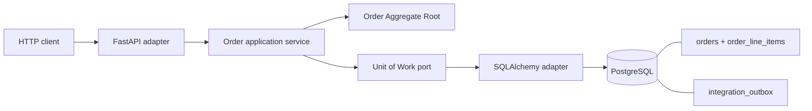

# DDD Aggregates and Domain Events — Order Service

A small runnable **FastAPI + PostgreSQL** microservice using **Hexagonal Architecture**. The `Order` Aggregate Root enforces invariants, while an application service saves the **current order state** and the selected outgoing integration-event intent in **one local SQL transaction**.

This is the first laboratory in [Chapter 5 — Event-Driven Architecture](../README.md). It builds on Chapter 4's Outbox pattern but does **not** implement the publisher again. It does not use an event store or reconstruct state from events.

## What to learn

- Aggregate Root (`Order`) versus child entities/value-like objects (`OrderLineItem`), local invariants and transaction boundaries.
- Dependency direction: domain → application → ports → SQLAlchemy/FastAPI adapters.
- **Domain Event**: an immutable business fact raised by the domain; **Integration Event**: the contract saved for communication with other services.
- Separate current-state tables from the *integration_outbox* table. They have different purposes.
- Optimistic version check (`version_id`, HTTP 409) for stale writes.

## Architecture



```mermaid
sequenceDiagram
  participant C as Client
  participant A as Application Service
  participant R as Order Aggregate
  participant D as PostgreSQL
  C->>A: CreateOrder
  A->>R: Order.create(...)
  R-->>A: Order + OrderCreated domain event
  A->>D: BEGIN; INSERT order and outbox intent; COMMIT
  D-->>A: Committed
  A-->>C: Order current state
```

The *domain* does not import Kafka, RabbitMQ, or SQLAlchemy. The message relay is intentionally outside this lab: see the Chapter 4 Transactional Outbox examples.

## Start and inspect

Prerequisites: Docker Compose, Make, curl. `make test` needs Docker only.

```bash
make up
make create
make events
make db
```

- Order API: <http://localhost:8003/docs>
- Adminer: <http://localhost:8083> (System PostgreSQL; Server `db`; Database `ftgo`; User/Password `ftgo`/`ftgo`).

`make create` returns an `id` and `row_version=1`. Inspect tables `orders`, `order_line_items` and `integration_outbox`. A newly created order is `APPROVAL_PENDING`; its outbox contains an `OrderCreated` notification. **The outbox row is a publication intent, not a second source of state.**

### Approve through the Aggregate Root

```bash
make approve ORDER_ID=<id> VERSION=1
make events
```

The application reloads `Order`, executes `order.approve()`, saves its new status and inserts `OrderApproved` in the same SQL transaction. Approval is refused for a previously approved or invalid order. The API endpoint can be inspected via Swagger.

### Experiment: local invariants, versioning and domain events

```bash
make test
```

The test suite checks invalid line items, one-way approval, `OrderCreated`/`OrderApproved` emission and actual SQLAlchemy transaction persistence with SQLite as a lightweight test database. The running application uses **PostgreSQL**.

To trigger a stale-write conflict, try an item update twice with the same version:

```bash
curl -fsS -X POST http://localhost:8003/orders/<id>/items \
  -H 'Content-Type: application/json' \
  -d '{"expected_version":1,"menu_item_id":"SALAD","name":"Salad","price":5,"quantity":1}'
```

The second request using `expected_version: 1` returns **409 Conflict** because the first changed the row version. This is distinct from Kafka consumer offsets.

## Code map

| Layer | Files | Responsibility |
|---|---|---|
| Domain | `app/domain/models.py` | Aggregate rules and immutable domain notifications |
| Application | `app/application/order_service.py` | Use cases; collects notifications; one UoW commit |
| Ports | `app/ports/` | Repository and Unit of Work contracts |
| Inbound | `app/adapters/inbound/` | FastAPI routes, schemas and diagnostics |
| Outbound | `app/adapters/outbound/` | SQLAlchemy Repository and Unit of Work |
| Infrastructure | `app/infrastructure/` | Tables, engine and mapping |
| Tests | `tests/` | Domain + application + SQL persistence |

## What is intentionally simplified?

The event is recorded in `integration_outbox` but **not actually sent to a broker**: Chapter 4 already covers reliable publishing. Only meaningful selected business operations emit events; not every field update needs a cross-service message. Prices use `float` to keep the exercise compact (real payments require `Decimal` and a currency type). A production API would likely use ETags/If-Match and require credentials. This is a teaching demo, not a production reference.

```bash
make down
make reset  # deletes the teaching database volume
```
