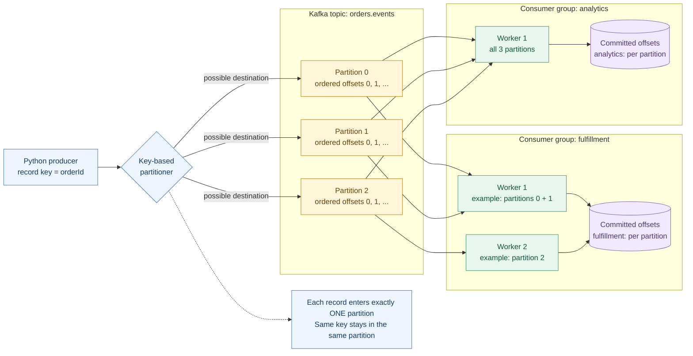
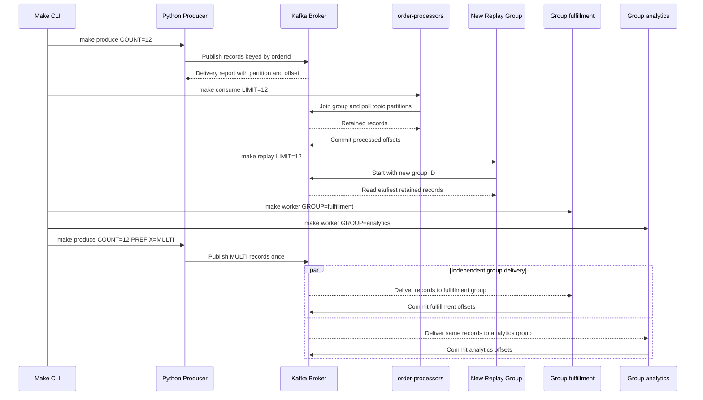

# Kafka Fundamentals — Topics, Partitions, Keys, Consumer Groups and Replay

A runnable **Apache Kafka (KRaft) + Python** example that demonstrates how Kafka stores records in partitioned logs and how consumers track their own progress. The application follows a compact **Hexagonal (Ports & Adapters) Architecture**: event creation and the publishing use case do not depend on the Kafka client API.

This example is part of [Chapter 5 — Event-Driven Architecture](../README.md). It runs independently of the CDC and Event Sourcing examples.

## What this example demonstrates

| Concept | What you can verify |
|---|---|
| **Topics and partitions** | `orders.events` has **3 partitions**. Each partition is a separate ordered log. |
| **Message keys** | The producer uses `orderId` as the Kafka record key. Repeated keys map to one partition with the current partitioner and partition count. |
| **Offsets** | Kafka assigns increasing offsets **within each partition**; offsets are not global event sequence numbers. |
| **Consumer groups** | Members of one group share partition ownership. Each partition has at most one active consumer within that group. |
| **Multiple active groups** | Different groups read the **same topic records independently**, each with its own offset progress and partition assignments. |
| **Committed progress** | A consumer that has committed its offsets does not automatically read those records again when restarted with the same group ID. |
| **Independent replay** | A new consumer group can read retained records from the beginning of the topic. |
| **At-least-once processing** | A consumer commits *after* handling each record. A crash before commit can cause that record to be read again. |

## Requirements and services

Requires Docker with the Compose plugin and `make`. Python 3.10+ is needed only to run the unit tests directly on the host.

`make up` starts the broker and UI, creates the topic if it does not exist, and builds the Python client image. The Python producer and consumers are **short-lived, on-demand containers** launched by `make`; no consumer runs continuously until you start it.

| Service | Purpose | Access |
|---|---|---|
| `kafka` | Single-node Kafka broker in KRaft mode | `kafka:19092` from containers, `localhost:29092` from the host |
| `kafka-ui` | Kafbat UI for inspecting the cluster | <http://localhost:8085> (local host only) |
| `topics` | One-shot topic initializer | Creates `orders.events` with 3 partitions and replication factor 1 |
| `client` | Python producer or consumer (Compose tools profile) | Started by `make produce`, `make consume`, `make worker`, and `make replay` |

> **Existing data matters.** The `kafka_data` Docker volume retains topic records and committed consumer-group offsets across `make down` / `make up`. Results described below assume a fresh volume or that you account for records already present. `make reset` removes this volume and **irreversibly deletes local Kafka data**.

## Architecture



**Read the diagram from left to right:** the producer uses `orderId` as a key, so **each record is appended to exactly one partition**. The three partition arrows represent possible destinations, **not three copies of a record**. Records sharing a key use the same partition with this topic configuration; offsets and ordering are scoped to an individual partition.

Both `fulfillment` and `analytics` subscribe to **all three partitions independently**. In `fulfillment`, two workers split partition ownership; in `analytics`, the single worker can own all three. **The particular 2+1 partition assignment drawn for `fulfillment` is illustrative, not guaranteed**: it may change with consumer membership and rebalances. Each group commits its **own offsets per topic partition**, independent of the other group's progress. See Step 8 to reproduce this setup and inspect the actual assignments in Kafka UI.

## Complete walkthrough

The following steps use only the commands implemented by this project. Open Kafka UI in a browser alongside the terminals to inspect the broker state after each action. Actual partition IDs and offset numbers depend on the current Kafka volume and key hashing; they are **not** hard-coded outcomes.

### Step 1 — Start Kafka and inspect the empty topic

```bash
cd event-driven-architecture/kafka-fundamentals
make up
make status
make topics
make partitions
```

**In the terminal:** confirm that the topic `orders.events` exists and has **3 partitions**. `make partitions` invokes Kafka's topic-description CLI and displays each partition's leader and replica information. With one broker, replication factor is 1.

**In Kafka UI:** open <http://localhost:8085>, select the `kafka-fundamentals` cluster, and open **Topics → orders.events**. Inspect its partition count and, on a fresh volume, that the log contains no records yet. UI labels may vary slightly between versions.

**Why this matters:** a Kafka topic is a collection of partition logs. It is not one globally ordered queue.

### Step 2 — Publish twelve keyed events

```bash
make produce COUNT=12 PREFIX=KEYS
```

The producer sends 12 `OrderStatusChanged` example records. It cycles through **four order IDs**, so each key appears three times:

| Example indices (`sequence`) | Record key (`orderId`) |
|---|---|
| `0`, `4`, `8` | `KEYS-00` |
| `1`, `5`, `9` | `KEYS-01` |
| `2`, `6`, `10` | `KEYS-02` |
| `3`, `7`, `11` | `KEYS-03` |

For each successful delivery the producer reports `key=...`, `partition=...`, and `offset=...`. For example, the three records with key `KEYS-00` should report **the same partition**, though their offsets will differ. Distinct keys can hash to the same partition; an even 4-to-3 distribution is **not** guaranteed.

**In Kafka UI:** select **Topics → orders.events → Messages** (or the corresponding message browser). Inspect each record's **key**, **value**, **partition**, and **offset**. The JSON payload contains `eventId`, `type`, `orderId`, `sequence`, `status`, and `occurredAt`.

**Important:** `sequence` is an example-wide counter generated by Python, not Kafka's partition offset or an aggregate-specific version. The status values are illustrative; this project does not enforce an Order state machine.

### Step 3 — Verify ordering and partition offsets

Keep Kafka UI on `orders.events`. Choose one partition and inspect its records in offset order. Then compare records from different partitions.

- Within a partition, offsets increase as records are appended (`0`, `1`, `2`, ... on a fresh log).
- The same `orderId` appears on one partition under the present key partitioner and partition count.
- Kafka does **not** define a total order of records across different partitions.
- `eventId` identifies an application record, `sequence` is generated by the example, and `offset` locates a Kafka record **within one partition**. These are different identifiers.

This is the main reason to inspect both the producer output and the Kafka UI message browser instead of looking only at JSON payloads.

### Step 4 — Consume using a named group

```bash
make consume LIMIT=12
make group-info GROUP=order-processors
```

The consumer uses group ID **`order-processors`**. With a fresh group, `auto.offset.reset=earliest` makes it read records from the earliest retained offsets. For each record it prints the key, partition, offset, event ID, and example sequence, then **commits** its consumed position synchronously.

**In Kafka UI:** open **Consumer Groups → order-processors**. Compare committed offsets with partition end offsets. After the consumer has processed the available records, lag should be zero for partitions it has caught up with. The consumer may already have exited, so the group can appear inactive while its committed offsets remain stored.

If the volume already contains more than 12 records, the consumer stops after processing the first **12 available to that group**, rather than necessarily the 12 just produced.

### Step 5 — Restart the same group: previous records are not replayed

Do **not** produce anything new between these commands:

```bash
make consume LIMIT=12
make group-info GROUP=order-processors
```

**On a clean demonstration sequence**, the consumer reports an **idle timeout after 12 seconds** and `received=0`: its group has already committed the offsets for the available records. This is not an error.

**Key distinction:** `auto.offset.reset=earliest` does **not** rewind an existing group with valid committed offsets. It only defines a starting position for a group with no applicable committed offset.

### Step 6 — Replay independently using a new group

```bash
make replay LIMIT=12
make groups
```

`make replay` constructs a new group name (`replay-<timestamp>`), so it has **no committed offsets** and begins at the earliest records still retained in the topic. This group does not change `order-processors` offsets.

**In Kafka UI:** compare the replay group with `order-processors`. Their committed positions are independent, even though they use the same topic.

**Caution:** `LIMIT=12` means *stop after reading twelve records*. It does **not** mean *read the latest twelve records*. On a reused volume, the first records may belong to older runs.

### Step 7 — Start two workers in one group

Leave Kafka running. Open **three terminals** in the `kafka-fundamentals` directory:

**Terminal A**

```bash
make worker
```

**Terminal B**

```bash
make worker
```

**Terminal C**

```bash
make produce COUNT=24 PREFIX=WORK
make group-info GROUP=shared-workers
```

Both workers use **the same group ID: `shared-workers`**. Watch their `assigned [...]` logs. The three topic partitions are distributed between active workers, so the same partition cannot be processed by both at the same time within this group.

**In Kafka UI:** open **Consumer Groups → shared-workers** and inspect its members, partition assignments, committed offsets, and lag. The two workers may have unequal workloads because partition ownership and key distribution need not be balanced.

**Existing backlog:** if `shared-workers` is new and records were published in earlier steps, it first consumes those retained records too. Watch for keys beginning with `WORK-` to distinguish the newly published batch.

**Optional scaling experiment:** start a third `make worker` in a fourth terminal, then a fourth. With three partitions, at most **three workers can have partitions assigned** in a single group at any moment; the fourth has no partition to process. Stop one active worker with Ctrl+C and observe a group rebalance and reassignment. Stop all workers when finished.

### Step 8 — Two independent consumer groups reading the same events concurrently

This is **different from Step 7**: now start consumers belonging to **two distinct group IDs**. Both groups subscribe to `orders.events`, so **each group receives the entire set of records**. Only consumers *inside the same group* divide partitions.

Stop any `shared-workers` consumers from Step 7 with Ctrl+C to simplify the terminal output. Open **four terminals** in `kafka-fundamentals/` and leave the first three running:

**Terminal A — Fulfillment, worker 1**

```bash
make worker GROUP=fulfillment
```

**Terminal B — Fulfillment, worker 2 (same group as A)**

```bash
make worker GROUP=fulfillment
```

**Terminal C — Analytics, independent group**

```bash
make worker GROUP=analytics
```

**Terminal D — Produce and inspect**

```bash
make produce COUNT=12 PREFIX=MULTI
make group-info GROUP=fulfillment
make group-info GROUP=analytics
make groups
```

**What to observe in the terminals:**

- `fulfillment` has **two active members**: between them, they consume the twelve `MULTI-*` messages **once per group**. They split the three partitions, so individual workers need not print six records each.
- `analytics` has **one active member**: it consumes **the same twelve `MULTI-*` messages**, not the leftovers from `fulfillment`. Its member can own all three partitions.
- The **same event ID and Kafka partition/offset** can appear once in the `fulfillment` group logs and again in the `analytics` logs. This is expected because the groups are independent.
- Each group commits **its own offsets**; progress in one group does not advance the offsets of the other. Publishing once does **not** mean a single record is exclusively assigned to one group.

**In Kafka UI:** open <http://localhost:8085> → **Consumer Groups**, and inspect `fulfillment` and `analytics` while all three consumers are still running. Compare **members**, **partition assignments**, **committed offsets**, and **lag**. `fulfillment` should have two members, `analytics` one; both groups can reach lag 0 after consuming the published data.

**What if there are old messages?** A new group starts from the earliest retained record (`auto.offset.reset=earliest`), so you may also see keys from previous steps. Focus on the `MULTI-*` keys. Once both groups catch up, **each should have processed all twelve new records**. On repeated runs, the existing `fulfillment` and `analytics` groups resume from their committed positions and consume the newly published records.

**Optional comparison:** stop Terminal C with Ctrl+C, produce `make produce COUNT=8 PREFIX=WHILE-OFFLINE`, then inspect both groups. `fulfillment` continues advancing, whereas `analytics` temporarily accumulates **lag**. Restart `make worker GROUP=analytics`: it consumes its own backlog without asking `fulfillment` to replay anything.

Keep the workers running while you inspect the assignments in Step 9; then stop them with Ctrl+C.

### Step 9 — Compare group ownership and offsets

```bash
make groups
make group-info GROUP=shared-workers
make group-info GROUP=order-processors
make group-info GROUP=fulfillment
make group-info GROUP=analytics
```

Look for the following fields in the Kafka consumer-group output: **CURRENT-OFFSET**, **LOG-END-OFFSET**, **LAG**, and **CONSUMER-ID**. The meaning is:

- **Current offset:** the next record position committed for that group/partition.
- **Log end offset:** the end of that partition log.
- **Lag:** records remaining between the group's committed position and the log end.
- **Consumer ID:** the currently assigned group member, when the group is active.

Producing more messages can increase lag; consuming and committing reduces it. Groups can have different lag for the same topic because they progress independently.

### Step 10 — Check the reliability boundary

Open `app/main.py` and locate the consumer's processing order:

```python
message = c.poll(1.0)
event = parse_event(message.value())
# Print and handle the event.
c.commit(message=message, asynchronous=False)
```

The real code prints the record before committing. If the process crashes **after handling** a record but **before committing** its offset, Kafka can deliver that record again. This is why offset commits do not, by themselves, guarantee exactly-once external business effects. This example only prints records; it does not update a business database.

## Command reference

| Command | Purpose |
|---|---|
| `make up` | Start Kafka and Kafka UI, initialize the 3-partition topic, and build the client image. |
| `make status` | Show container/service status. |
| `make ui` | Start Kafka UI if it was stopped; the normal `make up` already starts it. |
| `make topics` | List Kafka topics. |
| `make partitions` | Describe `orders.events`, including its partitions. |
| `make produce COUNT=12 PREFIX=DEMO` | Publish example events with a repeated `orderId` key. |
| `make consume LIMIT=12` | Read using persistent group ID `order-processors`; stop at the limit or after 12 idle seconds. |
| `make replay LIMIT=12` | Start a **new** group at earliest retained offsets and stop after the limit. |
| `make worker` | Start a long-running member of the default `shared-workers` group. Stop with Ctrl+C. |
| `make worker GROUP=fulfillment` | Start a worker in a **chosen group**. Run this simultaneously with `GROUP=analytics` to demonstrate independent groups. |
| `make groups` | List consumer groups. |
| `make group-info GROUP=shared-workers` | Show committed offsets, lag, and partition ownership for a specific group. |
| `make logs` | Follow the Kafka broker logs. |
| `make test` | Execute fast offline Python unit tests. |
| `make down` | Stop/remove containers while **retaining** Kafka data. |
| `make reset` | Stop/remove containers **and delete Kafka data and committed offsets**. |

## Sequence diagram



## Code map: Ports and Adapters

| File | Role |
|---|---|
| `app/domain/messages.py` | `OrderStatusChanged` contract, example payloads, serialization and parsing. |
| `app/application/publish_example.py` | Publishing use case; sets `orderId` as the key and uses a producer port. |
| `app/ports/event_bus.py` | `EventProducer` protocol independent of Kafka APIs. |
| `app/adapters/outbound/kafka_producer.py` | `confluent-kafka` adapter with delivery callbacks, broker acknowledgements and idempotent producer configuration. |
| `app/main.py` | CLI commands and Kafka consumer with explicit offset commits. |
| `tests/test_messages.py` | Fast checks for key selection, JSON handling, and invalid records. |

## Tests

```bash
make test
```

The tests verify key selection and serialization without starting Kafka. Broker connectivity, partition assignment, UI output, and consumer group behavior require the Docker Compose stack and the walkthrough above.

## Troubleshooting

| Symptom | Explanation / action |
|---|---|
| Kafka UI is unavailable | Check `make status`, then `docker compose logs kafka-ui`; port `8085` must be free on the host. |
| Docker reports a port conflict | This stack uses host ports `29092` (Kafka) and `8085` (UI). Stop any conflicting stack or change the host mapping. |
| The consumer prints `received=0` | It may already have committed all available records. Use a **new replay group** or publish new records. |
| Replay shows older records than expected | Replay reads **earliest retained** records, not the last N records. Old data persists across `make down`. |
| Two workers get uneven record counts | Work distribution follows **partitions**, not per-message round-robin across workers. Keys can concentrate on a partition. |
| Two different groups both print the same event | **Expected:** every consumer group reads the topic independently and commits its own offsets. |
| A fourth worker gets no partition | The topic has only three partitions; a single group cannot assign one partition to two members simultaneously. |
| Messages cannot be reached from containers | Use broker address `kafka:19092` inside Compose, not `localhost:29092`. |
| Kafka or the topic is not ready | Use `make status`, `make logs`, and `make partitions` to inspect readiness and initialization. |

## Scope, reliability and cleanup

The cluster uses a **single broker**, one replica per partition, and unauthenticated plaintext networking. Producer settings include `acks=all` and `enable.idempotence=true`, but with one replica this is not a highly available deployment. Consumer offsets are committed after processing; repeated deliveries are possible across crashes. Kafka topic replay is **not Event Sourcing** and retained messages are not automatically a durable domain event store.

To stop the stack without deleting history:

```bash
make down
```

To start from a completely empty local broker **only if existing data may be deleted**:

```bash
make reset
make up
```

The next independent example, [CDC with Debezium, Kafka and RabbitMQ](../cdc-debezium-rabbitmq/), adds PostgreSQL change capture, business integration events, and a Kafka-to-RabbitMQ bridge.
