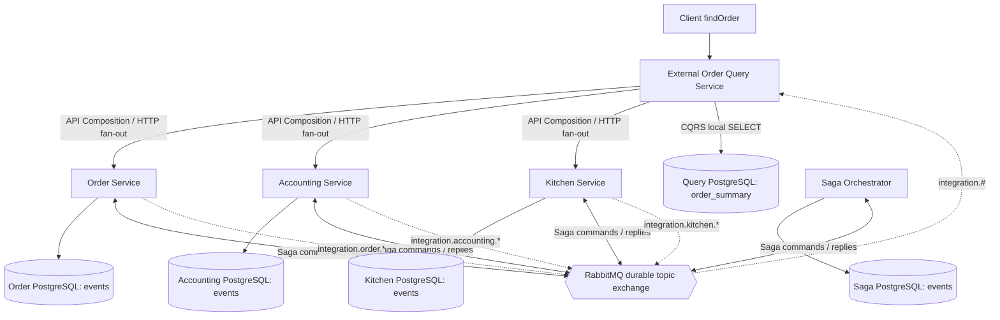
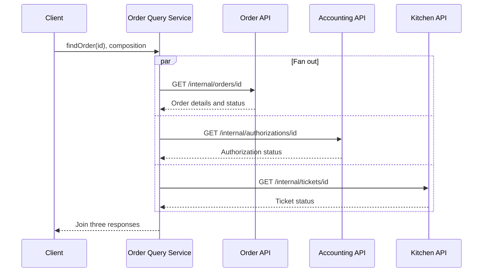
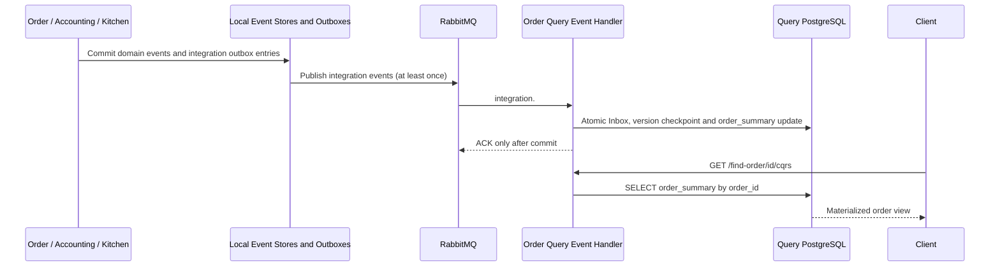

# Event-Sourced Saga + External CQRS Order Query Service 

This laboratory **extends [Event-Sourced Saga Orchestration](../event-sourced-saga-orchestration/)**, preserving the exact event-sourced Order, Accounting, Kitchen, and Saga Orchestrator workflow. It adds an **independent, externally accessible `Order Query Service` with its own fifth PostgreSQL database**.

The teaching objective is a direct comparison of two ways to implement the **same `findOrder(orderId)` use case**:

1. **API Composition:** the Query Service calls the internal Order, Accounting, and Kitchen REST APIs **for every query** and combines their current responses. It is subject to network calls, latency, and partial failure. It does not require a persisted read model.
2. **CQRS:** the Query Service consumes integration events from the three services, **materializes an `order_summary` read model in its own PostgreSQL**, and answers the query locally, without contacting those services at request time.

CQRS is independent of Event Sourcing, and separate databases are not mandatory for CQRS in general. **Here** they are deliberate, because the external Query Service has a different service owner, API responsibility, lifecycle, and data model.

## Architecture: five services and five independent databases



There are **five PostgreSQL instances**, not five schemas in a shared DB. `query-db` contains only the derived `order_summary`, `projection_inbox`, and `projection_offsets` tables. It does not contain an authoritative Event Store. The Query Service has no connection string or direct access to the other four databases.

In normal use, **Saga messages and integration notifications share a durable RabbitMQ topic exchange but use different routing keys and queues**. The Query Service consumes only `integration.#`; it does not interpret internal Saga orchestration commands as business facts.

## Start and compare the same Order

Run from this directory (stop Example 03 first if running):

```bash
make up
make demo-comparison
make inspect-query
make demo-outage
make rebuild-projection
make test
make down
```

The main externally accessible query API is at **<http://localhost:8215/docs>**. Its two intentionally distinct endpoints are:

```text
GET http://localhost:8215/find-order/{order_id}/composition
GET http://localhost:8215/find-order/{order_id}/cqrs
```

`make demo-comparison` creates an Order, waits until its event-sourced Saga has completed, waits for the projection to catch up, then performs both queries and prints the responses. The query format is intentionally comparable:

```json
{
  "order_id": "...",
  "consumer_id": "consumer-101",
  "restaurant_id": "restaurant-4",
  "total": 18.0,
  "order_status": "APPROVED",
  "payment_status": "AUTHORIZED",
  "kitchen_status": "ACCEPTED"
}
```

The response additionally identifies `strategy`, `queried_services`, and `elapsed_ms`; CQRS includes **per-source version checkpoints**. Response times are observations, **not a benchmark**: one local read avoids runtime fan-out, but the relative wall-clock numbers depend on the environment.

## What the API Composition query does



This illustrates the same **cross-service data composition** problems already discussed earlier in the course: multiple network calls, timeouts, independent service availability, and potentially inconsistent responses captured at different instants. A circuit breaker, retries, fallbacks and bulkheads are possible mitigations, **not** automatically implemented in this query endpoint. The endpoint uses a bounded 1.5-second HTTP timeout and returns HTTP **503** when a dependency is unavailable.

**Failure demonstration:**

```bash
make demo-outage
```

This first builds a fully projected order, then temporarily stops **Kitchen** and queries the *same* `order_id` using both strategies. **API Composition returns HTTP 503** because an internal service is unavailable; the **CQRS read model remains readable** because its query has no runtime dependency on Kitchen. The Make target starts Kitchen again after the test. The CQRS result can be **stale**, so availability does not imply instant consistency.

## What the CQRS query does



`order_summary` combines Order status, authorization status and Kitchen status. Each update uses:

- **`projection_inbox(message_id)`** to ignore duplicate deliveries.
- **`projection_offsets(order_id, source, last_version)`** to discard stale versions for an individual source Aggregate.
- **One local SQL transaction** for deduplication, version check and projection update.

Different source services have independent streams and no shared global ordering. Their events can arrive at different times, so the read model is **eventually consistent**. The demo uses one authorization and ticket Aggregate per order; production multi-entity joins need a more explicit versioning and reconciliation design.

## Rebuild the read model and demonstrate catch-up

```bash
make rebuild-projection
make demo-catchup
```

`make rebuild-projection` clears **only** the Query Service's derived tables (lab-only admin operation), then asks each source service to **requeue its retained integration Outbox notifications**. The Query consumer rebuilds the read model without querying or changing the source Event Stores. This lab deliberately **retains sent Outbox notifications** for educational replay. This is not Kafka replay by partition offset; it is an application-level replay of durable integration messages.

`make demo-catchup` stops the Query Service while creating a new Order. Its **durable RabbitMQ queue** accumulates integration notifications; when the Query Service restarts, the projection catches up and `findOrder` becomes available. Neither mechanism should be confused with Event Store replay used to reconstruct an individual source Aggregate.

## Explore Saga Event Sourcing as well

This folder contains the full Example 03 workflow, and the following targets work unchanged:

```bash
make demo-happy
make demo-compensation
make demo-recovery
make inspect-order
make inspect-accounting
make inspect-kitchen
make inspect-saga
```

RabbitMQ Management: <http://localhost:15683> (`lab` / `lab`). Order, Accounting, Kitchen, Saga and Query Swagger UIs use ports **8211, 8212, 8213, 8214, 8215** respectively.

## Code map

| Mechanism | Implementation |
|---|---|
| Event-sourced participant and orchestrator decisions | [`lab/domain.py`](lab/domain.py) |
| Per-service local Event Store, Inbox, Outbox | [`lab/storage.py`](lab/storage.py) |
| RabbitMQ worker: Saga commands and integration events | [`lab/messaging.py`](lab/messaging.py) |
| Query-only projection database and deduplication | [`lab/read_model.py`](lab/read_model.py) |
| Mapping business events to read-model columns | [`lab/projection_rules.py`](lab/projection_rules.py) |
| API Composition and CQRS query endpoints | [`lab/query_api.py`](lab/query_api.py) |
| Query comparison and projection rebuild script | [`scripts/compare.py`](scripts/compare.py) |
| Independent databases and Query Service | [`docker-compose.yml`](docker-compose.yml) |

## Alignment with the 44-slide Chapter 5 deck

| Slide | Demonstration |
|---|---|
| 31–32 | Two query paths: request-time composition versus CQRS. |
| 33–35 | Standalone Order Query Service, independent read database and event handlers. |
| 36–40 | Query datastore, atomic projection update, idempotence and failure handling. |
| 41–44 | Read-model catch-up, rebuild, and eventual consistency trade-offs. |

**Scope:** This is a teaching lab, not a production-grade saga engine or query platform. It uses a bounded timeout but **no circuit breaker implementation**, distributed tracing, external authorization, DLQ management, or automated schema migration. It does not guarantee consistent cross-service snapshots. Admin reset and requeue endpoints are enabled for local demonstrations only. The previously discussed API Composition and Circuit Breaker patterns remain a separate topic; here we **recap** its failure modes rather than reimplementing all resilience patterns.
