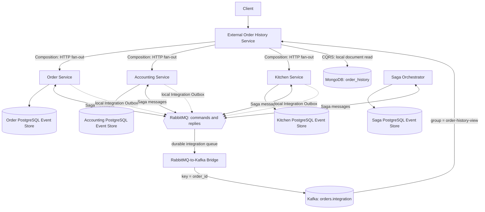
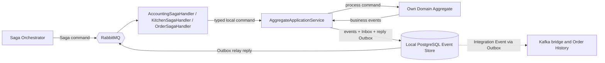
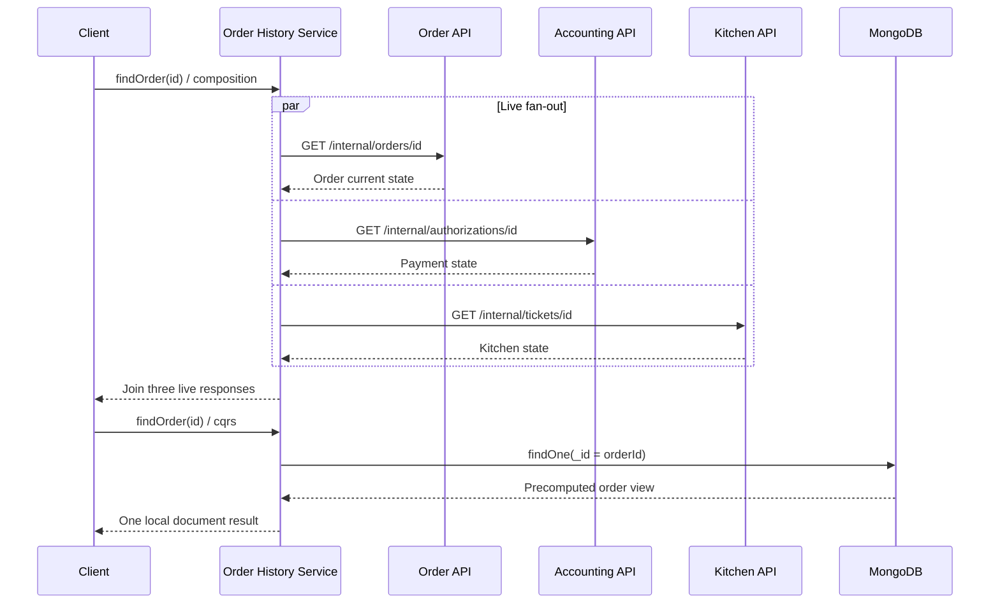
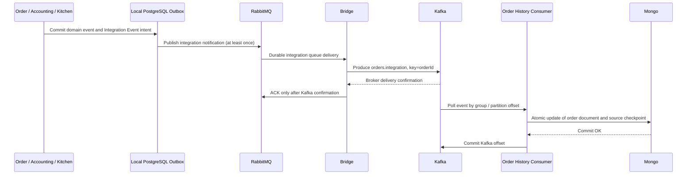

# Event-Sourced Saga + Kafka + MongoDB Order History Service (CQRS)

This laboratory extends [Event-Sourced Saga Orchestration](../event-sourced-saga-orchestration/) **without changing its business workflow**. It keeps the four independent Event-Sourced services (Order, Accounting, Kitchen and Saga Orchestrator) and introduces an **external, query-only Order History Service** with its **own MongoDB**. Kafka streams business **Integration Events** into the history projection; RabbitMQ continues to handle Saga commands and replies.

The use case is the **same `findOrder(orderId)` query**, implemented in two ways:

1. **API Composition**: the external History Service calls the internal Order, Accounting and Kitchen REST APIs **on every request**. Those calls are affected by network latency, timeouts, partial outages and mixed-time snapshots; we recap circuit breakers and other mitigation approaches rather than reimplementing them.
2. **CQRS**: the History Service reads **one MongoDB document**, asynchronously materialized from Kafka events. It is independent of source-service availability at query time, but may lag behind the authoritative events.

The additional `GET /order-history/{id}` returns the **business-event timeline** accumulated by the read model. This is a simplified Order History Service inspired by the query-only service discussed in *Microservices Patterns* (Richardson): its sources are Order, Accounting and Kitchen rather than a full Order/Delivery/Accounting system.

**CQRS does not require Event Sourcing, Kafka, MongoDB, or physically separate databases.** Those are deliberate design choices here to connect the chapter's Event Sourcing, event streaming, NoSQL and cross-service query topics.

## Architecture: four PostgreSQL Event Stores plus one MongoDB read model



There are **five physically separate databases**: four PostgreSQL instances with the authoritative event streams and a fifth database **of a different type**, MongoDB, owned exclusively by the History Service. MongoDB contains **derived read documents**, not an authoritative Event Store. No service reads another service's database.

### Why use RabbitMQ and Kafka together?

- **RabbitMQ** retains the lab 03 **Saga Orchestration** of durable **commands and replies** (not choreography).
- Every participant appends its domain events and its outgoing Integration Event into the **same local PostgreSQL transaction** (Outbox pattern).
- The existing Outbox relays publish those selected notifications to RabbitMQ. A **durable bridge queue** receives only `integration.#` messages; the bridge publishes each record to Kafka with **`key=order_id`** and acknowledges RabbitMQ **only after Kafka delivery confirmation**.
- **Kafka** retains records in the `orders.integration` topic (3 partitions). The History Service is a separate consumer group, `order-history-view`, and explicitly commits partition offsets **only after the MongoDB projection update succeeds**.
- Crash/retry can still cause **duplicate Kafka records**: the History projection uses message IDs to ignore duplicates and per-source stream versions to reject stale **state** updates, atomically inside the same MongoDB order document. Producer idempotence alone does not provide end-to-end exactly-once semantics.

A Kafka **partition offset** is not an Event Store Aggregate **version**. Kafka records are keyed by `order_id`, so the same order's integration notifications normally share one partition (while source services retain independent versions). This preserves **Kafka arrival order** for that key, not a globally transactional order of cross-service business facts.

## Saga command boundary (same as the preceding lab)

The four event-sourced source services use the **same separated participant architecture** as the [Saga Orchestration lab](../event-sourced-saga-orchestration/):



`lab/saga_handlers.py` converts incoming requests such as `command.account.authorize` into domain objects such as `AuthorizeAccount`. `lab/domain.py` defines **pure `process(command, state)`** decisions and `apply(role, state, event)` replay, with no RabbitMQ knowledge. `lab/application.py` coordinates Event Store persistence and the `SagaReplyRequested` pseudo-event; `lab/orchestration.py` owns the Saga state machine and chooses the next command. **Kafka consumers and MongoDB projection handlers are separate read-side concerns**, not participant Saga handlers: they consume *Integration Events* to update query documents and never issue commands to authoritative Aggregates.

These responsibilities and Saga message contracts are identical to the preceding standalone Saga lab; **only the external Kafka/MongoDB read side has been added**.

## Run the demo

Requirements: Docker Compose v2, `make`, and enough RAM for **four PostgreSQL containers, MongoDB, Kafka and RabbitMQ**. Stop the previous Saga lab first because host ports overlap.

```bash
make up
make demo-comparison
make inspect-query
make kafka-info
make kafka-groups
make demo-outage
make demo-catchup
make rebuild-projection
make test
make down
```

The main external REST API is the **Order History Service**, Swagger **<http://localhost:8215/docs>**:

```text
GET /find-order/{order_id}/composition   # live 3-service HTTP composition
GET /find-order/{order_id}/cqrs          # local MongoDB projection
GET /order-history/{order_id}           # projected business-event timeline
```

`make demo-comparison` creates an Order, waits for Saga completion and the Kafka-driven MongoDB projection, then calls both `findOrder` strategies **for the same order**. It also displays the count of Integration Events in the projected timeline. Responses include Order, payment and Kitchen status. Timings are observations, **not a benchmark**.

Use **Kafbat Kafka UI** at **<http://localhost:8087>** to inspect `orders.integration`, its three partitions, keyed records, the `order-history-view` group and lag. RabbitMQ Management remains at **<http://localhost:15683>** (`lab` / `lab`). The four source services' Swagger ports are `8211` (Order), `8212` (Accounting), `8213` (Kitchen), and `8214` (Orchestrator).

Inspect the MongoDB projection with:

```bash
make inspect-query
```

For MongoDB Compass, connect to `mongodb://localhost:27019/`, database `order_history`, collection `order_history` (local development only, no authentication).

## Live API Composition versus the CQRS read model



The composition endpoint has a bounded **1.5-second timeout**. It returns HTTP **503** if an internal dependency is unavailable, and does **not** implement circuit breakers, retries or a distributed consistent snapshot. Those are already covered in previous labs and can be recapped briefly.

```bash
make demo-outage
```

The demo stops Kitchen after materializing the order. **API Composition fails with 503**; the MongoDB CQRS query still returns its **last projected view**. That is a useful availability trade-off, **not proof of up-to-the-moment consistency**.

## Event-stream-driven projection and history



Each `order_history` MongoDB document includes `order_status`, `payment_status`, `kitchen_status`, `consumer_id`, `restaurant_id`, `total`, a `timeline` of distinct Integration Events, a bounded `processed_message_ids` Inbox and `source_versions` checkpoints (one per source service). Projection updates use an atomic conditional **single-document compare-and-swap**; duplicates are ignored; delayed older records may join the timeline but cannot overwrite newer state. No multi-document MongoDB transaction is needed for this **one-order read model**. The timeline is ordered by **arrival/application**, not by a global causal timestamp; independent services do not share a global event sequence.

Because the lab keeps the full timeline **inside one MongoDB document**, it is intentionally bounded in scale: a real unbounded Order History Service would partition or archive old history entries and replace the bounded in-document message-ID Inbox, or use a separate event-history collection with stronger transaction considerations.

## Kafka retention, replay and catch-up

```bash
make demo-catchup
```

This stops the History Service, creates a new Saga order, and starts History again. Kafka continues retaining the Integration Events while the consumer is offline. The group's committed offsets let it **resume without re-reading the whole topic**.

```bash
make rebuild-projection
```

This **stops the Kafka consumer**, clears **only** MongoDB's derived history documents, resets `order-history-view`'s Kafka offsets to the **earliest retained positions**, and starts the consumer again to rebuild the projection. The four PostgreSQL Event Stores are **untouched**. Run `make demo-comparison` at least once before this command so the consumer group has committed offsets.

**Critical limitation:** Kafka retention is finite unless configured otherwise. Replaying from the earliest *retained* Kafka offset can reconstruct a complete view only while the required Integration Event history is still available. A production rebuild needs a retained authoritative event archive, a durable source replay mechanism, or a coordinated snapshot/backfill strategy. This differs from the **unbounded local Event Store stream replay** demonstrated in lab 02.

## What to inspect in the code

| Concern | File |
|---|---|
| Typed domain commands, pure `process()` and `apply()` | [`lab/domain.py`](lab/domain.py) |
| Dedicated participant Saga handlers and message-to-command mapping | [`lab/saga_handlers.py`](lab/saga_handlers.py) |
| Local command application and reply pseudo-events | [`lab/application.py`](lab/application.py) |
| Event-sourced Saga Orchestrator state machine | [`lab/orchestration.py`](lab/orchestration.py) |
| HTTP and RabbitMQ inbound routing | [`lab/handlers.py`](lab/handlers.py) |
| PostgreSQL Event Store and transactional Outbox/Inbox | [`lab/storage.py`](lab/storage.py) |
| RabbitMQ Saga command / reply transport | [`lab/messaging.py`](lab/messaging.py) |
| RabbitMQ → Kafka bridge with delivery confirmation | [`lab/stream_bridge.py`](lab/stream_bridge.py) |
| Consumer group, manual Kafka commits | [`lab/kafka_worker.py`](lab/kafka_worker.py) |
| MongoDB Order History document and deduplication | [`lab/read_model.py`](lab/read_model.py) |
| Integration Event → projected fields | [`lab/projection_rules.py`](lab/projection_rules.py) |
| API Composition, CQRS and history query endpoints | [`lab/query_api.py`](lab/query_api.py) |
| Demo comparison, outage and catch-up | [`scripts/compare.py`](scripts/compare.py) |

### Connection to the course slides

| Slide group | What this lab shows |
|---|---|
| 24–30 | Event-sourced participants and Saga Orchestrator with four independent Event Stores. |
| 31–35 | Order History Query Service, API Composition vs CQRS and an independent read database. |
| 36–40 | MongoDB read model, idempotent event handlers and projection update strategies. |
| 41–44 | Kafka consumer-group offsets, eventual consistency, catch-up and reconstruction. |

**Scope and limitations:** This is a local teaching demo, not a production messaging platform. The unprotected MongoDB connection and reset endpoints are strictly for a trusted localhost environment; no production authentication, ACLs, DLQ, monitoring or schema migrations are provided. RabbitMQ and Kafka provide **at-least-once** delivery, not globally exactly-once processing. Source services do not share databases. The existing Saga Isolation countermeasures, circuit breakers and distributed tracing remain separate concerns.
