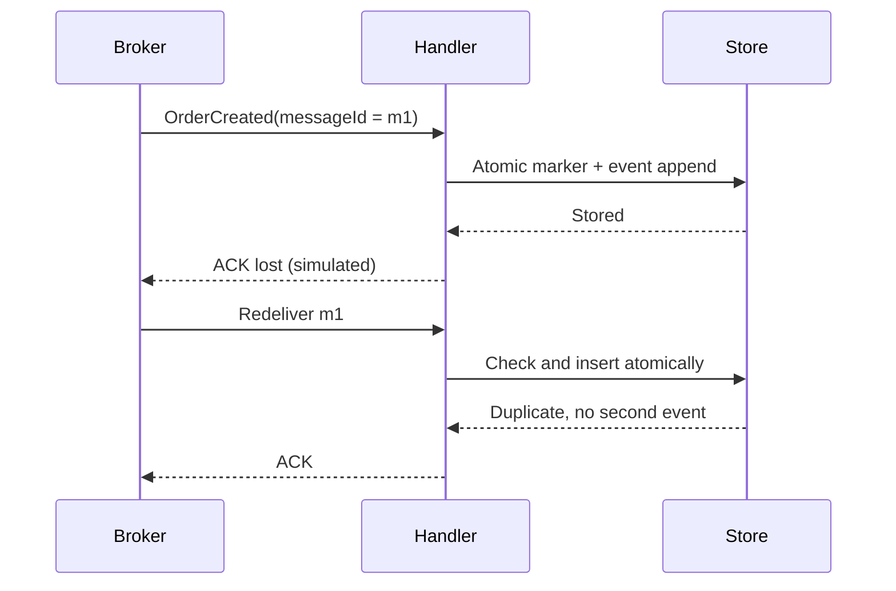

# Idempotent processing in an Event-Sourced system: PostgreSQL vs MongoDB

This is a **standalone teaching scenario inside Example 02**, not an extension of the `eventsourcing` library's `orderapplication_events` table. Its intentionally tiny event model (`OrderCreated`, `OrderApproved`) makes it possible to compare the *same* redelivery scenario with two persistence mechanisms. Event Sourcing and message delivery are separate concepts.

The demo uses the same **domain** message contract (`app/domain/idempotency.py`) and **application** handler (`app/application/idempotency_service.py`) with one **port** (`app/ports/message_inbox.py`). Only the outbound adapter changes.

## Why it is needed

An event broker or relay can deliver a command/event twice. The consumer must atomically persist **both** (a) that the message ID was processed, and (b) the append to the business event stream. A separate nontransactional `check-if-processed` followed by `append-event` is unsafe under crashes and races.



## PostgreSQL: two tables, one local transaction

[`app/adapters/outbound/postgres_inbox.py`](app/adapters/outbound/postgres_inbox.py) inserts into `demo_processed_messages` with a **unique primary key**, then appends to `demo_order_events` **inside the same PostgreSQL transaction**. A per-order advisory transaction lock serializes sequence assignment. Any exception rolls back both writes.

```sql
BEGIN;
INSERT INTO demo_processed_messages (message_id, order_id)
VALUES (:message_id, :order_id)
ON CONFLICT DO NOTHING RETURNING message_id;
-- If a row was inserted, append one event with the next order version.
-- Otherwise skip the business effect.
COMMIT;
```

The demo returns **2 events for 4 deliveries**. `processed_messages` is a persistent Inbox; it is **not** the event stream itself.

## MongoDB: one document, one atomic update

[`app/adapters/outbound/mongo_inbox.py`](app/adapters/outbound/mongo_inbox.py) stores one bounded classroom `demo_order_streams` document per order:

```json
{
  "_id": "Order-123",
  "events": [{"eventType": "OrderCreated", "messageId": "m1"}],
  "processedMessageIds": ["m1"]
}
```

An atomic conditional update checks `processedMessageIds != m1` and **in the same single-document write** adds both the event and the marker (`$push` + `$addToSet`). A redelivery matches no document and makes no change.

**Important trade-off:** an embedded array grows and MongoDB documents have a finite size. For unbounded high-volume event streams use individual event documents, then **multi-document transactions on a replica set** (or a different architecture) to coordinate a separate Inbox with the event append. This example does not claim that separate collections are updated atomically without a transaction.

## Run the comparison

```bash
make idempotency-postgres
make idempotency-mongo
# or make idempotency-all
```

For each backend, the output proves:

| Delivery | Message ID | Expected event count | Result |
|---|---|---|---|
| First `OrderCreated` | `m1` | 1 | appended |
| Duplicate `OrderCreated` | `m1` | 1 | ignored |
| New `OrderApproved` | `m2` | 2 | appended |
| Duplicate `OrderApproved` | `m2` | 2 | ignored |

The IDs are generated anew for each run. The output still displays the event list and reconstructed `APPROVED` state.

**This is not an exactly-once message-delivery guarantee.** It is idempotent local processing under at-least-once delivery, with a documented storage atomicity boundary.
