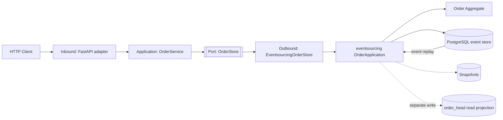
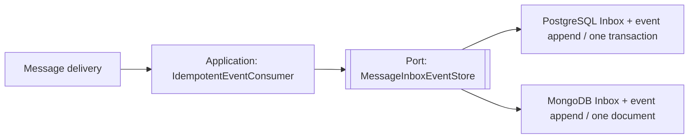
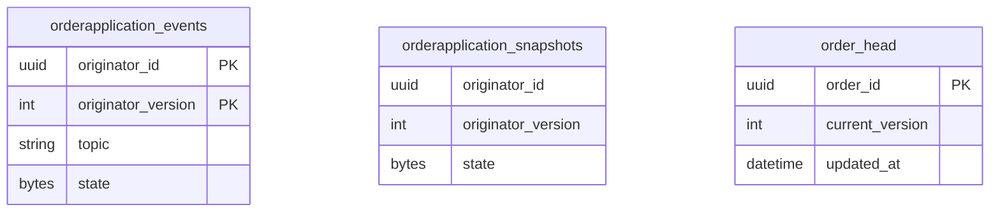
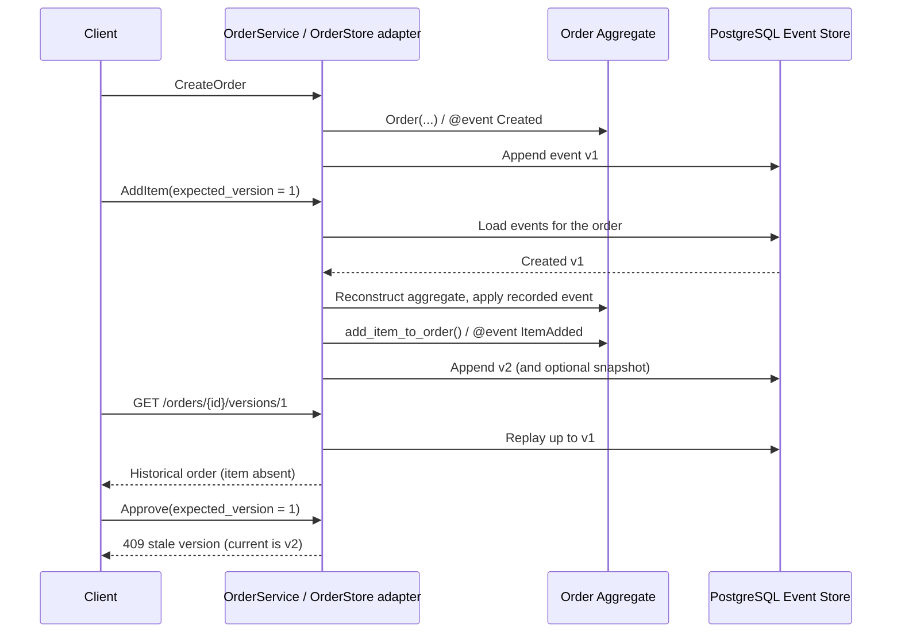
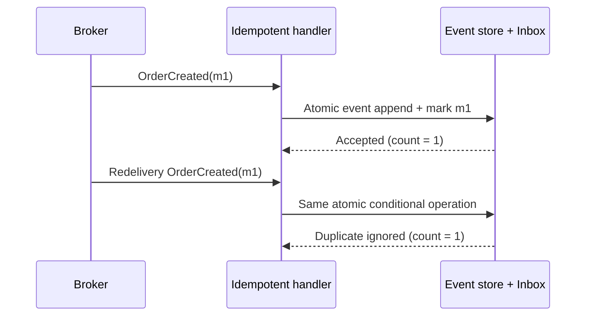

# Example 02 — Event-Sourced Orders

A runnable **FastAPI + PostgreSQL** Event-Sourced Order service with a **Hexagonal (Ports & Adapters) application layer**. The authoritative order state is reconstructed from a **versioned append-only event stream**, optionally accelerated by snapshots. The demo also shows expected-version conflicts, a derived SQL projection, and a **separate PostgreSQL vs MongoDB idempotent-processing example**.

This is the second persistence comparison laboratory in [Chapter 5 - Event-Driven Architecture](../README.md). Pair it with [Aggregate-Only](../aggregate-only/) to contrast **updating current-state rows** with **appending events**. The MongoDB adapter is *not* a complete MongoDB Event Store.

## What to learn

- Reconstruct an `Order` by **replaying versioned events** from an authoritative Event Store.
- Show the equivalent `approve()` and `cancel()` business invariants used in the Aggregate-Only example.
- Detect concurrent/stale commands using **expected aggregate version** checks.
- Understand snapshots as **replay optimizations** and projections as **derived read models**.
- Contrast **message deduplication** in PostgreSQL and MongoDB without confusing it with version checking.
- Identify the Application and `OrderStore` port, framework adapter and infrastructure boundaries.

## Architecture




`app/main.py` wires the service to the event-store adapter. The event-store library is isolated in `adapters/outbound`, **except for its aggregate base class and event decorator used by `app/domain/models.py`** (a documented pragmatic framework dependency). The event store is authoritative; read projections are not updated atomically with event appends.



## Persistence tables (conceptual)



The events table is authoritative; snapshot rows and `order_head` are derived artifacts.

## Sequence diagram: append, replay and stale-version conflict



## Start and inspect

```bash
make up
make demo
make inspect
make inspect-snapshots
```

API documentation: http://localhost:8102/docs. Postgres host port `55432`; Adminer http://localhost:8182 (server `db`, database `orders_es`, user/password `eventsourcing`).

## First, understand the `eventsourcing` Python library

This laboratory uses the real open-source **[`eventsourcing` Python package](https://eventsourcing.readthedocs.io/), version 9.x** (see `eventsourcing[postgres]>=9.3,<10` in [`requirements.txt`](requirements.txt)), with its PostgreSQL persistence module. It is **not** a custom Event Store implementation and it does **not** require Kafka or RabbitMQ. The library provides an Aggregate base class, the `@event` decorator, an application/repository abstraction, persistence of versioned event streams, concurrency checks, and snapshots.

Follow this short code-reading path **before** running the demo:

1. [`app/domain/models.py`](app/domain/models.py): `class Order(Aggregate)`, the `@event("Created")` constructor and `@event("ItemAdded")`, `@event("OrderApproved")` methods. These methods express state transitions and invariants.
2. [`app/adapters/outbound/eventsourcing_application.py`](app/adapters/outbound/eventsourcing_application.py): `OrderApplication` loads with `self.repository.get(order_id)`, invokes the Aggregate method, then calls `self.save(order)` to append its new events. It also configures `snapshotting_intervals = {Order: 2}`.
3. [`app/application/order_service.py`](app/application/order_service.py): the course-facing application service and `OrderStore` port; [`app/adapters/inbound/http_api.py`](app/adapters/inbound/http_api.py) exposes HTTP without requiring callers to know the library.
4. [`app/adapters/outbound/order_head_projection.py`](app/adapters/outbound/order_head_projection.py): an extra derived `order_head` table, **not** the authoritative Event Store or the mechanism that provides event-stream optimistic locking.

**Connection to the slides' `process()` / `apply()` model:** `OrderApplication` loads the state and handles the command; a decorated `Order` method validates and performs the transition; `@event` captures the corresponding event, and `self.save(order)` appends it. During replay the library applies recorded events to reconstruct an Order. There is **no separate handwritten `process()` / `apply()` switch in this example**; that explicit teaching implementation appears in [`../event-sourced-saga-orchestration/lab/domain.py`](../event-sourced-saga-orchestration/lab/domain.py).

## Guided demo: compare commands, event rows, replay and snapshots

```bash
make up
make demo
make inspect
make inspect-snapshots
```

[`scripts/demo.py`](scripts/demo.py) is **non-interactive**. It prints the full responses and the ID of a newly created order; its sequence is:

| Demo step | What the command causes | Where to verify |
|---|---|---|
| 1. Create | The `Created` event is appended at Aggregate version **1**. | `orderapplication_events`, one row for the printed `originator_id`. |
| 2. Add water | `ItemAdded` is appended at version **2**; the snapshot interval is 2. | Events v1/v2 and the `orderapplication_snapshots` table. |
| 3. Read version 1 | `GET /orders/{id}/versions/1` reconstructs the **old** Order, where water is absent. | Compare the step-2 response with the historical response. |
| 4. Stale approve | `expected_version = 1` conflicts with current version 2 and returns HTTP **409**. | No new approval event should be appended for this rejected call. |
| 5. Valid approve | A fresh expected version produces `OrderApproved`, version **3**. | Events v1/v2/v3 and derived `order_head.current_version`. |

**Why the snapshots matter:** reading current state normally means replaying events in order; a snapshot at version N permits replay from N+1. The saved snapshot is **not** a replacement for the event stream. **Why the version matters:** every event has a stream version, and conflicting appends are rejected, even without a separate SQL `ENTITIES` table. Running the demo twice creates different Aggregate IDs, so filter queries using the printed ID when explaining a single stream.

## Expected results

| Stage | Result |
|---|---|
| Create order | Event `Created` / aggregate version 1 |
| Add item | Event `ItemAdded` / version 2 (snapshot interval is **2**) |
| Load `/versions/1` | Historical order **before** the added item |
| Approve with stale `expected_version=1` | **HTTP 409 Conflict** |
| Approve with current version | `OrderApproved` appended / current version 3 |

## Code map

| Mechanism | Code |
|---|---|
| Domain event methods and invariants | [`app/domain/models.py`](app/domain/models.py) |
| Framework-backed Event Store and snapshots | [`app/adapters/outbound/eventsourcing_application.py`](app/adapters/outbound/eventsourcing_application.py) |
| Read projection adapter | [`app/adapters/outbound/order_head_projection.py`](app/adapters/outbound/order_head_projection.py) |
| Snapshot serialization adapter | [`app/adapters/outbound/transcoding.py`](app/adapters/outbound/transcoding.py) |
| Standalone schema upcasting *illustration* | [`app/infrastructure/upcasting.py`](app/infrastructure/upcasting.py) |
| Inbound REST adapter | [`app/adapters/inbound/http_api.py`](app/adapters/inbound/http_api.py) |
| Application service and ports | [`app/application/`](app/application/) and [`app/ports/`](app/ports/) |
| Example script | [`scripts/demo.py`](scripts/demo.py) |
| PostgreSQL and MongoDB Inbox adapters | [`app/adapters/outbound/postgres_inbox.py`](app/adapters/outbound/postgres_inbox.py), [`mongo_inbox.py`](app/adapters/outbound/mongo_inbox.py) and [`IDEMPOTENCY_POSTGRES_MONGODB.md`](IDEMPOTENCY_POSTGRES_MONGODB.md) |

### Mapping the course slides to Python `eventsourcing`

The slides use the conceptual separation **`process(command)`** (validate and decide which events to record) and **`apply(event)`** (evolve the Aggregate's state deterministically). This project uses the real [`eventsourcing` Python library](https://eventsourcing.readthedocs.io/) rather than defining methods with those literal names. **The mapping is conceptual, not a 1:1 API mapping.**

| Concept in the slides | Where it happens in this lab | What to inspect |
|---|---|---|
| **Command** (e.g. ApproveOrder) | HTTP handler → `OrderService.approve_order()` → `OrderApplication.approve_order()` | `app/adapters/inbound/http_api.py`, `app/application/order_service.py`, `app/adapters/outbound/eventsourcing_application.py` |
| **`process(command)`**: check rules and decide an event | `OrderApplication` checks `expected_version`, then invokes `order.approve()`. `Order.approve()` validates `APPROVAL_PENDING` and is decorated with `@event("OrderApproved")`. | `app/domain/models.py`, `app/adapters/outbound/eventsourcing_application.py` |
| **Append the decided event** | `OrderApplication.save(order)` persists the pending library-generated event in `orderapplication_events`, enforcing stream version consistency. | `app/adapters/outbound/eventsourcing_application.py` |
| **`apply(event)`**: evolve state | The `@event`-decorated Aggregate method is used by the library's event machinery to update state; the framework invokes the recorded events again when reconstructing an Order. There is **no handwritten `apply()` switch** in this lab. | `app/domain/models.py` and `self.repository.get(order_id)` |
| **Replay / historic state** | `OrderApplication.get_order_version(order_id, version)` loads the stream to the requested version; `get_order()` rebuilds current state. | `app/adapters/outbound/eventsourcing_application.py` |
| **Snapshot** | `is_snapshotting_enabled = True`, `snapshotting_intervals = {Order: 2}`. The library can restore a snapshot and apply only subsequent events. | `app/adapters/outbound/eventsourcing_application.py` |

For example, approving a pending order follows this path:

```text
POST /orders/{id}/approve
  -> OrderService.approve_order(id, expected_version)
  -> OrderApplication.approve_order(...)
  -> repository.get(id)            # replay events / use latest snapshot
  -> order.approve()               # @event("OrderApproved")
  -> save(order)                   # append the event, version conflict on stale write
  -> later repository.get(id)      # reconstruct approved state from history
```

**Important difference from the diagram in the slides:** with `eventsourcing`, the decorated Aggregate method contains the state change and the decorator makes it an event-sourced transition. It is **not** a standalone pure `process()` function returning event objects followed by a separately written `apply()` function. To see that explicit separation in source code, open the next lab, [Event-Sourced Saga Orchestration](../event-sourced-saga-orchestration/), especially `lab/domain.py` (`process()`, `apply()`, `evolve()`).

**Avoid conflating operations:** Kafka offsets, Event Store stream versions, snapshot versions, and CQRS projection checkpoints are different concepts. This first Event Sourcing service does not require a broker; publishing to external services is introduced separately in the Saga and CQRS labs.

## PostgreSQL data to inspect

The `eventsourcing` library stores events in `orderapplication_events` and snapshots in `orderapplication_snapshots`. Use:

```bash
make inspect
make inspect-snapshots
```

To inspect the optional read model:

```bash
docker compose exec -T db psql -U eventsourcing -d orders_es -c 'SELECT * FROM order_head ORDER BY updated_at DESC LIMIT 5;'
```

### Inspect `eventsourcing` tables in Adminer

`make up` does not automatically start the optional Adminer container. In this directory, run:

```bash
docker compose up -d adminer
```

Open **<http://localhost:8182>**, choose **PostgreSQL**, and log in with **Server:** `db`, **Username:** `eventsourcing`, **Password:** `eventsourcing`, **Database:** `orders_es`. The `db` name resolves between Docker containers; do **not** use `localhost` in Adminer's Server field.

In **SQL command**, start with:

```sql
-- Each event is an immutable row, ordered by Aggregate version.
SELECT originator_id, originator_version, topic
FROM orderapplication_events
ORDER BY originator_id, originator_version;

-- One or more replay checkpoints, depending on the demo runs.
SELECT originator_id, originator_version
FROM orderapplication_snapshots
ORDER BY originator_id, originator_version;

-- A derived, current-version projection; not the Event Store.
SELECT order_id, current_version, aggregate_schema_version
FROM order_head ORDER BY updated_at DESC;
```

Select **`orderapplication_events`** to inspect the `topic` (library event class/type), `originator_id` (Aggregate ID), `originator_version` (stream position) and `state` (serialized event data). The `state` column is encoded by the library, so it is **not guaranteed to be human-readable JSON in Adminer**: use the REST response for domain fields and this table for identity/version/replay concepts. Compare the order's event versions with `order_head.current_version`; the projection is **derived** and may briefly lag behind the Event Store because it is written separately.

Use `make inspect` and `make inspect-snapshots` if you prefer `psql`. The MongoDB service in this lab is only for the **separate idempotency exercise**; Adminer is a PostgreSQL UI, not a MongoDB browser.

## Additional example - Idempotency with PostgreSQL and MongoDB

The application above demonstrates **Event Sourcing + expected-version checks**. The HTTP adapter calls `OrderService`, not the eventsourcing framework directly. To show a different concern—**at-least-once message redelivery**—run the isolated two-backend example in [`IDEMPOTENCY_POSTGRES_MONGODB.md`](IDEMPOTENCY_POSTGRES_MONGODB.md):

```bash
make idempotency-postgres
make idempotency-mongo
# or make idempotency-all
```

Each backend receives **four deliveries, but accepts only two distinct message IDs**:

| Backend | Atomicity boundary | Deduplication strategy |
|---|---|---|
| PostgreSQL | One database transaction | `demo_processed_messages` INSERT + `demo_order_events` append together |
| MongoDB | One order stream document | Filter missing `processedMessageIds`, then `$push` event + `$addToSet` ID in one update |

These are **small standalone persistence examples** of the same message-processing contract, not replacements for the `eventsourcing` library tables. With MongoDB, a separate Inbox collection and a separate event collection would require a multi-document transaction; this compact demo embeds both within a bounded document instead.



## What is intentionally simplified?

The PostgreSQL Event Store is the source of truth; snapshots are replay optimizations, and `order_head` is only a **derived** projection. Projection updates occur in a separate local transaction, so they are not guaranteed to be atomic with event appends. The schema upcaster is a **standalone demonstration**, not wired into the library's event deserialization. Reliable publishing to Kafka or RabbitMQ is **not implemented** here.

The core `Order` still inherits from the `eventsourcing` framework's aggregate class and uses its event decorator. This is a pragmatic exception to framework-independent Domain design, documented for transparency. The MongoDB inbox example uses a bounded **single-document atomic update**; it is not a general MongoDB Event Store or a substitute for transactions across multiple documents.

**Slide placement:** present the Aggregate comparison on **slide 23**; connect snapshots to **slide 16**, optimistic locking to **slide 14**, and the standalone PostgreSQL vs MongoDB idempotency demo to **slide 19** of the 44-slide deck.

## Test and cleanup


```bash
make test               # in-memory event store, no DB dependency
make test-integration   # PostgreSQL-backed integration tests
make logs
make down
make reset              # WARNING: deletes demo data
```


