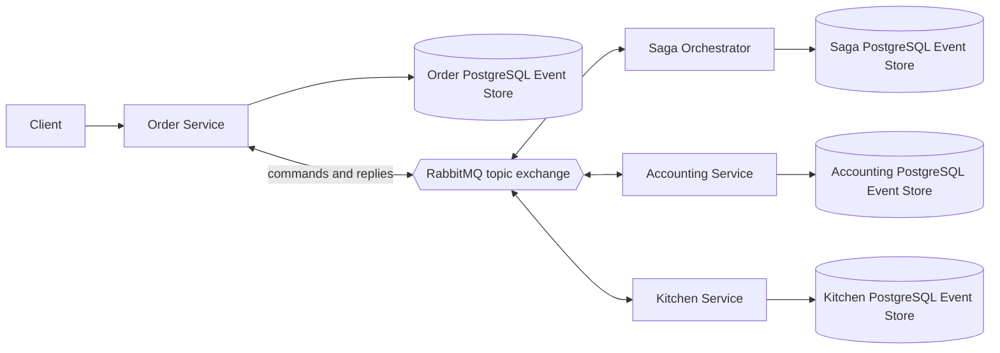
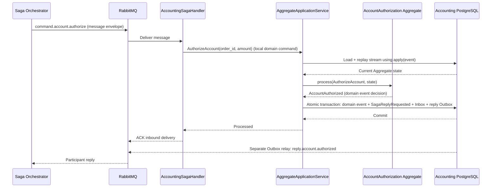
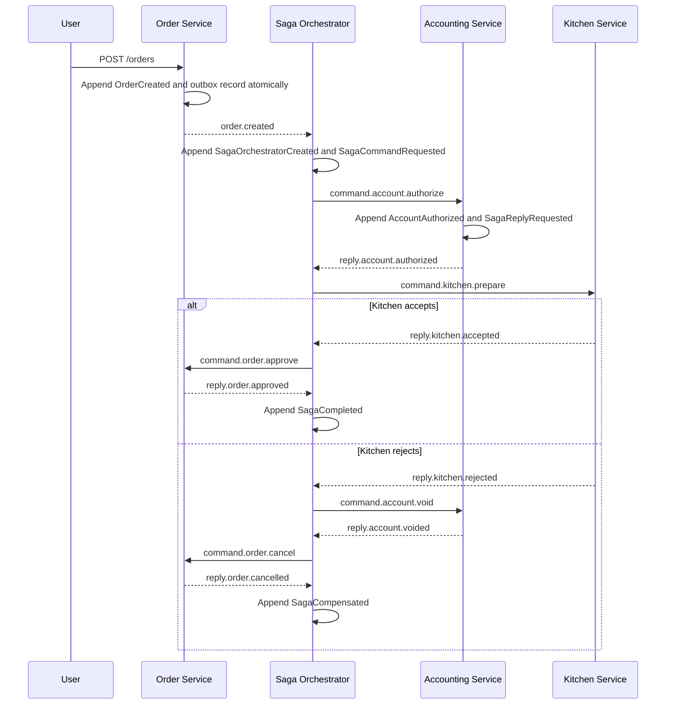
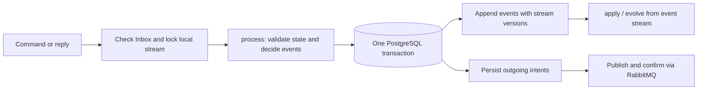

# Event-Sourced Saga Orchestration 

A **standalone, executable** extension of the Event Sourcing concepts in [Event-Sourced Orders](../event-sourced-orders/). This lab implements a Create Order Saga whose **participants and orchestrator are all event sourced**. Each service owns its **own PostgreSQL instance**; RabbitMQ carries durable commands and replies.

Unlike Event-Sourced Orders, which uses the Python `eventsourcing` library to teach an individual Aggregate, this example deliberately implements a **small explicit Event Store** using PostgreSQL and `psycopg`. This makes `process(command)`, `apply(event)`, the Saga event stream, and atomic Outbox/Inbox boundaries visible in code. **Each participant has its own Saga message handler** that translates a broker-level request into a local, typed Aggregate command; the Aggregate itself never interprets RabbitMQ message types. It does **not** pretend to reuse the `eventsourcing` framework internally.

## Architecture



**Four services, four PostgreSQL instances.** No service queries or writes another service's database. Every instance contains its own `events`, `aggregate_heads`, `inbox` and `outbox` tables. The `Order`, `AccountAuthorization`, `KitchenTicket` and `SagaOrchestrator` are separate Aggregate streams. This is a simplified demonstration of domain/technical patterns, not a payment-processing system.

## Explicit Saga handlers versus local Aggregate commands

A **Saga command is not a domain event to append** and the Orchestrator cannot decide which event a participant should record. The Saga Orchestrator publishes a request such as `command.account.authorize` to RabbitMQ; the receiving service owns the decision.



**Follow the code in this order:**

1. [`lab/messaging.py`](lab/messaging.py): `MessageWorker` receives the broker envelope and calls `handle_delivery()`; it never calls an Aggregate directly.
2. [`lab/handlers.py`](lab/handlers.py): `handle_delivery()` routes the message to the service-specific adapter.
3. [`lab/saga_handlers.py`](lab/saga_handlers.py): `AccountingSagaHandler`, `KitchenSagaHandler` and `OrderSagaHandler` **translate Saga messages into local typed commands** (`AuthorizeAccount`, `PrepareTicket`, `ApproveOrder`, etc.). The `SagaOrchestratorHandler` separately consumes `order.created` and replies.
4. [`lab/application.py`](lab/application.py): `AggregateApplicationService` invokes the local decision and atomically records its proposed events, the `SagaReplyRequested` **technical pseudo-event**, an Inbox entry and the reply Outbox message. The pseudo-event belongs to the integration/application boundary, not to the business Aggregate's rules.
5. [`lab/domain.py`](lab/domain.py): **`process(command, state)`** checks invariants and proposes **only domain events**; **`apply(role, state, event)`** is used to replay persisted events. Neither method sends messages.
6. [`lab/orchestration.py`](lab/orchestration.py): `advance_saga(message, saga_state)` runs the **Saga's own event-sourced state machine** and chooses the next participant command; it never modifies participant streams.
7. [`lab/storage.py`](lab/storage.py): locks the local stream, deduplicates deliveries, appends events and the Outbox in one PostgreSQL transaction. The actual RabbitMQ publishing happens **after commit**.

For example, the orchestrator's `command.kitchen.prepare` is **not** persisted as `TicketAccepted`: `KitchenSagaHandler` first constructs `PrepareTicket`, and the Kitchen Aggregate's `process()` chooses **`TicketAccepted` or `TicketRejected`**. If there is no new business event (e.g. the ticket already exists), the Saga handler still records `SagaReplyRequested` when an independently identified message requires a reply; an exact duplicate message ID is discarded by the Inbox.

**Choreography would be a different workflow**: participants would subscribe to business events (for example `AccountAuthorized`) and their event handlers would trigger local Aggregate commands without a central Saga Orchestrator. This laboratory demonstrates **Orchestration**, not Choreography. Event Sourcing is independent of that coordination choice.

## Start and run

Requirements: Docker Engine with Compose v2 and `make`. Run these commands from **this** directory. If you also opened the CQRS laboratory, stop it first: the two stacks intentionally reuse host ports.

```bash
make up
make demo-happy
make inspect-saga
make demo-compensation
make inspect-accounting
make demo-recovery
make test
make down
```

| Command | Observable result |
|---|---|
| `make demo-happy` | Order `APPROVED`, authorization `AUTHORIZED`, ticket `ACCEPTED`, Saga `COMPLETED`. |
| `make demo-compensation` | Kitchen rejects; accounting voids authorization; order becomes `CANCELLED`; Saga is `COMPENSATED`. |
| `make demo-recovery` | Stops Accounting, creates an order and lets the Saga persist its `AUTHORIZING` step; restarts the orchestrator, then starts Accounting so the in-flight Saga resumes. Then redelivers the **same** `OrderCreated` message and verifies the Saga stream did not grow. |
| `make inspect-order` | Reads the Order Service event stream in **its own** PostgreSQL. |
| `make inspect-accounting` | Reads the Accounting Service's events, including `SagaReplyRequested`. |
| `make inspect-kitchen` | Reads the Kitchen Service's ticket events and reply requests. |
| `make inspect-saga` | Reads the Saga Orchestrator's `SagaOrchestratorCreated`, `SagaCommandRequested`, `SagaReplyReceived`, and terminal events. |
| `make test` | Executes pure decision and replay tests without requiring PostgreSQL or RabbitMQ. |
| `make reset` | **Deletes all lab data and Docker volumes.** |

Service Swagger UIs: [Order](http://localhost:8211/docs), [Accounting](http://localhost:8212/docs), [Kitchen](http://localhost:8213/docs), [Orchestrator](http://localhost:8214/docs). RabbitMQ Management: <http://localhost:15683> (`lab` / `lab`).

## Guided walkthrough: follow one Saga through four Event Stores

The scripts in [`scripts/demo.py`](scripts/demo.py) are **automated scenarios**, not interactive prompts. Each run prints a new Order ID, each service's current status, Aggregate version, and the **event types obtained from its `GET /events/{order_id}` endpoint**. The output tells you *what was persisted*, not merely that HTTP returned 200.

1. Run `make up` and `make demo-happy`. Wait for the final **`PASS: COMPLETED`** message. The Order is `APPROVED`, Accounting is `AUTHORIZED`, Kitchen is `ACCEPTED`, and the orchestrator is `COMPLETED`.
2. Run `make inspect-saga` and `make inspect-accounting`. The Saga's event stream records successive requests and replies; Accounting's **different PostgreSQL database** records `AccountAuthorized` and technical `SagaReplyRequested`.
3. Run `make demo-compensation`. It requests a **Kitchen rejection**: the orchestrator sends compensation commands; Accounting moves to `VOIDED`, Order to `CANCELLED`, and the Saga to `COMPENSATED`. This is a *new Order ID*, not a rollback of the previous successful demonstration.
4. Run `make demo-recovery`. The Make target stops Accounting, starts a Saga that pauses at `AUTHORIZING`, restarts the orchestrator, and brings Accounting back. Recovery works because the orchestrator **replays its persisted Saga stream**; the script also sends a duplicate `OrderCreated` delivery to verify no extra Saga events are appended.
5. Use `make inspect-order`, `make inspect-kitchen`, and `make inspect-saga` to compare each service's event history. The service databases have **the same table names but contain different events** because each service owns its data.

**Read the implementation in execution order:** [`lab/messaging.py`](lab/messaging.py) (durable RabbitMQ delivery) → [`lab/handlers.py`](lab/handlers.py) (routing) → [`lab/saga_handlers.py`](lab/saga_handlers.py) (participant-specific message-to-command translation) → [`lab/application.py`](lab/application.py) (application coordination) → [`lab/domain.py`](lab/domain.py) (`process(command)` decides, `apply()` reconstructs) → [`lab/storage.py`](lab/storage.py) (append events, Inbox and Outbox atomically). On the orchestrator side [`lab/orchestration.py`](lab/orchestration.py) makes workflow decisions. **This lab uses `psycopg` plus an explicit educational Event Store, not the Python `eventsourcing` package used in the preceding lab.**

### Inspect each PostgreSQL Event Store with Adminer

An optional Adminer service is now included for SQL exploration. It is **not** started by `make up`; start it when you need the database UI:

```bash
make adminer
```

Open **<http://localhost:8183>** and choose **PostgreSQL**. Use **Username:** `demo`, **Password:** `demo`, **Database:** `events`. Change the **Server** field to select the database you want:

| Adminer Server | Owner | Useful contents |
|---|---|---|
| `order-db` | Order Service | `OrderCreated`, `OrderApproved`, or `OrderCancelled` |
| `accounting-db` | Accounting Service | `AccountAuthorized`, `AuthorizationVoided`, and Saga reply-request events |
| `kitchen-db` | Kitchen Service | `TicketAccepted` or `TicketRejected` and reply requests |
| `saga-db` | Saga Orchestrator | `SagaOrchestratorCreated`, requests, replies, completion/compensation |

After login, open **SQL command** and run the following separately for each Server:

```sql
-- Per-Aggregate stream and event sequence.
SELECT aggregate_id, version, event_type, payload
FROM events ORDER BY occurred_at, version LIMIT 100;

-- Current Aggregate metadata: analogous to ENTITIES in the slides.
SELECT aggregate_id, aggregate_type, version FROM aggregate_heads;

-- Received message IDs already processed; why duplicate deliveries are safe.
SELECT message_id, processed_at FROM inbox ORDER BY processed_at DESC LIMIT 20;

-- Messages waiting to be published, or already sent to RabbitMQ.
SELECT outbox_id, routing_key, published_at FROM outbox ORDER BY outbox_id DESC LIMIT 30;
```

Adminer runs inside Docker, so **do not use `localhost`** in its Server field. The four PostgreSQL services are not published as host database ports; the Compose service names above are how Adminer reaches them. The `aggregate_heads.version` column tracks the latest stream version and is used with a row lock; `events.version` tracks every individual event, and `inbox.message_id` is for message deduplication (a different concern from concurrency).

**Technical nuance:** the current code records both a **`SagaReplyRequested` technical pseudo-event** in the participant's event stream *and* the outgoing reply in that service's transactional Outbox. The pseudo-event explains the Richardson-style event-store technique; the Outbox actually drives the reliable RabbitMQ publication. The Saga orchestrator being event-sourced is an independent choice—it does not force participants to use pseudo-events.

## Business workflow: successful and compensating Saga



Messages are **not** sent from inside the database transaction. A command decision appends Saga events and an Outbox message in the same transaction. An Outbox relay publishes to RabbitMQ with publisher confirmations and only then marks the row published. Because a crash can occur after publish but before marking, **at-least-once delivery and duplicates are expected**.

Every inbound message is deduplicated in the receiver's PostgreSQL `inbox` **in the same transaction as its new events and outgoing messages**. Participant handlers append a `SagaReplyRequested` *pseudo-event* even when a valid newly delivered command requires a reply but no business state change. A delivery with an **already processed message ID** is discarded before domain processing; it does not append another pseudo-event.

## Event-sourced Saga state

The Saga stream ID is deterministic: `saga:<order_id>`. A successful sequence looks like:

```text
SagaOrchestratorCreated
SagaCommandRequested (AUTHORIZING)
SagaReplyReceived (reply.account.authorized)
SagaCommandRequested (TICKETING)
SagaReplyReceived (reply.kitchen.accepted)
SagaCommandRequested (APPROVING)
SagaReplyReceived (reply.order.approved)
SagaCompleted
```

The orchestrator does not store a mutable `saga.status` as its authoritative state. On `GET /sagas/{order_id}`, it **replays its own event stream** using `evolve("orchestrator", events)` to derive current `status` and `step`. Order, Accounting, and Kitchen likewise reconstruct their own state from local streams.



The stream uses a unique `(aggregate_id, version)` constraint and a locked local `aggregate_heads` record to serialize concurrent updates. This is distinct from the **explicit expected-version optimistic locking** demonstrated by Example 02; both protect stream consistency.

## How this matches the course slides

| Slide in the 44-slide Chapter 5 deck | Implementation |
|---|---|
| 24–26, Saga with Event Sourcing | Each participant and the orchestrator persists events in a separate PostgreSQL. |
| 27, Event-sourced participant | Accounting/Kitchen respond after appending their business and reply-request events. |
| 28, Idempotence and pseudo-events | Atomic Inbox and `SagaReplyRequested` event. |
| 29, Event-sourced orchestrator | Replay `SagaOrchestratorCreated`, `SagaCommandRequested`, replies, and terminal events. |
| 30, Reliable commands and replies | Atomic Outbox and deduplicated replies (not exactly-once transport). |

## Code map

| Concern | Source |
|---|---|
| Local typed Aggregate commands, `process()` and `apply()` / replay | [`lab/domain.py`](lab/domain.py) |
| Individual participant Saga handlers and wire-command translation | [`lab/saga_handlers.py`](lab/saga_handlers.py) |
| Local command application, reply pseudo-event and transactional coordination | [`lab/application.py`](lab/application.py) |
| Event-sourced Saga state machine and outgoing commands | [`lab/orchestration.py`](lab/orchestration.py) |
| Local stream version, Event Store, atomic Inbox/Outbox | [`lab/storage.py`](lab/storage.py) |
| Reliable RabbitMQ publisher and durable consumer | [`lab/messaging.py`](lab/messaging.py) |
| HTTP Order creation and inbound message dispatch | [`lab/handlers.py`](lab/handlers.py) |
| REST adapters, service ownership | [`lab/api.py`](lab/api.py) |
| Three demo paths, including restart and redelivery | [`scripts/demo.py`](scripts/demo.py) |

## Important boundaries and limitations

- RabbitMQ routes commands and replies; it **is not** an Event Store. Event history resides in each service's own PostgreSQL.
- The workflow intentionally has a single Saga per order and no overlapping Cancel Saga; concurrency isolation anomalies remain the focus of Chapter 4's separate Saga Isolation lab.
- The Saga laboratory publishes selected **integration notifications** from its durable Outbox; they are unused here but become the source for the external Kafka-driven Order History Service in [Event-Sourced CQRS Query Service](../event-sourced-cqrs-query-service/).
- These labs assume demo-only trust within the Docker network: internal admin/requeue endpoints are **not production access controls**. There is no production dead-letter policy, timeouts-based compensation, or external payment integration.
- Run one stack at a time, because Examples 03 and 04 intentionally reuse service ports 8211–8214 and RabbitMQ Management 15683.
