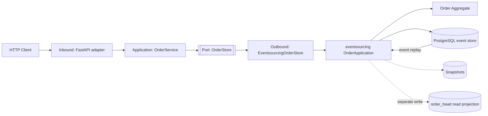
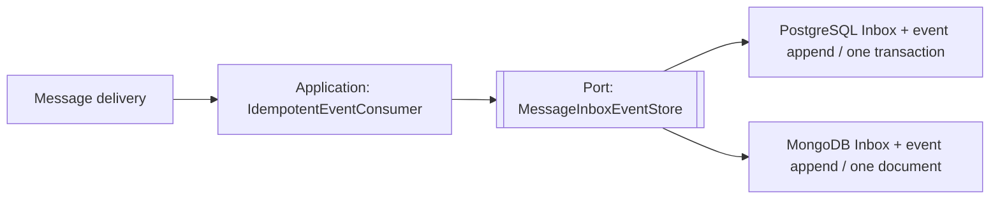
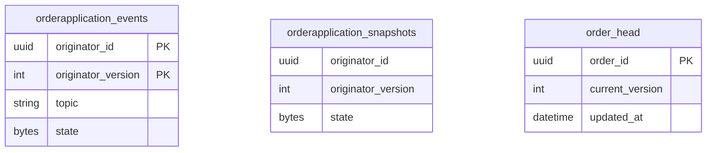
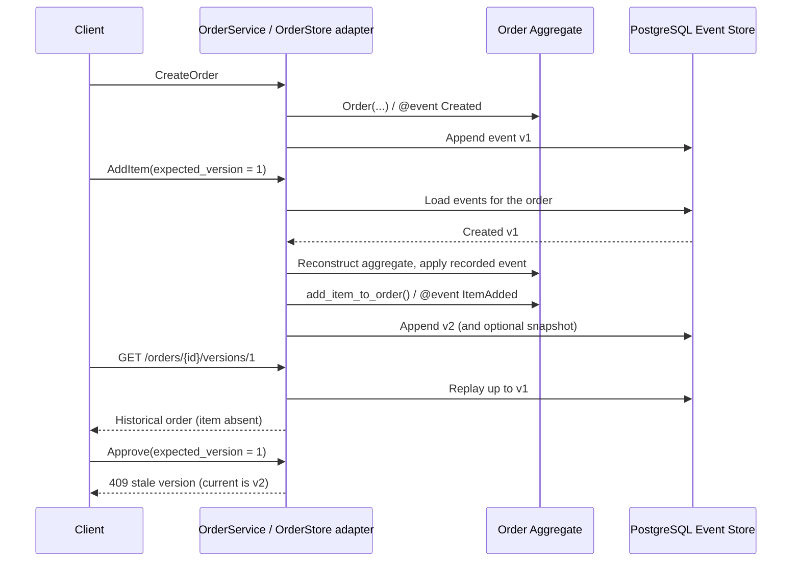
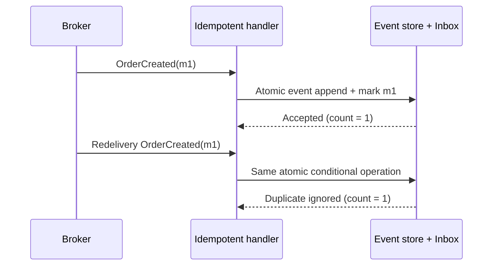

# Example 02 — Event-Sourced Orders

A runnable **FastAPI + PostgreSQL** Event-Sourced Order service with a **Hexagonal (Ports & Adapters) application layer**. The authoritative order state is reconstructed from a **versioned append-only event stream**, optionally accelerated by snapshots. The demo also shows expected-version conflicts, a derived SQL projection, and a **separate PostgreSQL vs MongoDB idempotent-processing example**.

This is the second persistence comparison laboratory in [Chapter 5 - Event-Driven Architecture](../../README.md). Pair it with [Example 01 - Aggregate-Only](../01-aggregate-only/) to contrast **updating current-state rows** with **appending events**. The MongoDB adapter is *not* a complete MongoDB Event Store.

## What to learn

- Reconstruct an `Order` by **replaying versioned events** from an authoritative Event Store.
- Show the equivalent `approve()` and `cancel()` business invariants used in the Aggregate-Only example.
- Detect concurrent/stale commands using **expected aggregate version** checks.
- Understand snapshots as **replay optimizations** and projections as **derived read models**.
- Contrast **message deduplication** in PostgreSQL and MongoDB without confusing it with version checking.
- Identify the Application and `OrderStore` port, framework adapter and infrastructure boundaries.

## Architecture




`app/main.py` wires the service to the event-store adapter. The event-store library is isolated in `adapters/outbound`, **except for its aggregate base class and event decorator used by `app/domain/models.py`** (a documented pragmatic framework dependency). The event store is authoritative; read projections are not updated atomically with event appends.



## Persistence tables (conceptual)



The events table is authoritative; snapshot rows and `order_head` are derived artifacts.

## Sequence diagram: append, replay and stale-version conflict



## Start and inspect

```bash
make up
make demo
make inspect
make inspect-snapshots
```

API documentation: http://localhost:8102/docs. Postgres host port `55432`; Adminer http://localhost:8182 (server `db`, database `orders_es`, user/password `eventsourcing`).

## Expected results

| Stage | Result |
|---|---|
| Create order | Event `Created` / aggregate version 1 |
| Add item | Event `ItemAdded` / version 2 (snapshot interval is **2**) |
| Load `/versions/1` | Historical order **before** the added item |
| Approve with stale `expected_version=1` | **HTTP 409 Conflict** |
| Approve with current version | `OrderApproved` appended / current version 3 |

## Code map

| Mechanism | Code |
|---|---|
| Domain event methods and invariants | [`app/domain/models.py`](app/domain/models.py) |
| Framework-backed Event Store and snapshots | [`app/adapters/outbound/eventsourcing_application.py`](app/adapters/outbound/eventsourcing_application.py) |
| Read projection adapter | [`app/adapters/outbound/order_head_projection.py`](app/adapters/outbound/order_head_projection.py) |
| Snapshot serialization adapter | [`app/adapters/outbound/transcoding.py`](app/adapters/outbound/transcoding.py) |
| Standalone schema upcasting *illustration* | [`app/infrastructure/upcasting.py`](app/infrastructure/upcasting.py) |
| Inbound REST adapter | [`app/adapters/inbound/http_api.py`](app/adapters/inbound/http_api.py) |
| Application service and ports | [`app/application/`](app/application/) and [`app/ports/`](app/ports/) |
| Example script | [`scripts/demo.py`](scripts/demo.py) |
| PostgreSQL and MongoDB Inbox adapters | [`app/adapters/outbound/postgres_inbox.py`](app/adapters/outbound/postgres_inbox.py), [`mongo_inbox.py`](app/adapters/outbound/mongo_inbox.py) and [`IDEMPOTENCY_POSTGRES_MONGODB.md`](IDEMPOTENCY_POSTGRES_MONGODB.md) |

The library uses `@event` on aggregate methods, **not methods literally named `process(command)` and `apply(event)`**. Command handlers validate business rules and create events; the library reapplies recorded events when it reconstructs an aggregate.

## PostgreSQL data to inspect

The `eventsourcing` library stores events in `orderapplication_events` and snapshots in `orderapplication_snapshots`. Use:

```bash
make inspect
make inspect-snapshots
```

To inspect the optional read model:

```bash
docker compose exec -T db psql -U eventsourcing -d orders_es -c 'SELECT * FROM order_head ORDER BY updated_at DESC LIMIT 5;'
```

## Additional example - Idempotency with PostgreSQL and MongoDB

The application above demonstrates **Event Sourcing + expected-version checks**. The HTTP adapter calls `OrderService`, not the eventsourcing framework directly. To show a different concern—**at-least-once message redelivery**—run the isolated two-backend example in [`IDEMPOTENCY_POSTGRES_MONGODB.md`](IDEMPOTENCY_POSTGRES_MONGODB.md):

```bash
make idempotency-postgres
make idempotency-mongo
# or make idempotency-all
```

Each backend receives **four deliveries, but accepts only two distinct message IDs**:

| Backend | Atomicity boundary | Deduplication strategy |
|---|---|---|
| PostgreSQL | One database transaction | `demo_processed_messages` INSERT + `demo_order_events` append together |
| MongoDB | One order stream document | Filter missing `processedMessageIds`, then `$push` event + `$addToSet` ID in one update |

These are **small standalone persistence examples** of the same message-processing contract, not replacements for the `eventsourcing` library tables. With MongoDB, a separate Inbox collection and a separate event collection would require a multi-document transaction; this compact demo embeds both within a bounded document instead.



## What is intentionally simplified?

The PostgreSQL Event Store is the source of truth; snapshots are replay optimizations, and `order_head` is only a **derived** projection. Projection updates occur in a separate local transaction, so they are not guaranteed to be atomic with event appends. The schema upcaster is a **standalone demonstration**, not wired into the library's event deserialization. Reliable publishing to Kafka or RabbitMQ is **not implemented** here.

The core `Order` still inherits from the `eventsourcing` framework's aggregate class and uses its event decorator. This is a pragmatic exception to framework-independent Domain design, documented for transparency. The MongoDB inbox example uses a bounded **single-document atomic update**; it is not a general MongoDB Event Store or a substitute for transactions across multiple documents.

**Slide placement:** present the full comparison after **Aggregate-Only vs Event-Sourced Order** (slide 17). Optionally preview the backend contrast on **Reliable Publishing and Idempotent Consumers** (slide 13).

## Test and cleanup


```bash
make test               # in-memory event store, no DB dependency
make test-integration   # PostgreSQL-backed integration tests
make logs
make down
make reset              # WARNING: deletes demo data
```


