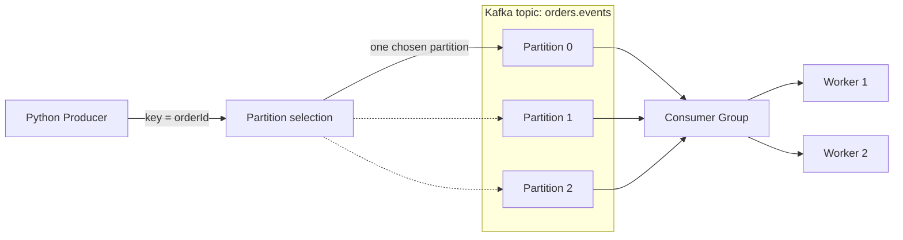
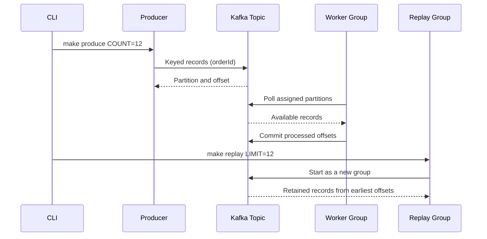

# Kafka Fundamentals — Topics, Partitions, Keys, Consumer Groups and Replay

A small runnable **Apache Kafka (KRaft) + Python** example using a compact **Hexagonal (Ports & Adapters) Architecture**. A topic with three partitions illustrates message keys, offsets, consumer-group work distribution, and replay. This lab is part of [Chapter 5 - Event-Driven Architecture](../README.md) and revisits the Kafka concepts introduced in Chapter 3.

The example is self-contained and driven by `make` commands; no manual broker configuration is required.

## What to learn

- **Topic, partition and offset:** ordering exists within a Kafka partition, not across the entire topic.
- **Record keys:** a stable `orderId` key routes related records to the same partition under a stable partitioning strategy.
- **Consumer groups:** workers in one group divide assigned partitions, while other groups retain independent offsets.
- **Replay:** a new group can reread messages that are still within topic retention.
- **Ports & Adapters:** business-message creation is separate from the Kafka producer adapter.

## Architecture




A **topic** is not a RabbitMQ exchange. A **partition** is an ordered append-only record sequence with increasing *offsets*; records with the same `orderId` key land in one partition (assuming a stable partition count and partitioner). A **consumer group** divides partitions among its active members. Two **different groups** can read the same topic independently. Retention determines how long Kafka keeps data; it is not infinite by default.

## Sequence diagram: publish and consume



## Start and inspect


Requires Docker Compose and Make. `make test` runs the Python-only tests locally.

```bash
make up
make partitions
make produce COUNT=12
make consume LIMIT=12
make groups
```

**Kafka UI:** <http://localhost:8085> (Kafbat UI). The `make up` command starts it alongside Kafka, and `make ui` starts or restarts it separately. In **Topics → orders.events**, inspect partition count, record keys, message payloads and per-partition offsets. Under **Consumer Groups**, compare the offset and lag of `shared-workers`, `order-processors` and replay groups. The UI connects to the broker at `kafka:19092` inside the Compose network; `localhost:29092` is for host-based Kafka clients. The UI is bound to the local machine only and does not require credentials in this example.

The producer prints the *partition and offset returned by Kafka* for each record. The consumer prints key, partition and offset and commits after processing.

### Consumer-group offsets versus replay

```bash
make consume LIMIT=12  # same group: already committed messages are not replayed
make replay LIMIT=12   # new group: starts at earliest retained offset
```

`auto.offset.reset=earliest` only takes effect for a group without a previously committed position. Use `make reset` if you want a completely fresh topic and offsets (removes the teaching Kafka volume).

### Two workers in the same consumer group

Use three terminal windows while the stack is running:

```bash
# terminal A
make worker
# terminal B: second member of the SAME group
make worker
# terminal C
make produce COUNT=24 PREFIX=SCALING
```

Compare the `assigned [...]` lines. **One partition can be assigned to at most one member of a group at a time.** Two workers may each own one or more of the three partitions; exact assignment depends on the group coordinator and client settings. A third worker may receive a partition; a fourth might be idle. Stop workers with Ctrl+C.

### Inspect broker topics and consumer offsets

```bash
make partitions
make groups
docker compose exec -T kafka /opt/kafka/bin/kafka-consumer-groups.sh \
  --bootstrap-server kafka:19092 --describe --group order-processors
```

The broker listens on `localhost:29092` from the host and on `kafka:19092` inside Compose. Avoid using `localhost` from a client container.

## What to observe

| Action | Expected observation |
|---|---|
| `make partitions` | The `orders.events` topic has three partitions. |
| `make produce COUNT=12` | Producer reports partition and offset for every record. |
| Two concurrent `make worker` processes | Assignment is distributed within the `shared-workers` group. |
| `make consume LIMIT=12` twice | Committed offsets affect repeated reads in the same group. |
| `make replay LIMIT=12` | A new group independently reads retained records. |

## Code map


| File | Reason to read |
|---|---|
| `app/domain/messages.py` | Immutable JSON business-message envelope |
| `app/application/publish_example.py` | Select message key and publish via a port |
| `app/ports/event_bus.py` | Outbound interface |
| `app/adapters/outbound/kafka_producer.py` | Kafka producer and broker acknowledgements |
| `app/main.py` | CLI consumer, group ID and offset commits |
| `tests/test_messages.py` | Serialization and key selection |

## Reliability and deliberate simplifications

The producer uses broker acknowledgements and producer idempotence; the consumer commits offsets **after processing**. A crash before committing an offset can cause a message to be delivered again. This exercise does **not** guarantee exactly-once business effects.

The one-broker KRaft deployment and plaintext local networking are chosen for teaching rather than production use. There is no PostgreSQL, Debezium, RabbitMQ or Event Sourcing here. Continue with [CDC, Debezium, Kafka and RabbitMQ](../cdc-debezium-rabbitmq/) for the next laboratory.

**Slide placement:** after **CDC with PostgreSQL, Debezium and Kafka** (Chapter 5, slide 5). The same slide links to both Kafka examples.

## Test and cleanup


The producer uses acknowledgements and producer idempotence; the consumer commits offsets **after** processing. This is not a guarantee of end-to-end exactly-once business effects, especially if a consumer crashes before the commit. This lab does not involve PostgreSQL or Debezium. Continue with [`../cdc-debezium-rabbitmq/`](../cdc-debezium-rabbitmq/) for a real CDC source.

```bash
make down
make reset  # WARNING: deletes Kafka data and committed offsets
```
