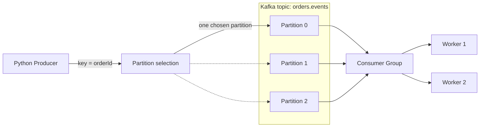

# Kafka Fundamentals — Topics, Partitions, Keys, Consumer Groups and Replay

A runnable **Apache Kafka (KRaft) + Python** laboratory for the first Kafka slides in Chapter 5. There is **one broker** and a topic with **three partitions** so students can inspect routing, consumer-group assignment and offsets without learning a large framework. Python code follows a minimal Domain / Application / Ports / Adapters separation.

## Architecture and vocabulary



A **topic** is not a RabbitMQ exchange. A **partition** is an ordered append-only record sequence with increasing *offsets*; records with the same `orderId` key land in one partition (assuming a stable partition count and partitioner). A **consumer group** divides partitions among its active members. Two **different groups** can read the same topic independently. Retention determines how long Kafka keeps data; it is not infinite by default.

## Run the exercises

Requires Docker Compose and Make. `make test` runs the Python-only tests locally.

```bash
make up
make partitions
make produce COUNT=12
make consume LIMIT=12
make groups
```

The producer prints the *partition and offset returned by Kafka* for each record. The consumer prints key, partition and offset and commits after processing.

### Consumer-group offsets versus replay

```bash
make consume LIMIT=12  # same group: already committed messages are not replayed
make replay LIMIT=12   # new group: starts at earliest retained offset
```

`auto.offset.reset=earliest` only takes effect for a group without a previously committed position. Use `make reset` if you want a completely fresh topic and offsets (removes the teaching Kafka volume).

### Horizontal scaling demonstration

Use three terminal windows while the stack is running:

```bash
# terminal A
make worker
# terminal B: second member of the SAME group
make worker
# terminal C
make produce COUNT=24 PREFIX=SCALING
```

Compare the `assigned [...]` lines. **One partition can be assigned to at most one member of a group at a time.** Two workers may each own one or more of the three partitions; exact assignment depends on the group coordinator and client settings. A third worker may receive a partition; a fourth might be idle. Stop workers with Ctrl+C.

### Inspect broker topics and consumer offsets

```bash
make partitions
make groups
docker compose exec -T kafka /opt/kafka/bin/kafka-consumer-groups.sh \
  --bootstrap-server kafka:19092 --describe --group order-processors
```

The broker listens on `localhost:29092` from the host and on `kafka:19092` inside Compose. Avoid using `localhost` from a client container.

## Code map

| File | Reason to read |
|---|---|
| `app/domain/messages.py` | Immutable JSON business-message envelope |
| `app/application/publish_example.py` | Select message key and publish via a port |
| `app/ports/event_bus.py` | Outbound interface |
| `app/adapters/outbound/kafka_producer.py` | Kafka producer and broker acknowledgements |
| `app/main.py` | CLI consumer, group ID and offset commits |
| `tests/test_messages.py` | Serialization and key selection |

## Reliability and scope

The producer uses acknowledgements and producer idempotence; the consumer commits offsets **after** processing. This is not a guarantee of end-to-end exactly-once business effects, especially if a consumer crashes before the commit. This lab does not involve PostgreSQL or Debezium. Continue with [`../cdc-debezium-rabbitmq/`](../cdc-debezium-rabbitmq/) for a real CDC source.

```bash
make down
make reset  # WARNING: deletes Kafka data and committed offsets
```
