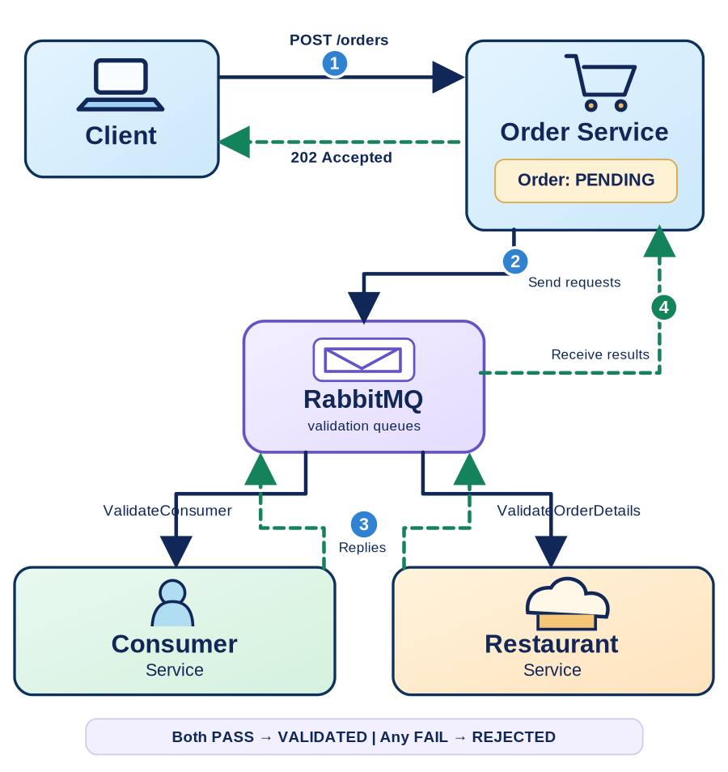

# Asynchronous Request Processing — Flask, RabbitMQ, and Order Validation

This focused lab accompanies **Chapter 4 — Microservices Coordination and Orchestration**, immediately before the **Transactional Outbox** lab. It builds on the RabbitMQ AMQP 0-9-1 examples from Chapter 3 and adapts the previous year's `microservices/rabbit-mq/finish-processing/` example.

**Learning goal:** an HTTP request can return **`202 Accepted`** while other services continue validating the order asynchronously. The client checks an order resource later for its final status. This is *asynchronous request processing*, not a full saga or event sourcing example.

The lab is Docker-first: Docker Compose and `make` are the only host dependencies, plus `curl` to send HTTP requests.

## Where it fits in the lecture

| Slide or topic | What this lab demonstrates |
|---|---|
| Availability and synchronous dependencies | HTTP does **not** wait for both validation services to respond. |
| Asynchronous request processing | `202 Accepted`, asynchronous validation requests, and later status updates. |
| RabbitMQ recap | Durable queues, persistent messages, manual acknowledgments, publisher confirms. |
| *Next:* Transactional Messaging / Outbox | A **remaining dual-write failure window**: saving the order and publishing messages are two separate operations. |

> The CAP theorem concerns **network partitions**. Asynchronous messaging improves temporal decoupling, but **does not by itself guarantee availability or solve CAP**. It also does not make a database update and message publication atomic.

## Architecture



```text
Client ── POST /orders ────────────> Order API ─── save PENDING ───> Order DB
Client <──── 202 Accepted ────────── Order API
                                        │
                               publish validation requests
                                        ▼
                                     RabbitMQ
                               /                     \
                              ▼                       ▼
                    Consumer Service          Restaurant Service
                              \                       /
                               └── validation replies ┘
                                        │
                                     RabbitMQ
                                        ▼
                           Order results listener
                                        │
                             Order DB status update
                                        │
Client ── GET /orders/{id} ───────────> Order API (PENDING / VALIDATED / REJECTED)
```

**Roles:** the `order-api` and `order-results` containers together form the logical **Order Service** and share **only its own SQLite database**. The other services simulate validations; they do not access Order Service's database.

**Queues:** `validation.consumer`, `validation.restaurant`, and `validation.results`. This minimal example uses the RabbitMQ **default exchange** and AMQP 0-9-1. Each process declares the same durable queues with compatible properties.

## 1. Start the services

```bash
make up
make ps
```

Open the RabbitMQ Management UI at <http://localhost:15672> (`student` / `student`). Observe the three queues in **Queues and Streams**.

For two-terminal live demonstration:

**Terminal 1 — service logs:**

```bash
make logs
```

**Terminal 2 — send commands:**

```bash
make create
```

The API responds with **HTTP 202** and the initial state:

```json
{
  "order_id": "ORD-1001",
  "status": "PENDING",
  "status_url": "/orders/ORD-1001"
}
```

Immediately inspect the status (before all validations finish, if you run quickly):

```bash
make status
```

Wait a few seconds and run `make status` again. The order becomes `VALIDATED` only when **both** `consumer_check` and `restaurant_check` have returned `PASS`.

> If an order already exists, use a different ID: `make create ORDER_ID=ORD-1002`. Order IDs are unique and persist across container restarts.

## 2. Demonstrate independent validation and failure

The workers intentionally use a short delay so you can see the intermediate state.

| Command | Simulated validation | Expected final state |
|---|---|---|
| `make create ORDER_ID=ORD-1003` | Both checks pass | `VALIDATED` |
| `make invalid-consumer` | `consumer_id=blocked` | `REJECTED` |
| `make invalid-item` | `item=unavailable` | `REJECTED` |

Inspect failed orders:

```bash
curl -s http://localhost:5001/orders/ORD-BLOCKED
curl -s http://localhost:5001/orders/ORD-NO-PIZZA
```

The `consumer_check` and `restaurant_check` columns demonstrate why **the first successful reply alone does not complete the order**.

## 3. Observe temporal decoupling

Stop the Restaurant Service without shutting down the Order Service:

```bash
docker compose stop restaurant-service
make create ORDER_ID=ORD-PAUSED
make status ORDER_ID=ORD-PAUSED
```

After the Consumer Service finishes, `consumer_check` should be `PASS`, `restaurant_check` should remain `PENDING`, and the overall order state should still be `PENDING`.

Restart the Restaurant Service and watch the order complete:

```bash
docker compose start restaurant-service
make status ORDER_ID=ORD-PAUSED
```

The RabbitMQ queue buffers the restaurant request while that worker is unavailable. **It does not guarantee an unlimited waiting time**, nor does it automatically make the full application available in every failure scenario.

## 4. Inspect the implementation

| File | Responsibility |
|---|---|
| `app/order_api.py` | `POST /orders` (HTTP 202) and `GET /orders/{id}`; publishes requests. |
| `app/adapters/outbound/sqlite_repository.py` | Persists current order state; combines two independent validation results. |
| `app/validation_worker.py` | Consumer and Restaurant validations; confirmed reply before request ACK. |
| `app/results_worker.py` | Order Service's result listener; idempotent updates and ACK after DB commit. |
| `app/adapters/outbound/rabbitmq.py` | Durable RabbitMQ queues, persistent JSON messages, publisher confirms. |
| `app/domain/validation.py` | Simple testable validation rules. |

### Important distinctions

- The **HTTP response** means *accepted for asynchronous processing*, **not** fully validated.
- **RabbitMQ acknowledgments** confirm message delivery/handling at specific steps; they do not provide a distributed ACID transaction.
- An order can become `REJECTED` if either validation fails; there are **no compensations, payments, or saga orchestration** in this lab.
- The SQLite `orders` table stores **current state**, not an append-only event stream. **This is not event sourcing.**

## 5. The deliberate reliability limitation — motivation for Outbox

The code first **commits an order as `PENDING`** and then publishes two validation requests. These are *not one atomic operation*. A crash or broker outage **between those operations** may leave an order in the database without all expected validation messages. The HTTP endpoint can return `503` with its `order_id` if it cannot confirm dispatch, but that does **not** repair the partial-write problem.

**Next lab:** the *Transactional Outbox Pattern* inserts both the business update and an outgoing message record **in the same local database transaction**; a relay later publishes the message. That addresses the database/message gap at the cost of handling possible duplicate deliveries.

For this lab, a broker connection is necessary to confirm both validation requests before replying `202`; you should not interpret the example as resilient to the broker itself being offline during submission.

## 6. Tests, lifecycle and reset

```bash
make test
make queues
make down
```

**Destructive reset:**

```bash
make reset
```

`make reset` deletes the RabbitMQ and Order Service volumes, including persisted orders. This is intended only to restart the classroom demonstration from a clean state.

## Source adaptation

Adapted from the previous-year archive `microservices_examples (1).zip` at `microservices/rabbit-mq/finish-processing/`, especially `order_service.py`, `consumer_service.py`, and `restaurant_service.py`.

The updated lab retains the original educational flow but corrects its HTTP response code, single-result completion behavior, in-memory order state, `auto_ack=True` processing, and missing queue/message persistence. The Docker services and tests are new. This is a classroom demonstration, not a production-grade workflow engine.

### Hexagonal architecture

- `app/domain/`: order status and validation rules, with no broker/database imports.
- `app/application/services.py`: create, read, and record-validation use cases.
- `app/ports/`: `OrderRepository` and `ValidationPublisher` protocols.
- `app/adapters/inbound/`: Flask HTTP endpoint and RabbitMQ consumers, called by stable entry-point modules.
- `app/adapters/outbound/`: SQLite and RabbitMQ implementations.
- `app/order_api.py`, `app/results_worker.py`, `app/validation_worker.py`: stable Compose entry points.
