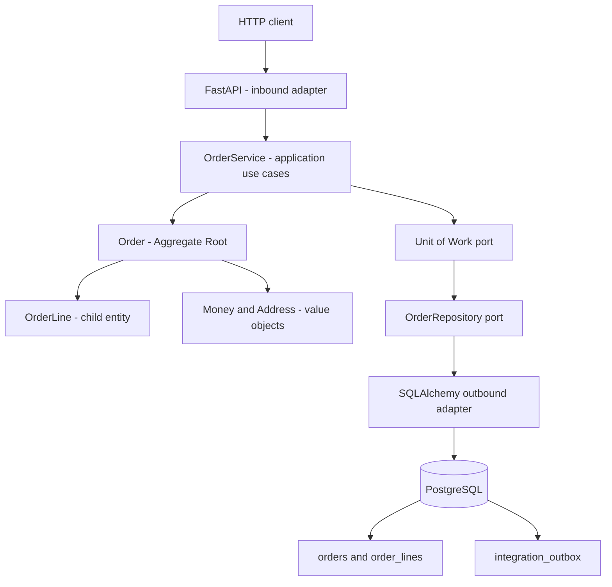
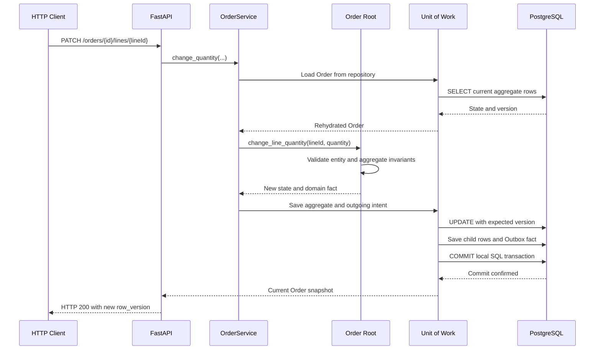

# DDD Aggregates and Domain Events — Order Service

A runnable **FastAPI + PostgreSQL** service demonstrating Domain-Driven Design (DDD) and **Hexagonal Architecture (Ports & Adapters)**. The `Order` **Aggregate Root** is the only public entry point for changing its `OrderLine` entities and `Address` value object. Every functional operation travels through **REST API → Application Service → Aggregate Root → Repository / Unit of Work**.

Part of **[Chapter 4 — Microservices Coordination and Orchestration](../README.md)** of *Information Systems Design and Big Data*. This project focuses on **domain modeling and aggregate boundaries**, not on comparing current-state persistence with Event Sourcing.

## What the project demonstrates

| DDD building block | Concrete implementation |
|---|---|
| **Aggregate Root** | `Order` controls all changes to lines, address, approval and cancellation. |
| **Entity** | `OrderLine` has a stable `line_id`: it remains the same entity when quantity changes. |
| **Value Object** | Immutable `Money(amount, currency)` and `Address` use equality by value. Money uses `Decimal`, not `float`. |
| **Factory** | `Order.create()` constructs a valid aggregate and records `OrderCreated`. |
| **Aggregate invariants** | At least one line, no duplicate menu items, one currency, maximum total of 200.00; approval requires an address and total of at least 15.00. |
| **Inter-aggregate references** | `consumer_id` and `restaurant_id` are identifiers, not loaded objects. |
| **Application Service** | `OrderService` orchestrates use cases but does not enforce business rules itself. |
| **Repository and Unit of Work** | A local SQL transaction persists the aggregate's current state and outgoing event intents. |
| **Domain Events** | Operations create immutable facts with event ID, aggregate ID, type and timestamp. |

A separate DDD **Domain Service** is not necessary here: the business operations all belong to the `Order` aggregate. Other aggregates are not updated in this transaction; cross-service coordination would require a separate Saga.

## Architecture and aggregate boundary



`Order.lines` exposes a **tuple of immutable entity snapshots**; `Order.address` is an immutable value object. Direct assignment to `order.state`, `order.address` or a line's `quantity` is rejected. To change the domain state, use root methods such as `change_line_quantity()`, `change_delivery_address()` or `approve()`. Python's underscore convention is not a security boundary; this is a modeling and application-design rule enforced by the public interface and tests.

### Successful update sequence



**Why use the Aggregate Root?** An independent line update might violate an invariant that involves **other lines**, such as consistent currency or the total price cap. `Order` evaluates the whole proposed aggregate **before** accepting the change. For example, adding a second line that raises the total above 200.00 returns HTTP `400` and leaves the current state unchanged.

## Start the service

Requirements: Docker with Compose and `make`. `curl` is useful for direct requests; Python 3 is needed to run `make demo` from the host.

```bash
make up
make status
```

| Interface | Address |
|---|---|
| FastAPI / OpenAPI | <http://localhost:8003/docs> |
| Read-only Outbox endpoint | <http://localhost:8003/lab/outbox> |
| Adminer | <http://localhost:8083> |

Adminer settings: system `PostgreSQL`, server `db`, database/user/password `ftgo` (local development credentials).

**Important when upgrading from an older version of this project:** the SQL schema has changed (`order_lines`, delivery-address columns, numeric money). SQLAlchemy `create_all()` does **not** migrate old tables. For a fresh disposable local database, use `make reset` **only if you agree to delete all existing orders and Outbox data**, then `make up`. Otherwise back up the volume and perform a schema migration before starting this version.

## Use the REST API

The public operations are:

| Method | Endpoint | Domain behavior |
|---|---|---|
| `POST` | `/orders` | Factory creates `Order` and its initial `OrderLine` entities. |
| `GET` | `/orders/{id}` | Read current state and stable line IDs. |
| `POST` | `/orders/{id}/lines` | Root adds a child Entity after checking aggregate invariants. |
| `PATCH` | `/orders/{id}/lines/{lineId}` | Root changes a line's quantity without changing its identity. |
| `DELETE` | `/orders/{id}/lines/{lineId}` | Root removes a line only if the aggregate remains valid. |
| `PUT` | `/orders/{id}/address` | Root replaces the immutable `Address` Value Object. |
| `POST` | `/orders/{id}/approve` | Root checks address, total and lifecycle state. |
| `POST` | `/orders/{id}/cancel` | Root records a cancellation state change. |
| `GET` | `/lab/outbox` | Inspect stored outgoing event intents; read-only diagnostic route. |

All write requests can include `expected_version` (query parameter on approve/cancel/delete-line, JSON field on other mutations). A stale version returns **HTTP 409**. Business-rule failures return **HTTP 400**, schema validation returns **422**, and missing resources return **404**.

### Create an order

```bash
make create
```

Equivalent HTTP request:

```bash
curl -sS -X POST http://localhost:8003/orders \
  -H 'Content-Type: application/json' \
  -d '{
    "consumer_id": "CUST_1", "restaurant_id": "REST_1",
    "lines": [{
      "menu_item_id": "PIZZA", "name": "Pizza", "quantity": 2,
      "unit_price": {"amount": "10.00", "currency": "EUR"}
    }]
  }'
```

The response includes an `id`, `row_version=1`, an OrderLine `line_id`, and a structured total (`20.00 EUR`). It does **not** include an editable reference to the in-memory entity.

### Change an Entity and replace a Value Object

Use the `id` and `line_id` returned by `POST /orders`:

```bash
# The Order Root, not the HTTP adapter, updates the child Entity.
curl -sS -X PATCH "http://localhost:8003/orders/<id>/lines/<lineId>" \
  -H 'Content-Type: application/json' \
  -d '{"quantity":3,"expected_version":1}'

# Replace the Address Value Object through the Order Root.
curl -sS -X PUT "http://localhost:8003/orders/<id>/address" \
  -H 'Content-Type: application/json' \
  -d '{"address":{"street":"Via Roma 1","city":"Bari", "postal_code":"70100","country":"IT"},"expected_version":2}'

# Approval is allowed only if the aggregate's rules are satisfied.
curl -sS -X POST "http://localhost:8003/orders/<id>/approve?expected_version=3"
```

After approval, attempting to edit an OrderLine or the delivery address is rejected. Removing the final OrderLine is also forbidden: the root prevents an empty aggregate.

### Run the complete API flow

```bash
make demo
make events
make db
```

`make demo` sends **real HTTP requests to the running service**. It creates an Order, adds a child Entity, changes its quantity, replaces the Address, verifies a stale version (`409`) and an aggregate-wide limit (`400`), approves the Order, rejects a post-approval edit, and inspects the resulting Outbox facts. It does not write SQL or construct aggregates directly.

## Tests

All tests can run in the Docker application image without PostgreSQL: API and transaction tests use an isolated **SQLite in-memory** database. The HTTP tests invoke the actual FastAPI routes using `TestClient`; pure domain tests instantiate model objects directly to check encapsulation and equality.

| Command | Verifies |
|---|---|
| `make test` | Complete suite: domain + FastAPI + persistence/outbox. |
| `make test-entities` | Entity identity and stable `line_id` across changes. |
| `make test-value-objects` | Immutable `Money`/`Address`, equality by value, decimal arithmetic. |
| `make test-boundaries` | No direct mutation of child entities, address, or root state. |
| `make test-invariants` | Cross-line total, currencies, minimum/maximum, lifecycle restrictions. |
| `make test-events` | Domain Event creation and metadata, including no-op behavior. |
| `make test-api` | HTTP endpoints, correct status codes and request validation. |
| `make test-transactions` | Repository roundtrips, optimistic versioning, atomic Outbox commit/rollback. |
| `make test-domain` | All pure domain tests. |
| `make test-local` | Entire suite in the host Python environment (after installing requirements). |

Examples:

```bash
make test-boundaries
make test-value-objects
make test-invariants
make test-api
make test-transactions
make test
```

Each Docker-based test command builds the application image if necessary. The SQLite tests verify the local transactional design, but they **do not replace a PostgreSQL concurrency or full Docker end-to-end test**. To exercise the running PostgreSQL-backed service, use `make demo`.

## Domain facts and Outbox

The root produces immutable Domain Events such as `OrderCreated`, `OrderLineQuantityChanged`, `DeliveryAddressChanged` and `OrderApproved`. The application collects those events and saves their serialized publication intents alongside the aggregate's **current state** in **one local SQL transaction**. `GET /lab/outbox` shows `eventId`, `aggregateId`, `eventType`, payload, and time.

The Outbox is **not an Event Store**. The aggregate is rebuilt from current-state SQL tables, **not** by replaying historical events. No Kafka/RabbitMQ publisher runs here; message delivery and idempotent consumers are intentionally separate responsibilities.

## Code map

| Layer | Path | Responsibility |
|---|---|---|
| Domain | `app/domain/models.py` | `Order`, `OrderLine`, `Money`, `Address`, rules, Domain Events. |
| Application | `app/application/order_service.py` | One use case and Unit of Work per business operation. |
| Ports | `app/ports/` | Repository and Unit of Work abstractions. |
| Inbound adapters | `app/adapters/inbound/` | FastAPI endpoints, validation and serialized read-only views. |
| Outbound adapters | `app/adapters/outbound/` | SQLAlchemy repository and transactional Unit of Work. |
| Infrastructure | `app/infrastructure/` | SQL tables and database connection. |
| API walkthrough | `examples/api_walkthrough.py` | Real HTTP requests against the running service. |
| Tests | `tests/` | Entities, Value Objects, boundary rules, invariants, HTTP and persistence. |

## Scope and cleanup

This is a compact DDD example, not a production-ready Order service. It does not implement authentication, migrations, currency conversion, a separate DDD Domain Service, a broker, a Saga or Event Sourcing. The explicit amounts and lifecycle rules are illustrative business policies; adapt them to your domain.

```bash
make down    # stop containers and retain PostgreSQL data
make reset   # WARNING: delete all data in this project's Docker volume
```
