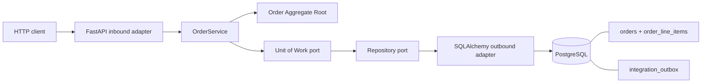
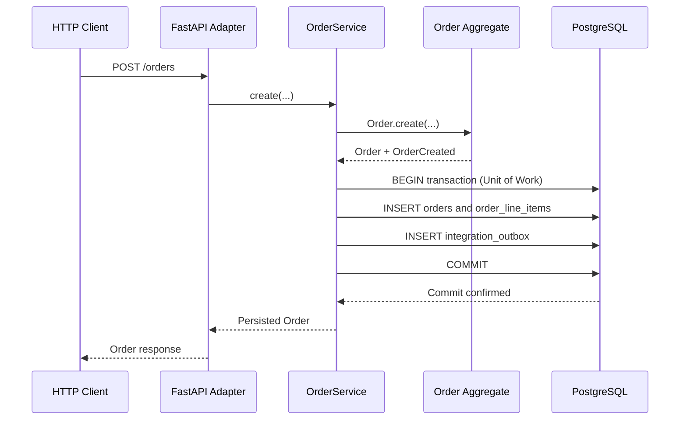

# DDD Aggregates and Domain Events — Order Service

A runnable **FastAPI + PostgreSQL** service demonstrating **Domain-Driven Design (DDD)** with **Hexagonal Architecture (Ports & Adapters)**. The `Order` Aggregate Root owns its business invariants, while an application service uses a Repository and Unit of Work to commit the **current order state** and selected **outgoing integration-event intents** in one local SQL transaction.

This example belongs to **[Chapter 4 — Microservices Coordination and Orchestration](../README.md)** of *Information Systems Design and Big Data*. It illustrates aggregate boundaries and local transactional consistency. It **does not implement Event Sourcing** or a message publisher.

## What it demonstrates

- **Aggregate Root and transaction boundary:** the `Order` root controls state transitions and access to its `OrderLineItem` children. Clients cannot directly assign `order.state` or mutate `order.line_items`.
- **Entity and value-like objects:** `Order` has identity; immutable `OrderLineItem` objects are compared by value. `consumer_id` and `restaurant_id` reference other aggregates by **ID**, not by object reference.
- **Factory method and invariants:** `Order.create()` requires at least one line item. Child items require positive quantities and nonnegative prices; the last item cannot be removed. Only a pending order with a positive total can be approved.
- **Application Service, Repository, Unit of Work:** `OrderService` coordinates use cases; the aggregate owns business decisions; persistence depends on interfaces rather than SQLAlchemy internals.
- **Domain Events and Outbox:** `OrderCreated` and `OrderApproved` are immutable domain facts. Selected events are serialized as outgoing intents in `integration_outbox`, atomically with the current-state SQL update.
- **Optimistic concurrency:** the repository checks `version_id` when updating an aggregate and reports stale writes as HTTP `409 Conflict`.

`OrderService` is an **application service**, not a separate DDD *domain service*. The business rules in this example belong to the `Order` Aggregate Root, so there is no need for an additional domain service.

## Architecture



Changes to an `Order` happen through root operations such as `approve()`, `add_item_to_order()` and `remove_item_from_order()`. The `line_items` property returns an immutable tuple of immutable `OrderLineItem` objects. The application coordinates transaction boundaries, but never bypasses aggregate invariants to edit its business state.

### Create an order and persist the Outbox intent



The SQL transaction is **local to one service**, not a distributed transaction. The event payload saved in `integration_outbox` represents an intent for external communication; it is **not** the authoritative state of the order, and no publisher runs in this project. The production-oriented concern of reliably relaying an Outbox entry to a broker is separate.

## Requirements and setup

- Docker with Docker Compose
- `make` and `curl`
- Python 3 and the dependencies from `requirements.txt` for optional local test execution

From this directory:

```bash
make up
make create
make events
make db
```

| Endpoint | URL |
|---|---|
| OpenAPI documentation | <http://localhost:8003/docs> |
| Read-only Outbox diagnostics | <http://localhost:8003/lab/outbox> |
| Adminer database UI | <http://localhost:8083> |

For Adminer choose PostgreSQL, server `db`, database `ftgo`, username `ftgo`, password `ftgo` (local Docker configuration only).

`make create` returns an order `id`, `row_version=1` and `APPROVAL_PENDING` state. Inspect `orders`, `order_line_items` and `integration_outbox`; the inserted `OrderCreated` intent shares the same committed transaction as the order's state.

### Approve through the Aggregate Root

Replace `ORDER_ID` with the `id` returned above:

```bash
make approve ORDER_ID=<order-id> VERSION=1
make events
```

The application reloads the aggregate, calls `order.approve()`, and stores the `APPROVED` state plus an `OrderApproved` Outbox entry in the same transaction. A second approval is rejected by the aggregate. The in-memory Domain Event is not itself a Kafka record or an event-store entry.

### Verify optimistic locking

Set `ORDER_ID` to an existing pending order ID. Run the following request **twice with the same** `expected_version`:

```bash
ORDER_ID=<order-id>
curl -i -sS -X POST "http://localhost:8003/orders/${ORDER_ID}/items" \
  -H 'Content-Type: application/json' \
  -d '{"expected_version":1,"menu_item_id":"SALAD","name":"Salad","price":5,"quantity":1}'
```

The first request succeeds and increments the version; the second returns **HTTP 409**. SQL-level compare-and-update also detects two concurrent updates that both loaded the same version, including when the HTTP caller omitted `expected_version`.

### Inspect the domain model without a database

```bash
DATABASE_URL=sqlite+pysqlite:///:memory: python -m examples.domain_events
```

This script creates an `Order` and collects its `OrderCreated` domain notification in memory, without publishing or persisting messages. The separate HTTP service persists outgoing intents using its Unit of Work.

## Testing

```bash
make test          # Run the Python suite in a container (Docker required)
make test-local    # Run the suite in your local Python environment
```

For `make test-local`, install `requirements.txt` first; tests use a local in-memory **SQLite** database through SQLAlchemy rather than PostgreSQL. The suite verifies business invariants, read-only aggregate state, immutable child values, event generation, version checks, and atomic Outbox/aggregate rollback. Running the full PostgreSQL Docker stack is a separate integration check.

## Code map

| Layer | Location | Responsibility |
|---|---|---|
| Domain | `app/domain/models.py` | `Order` root, immutable `OrderLineItem`, `OrderCreated`, `OrderApproved`, business rules |
| Application | `app/application/order_service.py` | Use cases; coordinates one Unit of Work and collects domain notifications |
| Ports | `app/ports/` | Repository and Unit of Work contracts |
| Inbound adapters | `app/adapters/inbound/` | FastAPI requests and response serialization; read-only diagnostics |
| Outbound adapters | `app/adapters/outbound/` | SQLAlchemy Repository and Unit of Work |
| Infrastructure | `app/infrastructure/` | SQL tables, SQLAlchemy engine and mappings |
| Examples | `examples/domain_events.py` | Isolated Domain Event illustration |
| Tests | `tests/` | Domain, application and transactional persistence behavior |

## Design boundaries and limitations

- **Not Event Sourcing:** `orders` and `order_line_items` contain current state. The Outbox is not an Event Store, and the aggregate is not rebuilt from historical events.
- **No message broker or publisher:** an Outbox row is written but not delivered. A separate relay and idempotent consumers would be required for reliable integration messaging.
- **Domain vs integration contract:** this compact example copies selected domain-event fields to an Outbox payload. A production-facing integration API would normally define and version an independent public event schema.
- **One aggregate per transaction:** the order and its children form the consistency boundary. The Outbox entry is accompanying local infrastructure data; `Consumer` and `Restaurant` are referenced by ID rather than changed within the same transaction.
- **Concurrency:** optimistic version checks protect concurrent SQL updates, while DDD invariants protect valid business transitions. These solve different problems.
- **Simplified monetary model:** prices use `float`. Money-sensitive applications should use `Decimal` with explicit currency semantics. Authentication, operational monitoring and production migration tooling are also outside this example.

## Cleanup

```bash
make down
make reset  # removes the local PostgreSQL Docker volume
```
