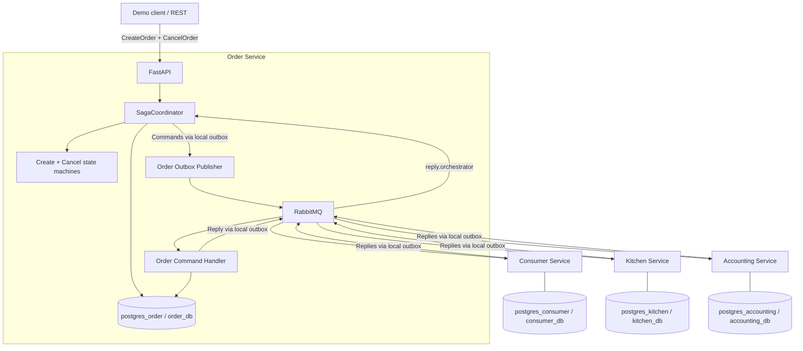
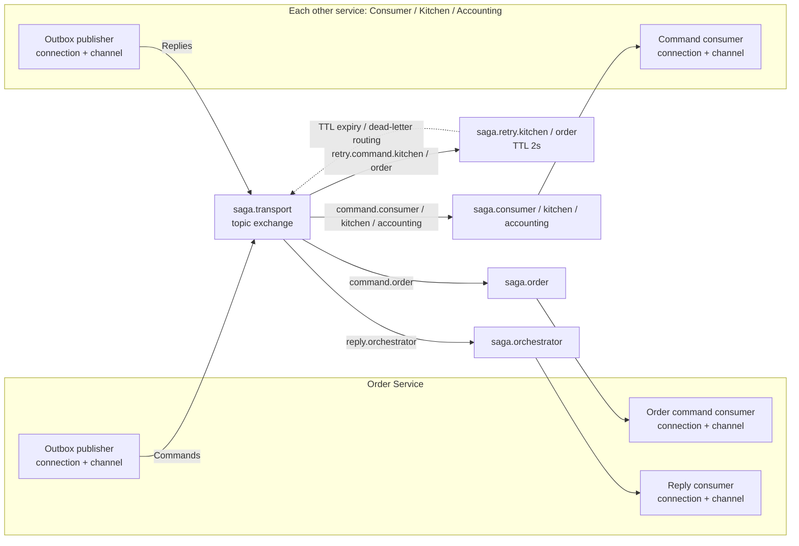
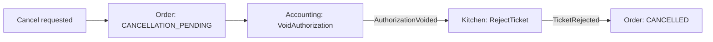
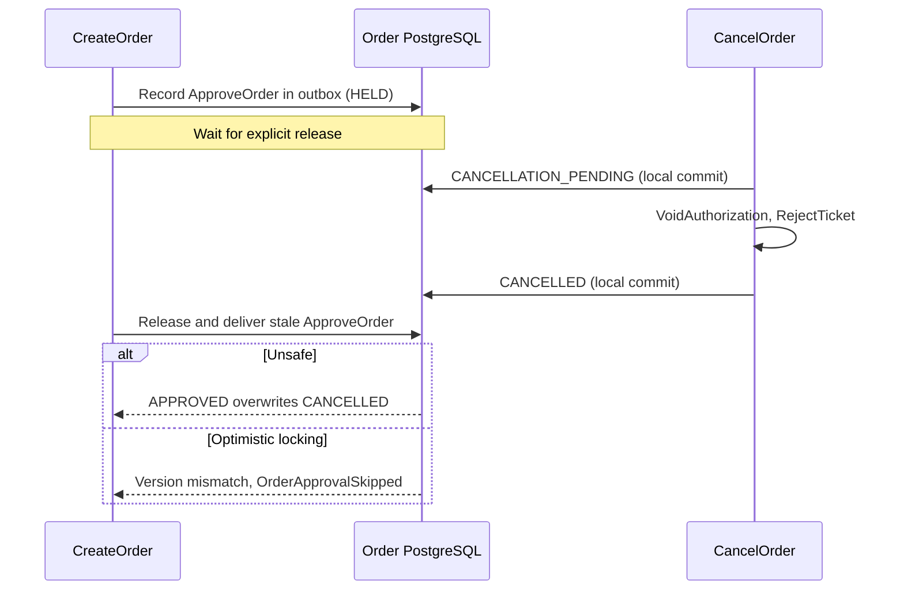

# Saga Isolation — Competing CreateOrder and CancelOrder Sagas

An **independent, runnable extension** of the Chapter 4 Saga Orchestration lab.
It keeps the same hexagonal architecture, RabbitMQ commands/replies, durable
outbox/inbox, idempotent handlers, and **four PostgreSQL instances**, but adds
one concurrent business workflow (`CancelOrder`) to demonstrate why **ACID
transactions in each service do not automatically isolate two Sagas**.

This lab is deliberately separate from `saga-orchestration`: no other repo
folder or running Compose project is needed. **The `unsafe` path is a teaching
fault, explicitly opt-in; normal orders keep their original guarded update.**

## 1. Architecture overview



Each participant owns its own database; there are no cross-service SQL joins.
Order's `SagaCoordinator` and its `Order Command Handler` belong to the same
Order Service and share `order_db`. **Cancellation uses a second state machine**
with a persistent `cancel_sagas` row and history.

## 2. AMQP connections, channels, and routing



The diagram groups the three participant services for readability; each has
its **own** connection/channel for consuming and another for its Outbox
publisher. Pika `BlockingConnection` objects are not shared across threads.
`app/topology.py` provisions the exchange, queues, and bindings with a temporary
connection/channel. RabbitMQ **topic exchange ≠ Kafka topic**.

| Queue | Binding key on `saga.transport` | Who consumes |
|---|---|---|
| `saga.orchestrator` | `reply.orchestrator` | Order SagaCoordinator |
| `saga.order` | `command.order` | Order Command Handler |
| `saga.consumer` | `command.consumer` | Consumer Service |
| `saga.kitchen` | `command.kitchen` | Kitchen Service |
| `saga.accounting` | `command.accounting` | Accounting Service |
| `saga.retry.order` | `retry.command.order` | No active consumer: 2s TTL → `command.order` |
| `saga.retry.kitchen` | `retry.command.kitchen` | No active consumer: 2s TTL → `command.kitchen` |

The two TTL queues handle **controlled delayed retries**, not terminal DLQs.
Unexpected handler errors are rejected, but this teaching lab does **not**
implement a production-grade terminal DLQ and recovery workflow.

## 3. Two real business workflows

**CreateOrder Saga** (same as the Orchestration lab):

```text
VerifyConsumer -> CreateTicket -> AuthorizeCard -> ApproveTicket -> ApproveOrder
     |                |                |
     +-> RejectOrder  +-> RejectOrder  +-> RejectTicket -> RejectOrder
```

**CancelOrder Saga** (new; cancellation is valid after card authorization and
ticket creation, not at arbitrary points in the CreateOrder workflow):



The local Order transaction commits `CANCELLATION_PENDING`, creates a
`cancel_sagas` record, and enqueues `VoidAuthorization` **atomically**. Replies
advance `CancelOrderStateMachine`. Accounting writes `VOIDED` in its own DB;
Kitchen writes `REJECTED` in its own DB. Finally Order commits `CANCELLED`.
`VoidAuthorization` models reversing a **card authorization**, not refunding a
captured payment. Cancellation can remain `CANCELLATION_PENDING` if a
compensating command fails: local ACID is **not** distributed ACID.

## 4. Deterministic isolation experiments

When `isolationMode` is `unsafe`, `semantic`, or `optimistic`, CreateOrder
proceeds normally until it **atomically stores an `ApproveOrder` command in its
outbox marked `held=true`**. The gate in `approval_gates` becomes `PAUSED`.
The publisher skips only held messages: it can still publish CancelOrder
commands, and RabbitMQ consumers keep processing normally. No SQL locks are
kept open while the student inspects the scenario.



| Experiment | Competing CancelOrder while `APPROVAL_PENDING` | Expected final state |
|---|---|---|
| `unsafe` | Accepted; completes, then stale `ApproveOrder` overwrites `CANCELLED` | **APPROVED** (wrong; Accounting=`VOIDED`, Kitchen=`REJECTED`) |
| `semantic` | Refused with HTTP **409**, because CreateOrder owns a semantic lock; after CreateOrder completes, cancellation is allowed | **CANCELLED** (correct; sequential workflows) |
| `optimistic` | Accepted; version increments during cancellation; stale `ApproveOrder` fails a **conditional SQL UPDATE** | **CANCELLED** (correct) |

The `unsafe` code *deliberately bypasses the usual state guard* to make the
anomaly visible; it is **not** caused by a PostgreSQL bug or by weak local
transaction isolation. In `optimistic`, the guarded UPDATE checks **both**
`status='APPROVAL_PENDING'` and the `version` captured when `ApproveOrder` was
queued. A stale command produces `OrderApprovalSkipped`, so CreateOrder never
concludes with a false approval. In `semantic`, the 409 means the client must
retry its **request later**, not that RabbitMQ should retry a command.

## 5. Run locally

Requires Docker Compose v2 and Python 3 (stdlib only) for the scenario script.
Use a free `8001` (Order API), `8082` (Adminer), and `15673` (RabbitMQ UI).
**Stop the separate Saga Orchestration lab first**, because it exposes the
same host ports. From this directory:

```bash
make up
make status
make unsafe       # Demonstrate lost update / missing saga isolation
make semantic     # Reject concurrent cancellation; then cancel after approval
make optimistic   # Accept concurrency; protect ApproveOrder with version check
make logs         # Optional live view of transitions and compensating commands
```

Each `make <scenario>` creates **a fresh order** and reports its UUID. The
script waits for the durable `PAUSED` gate, starts CancelOrder, waits until
compensation completes, and releases the held approval command. It does not
rely on timing guesses or randomly overlapping transactions. Failure to
reach the expected state makes the script exit nonzero.

Other commands: `make approve`, `make decline`, `make invalid`, `make retry`,
`make ticket-failure`, `make order ORDER_ID=...`, `make history ORDER_ID=...`,
`make cancel-history ORDER_ID=...`, `make gate ORDER_ID=...`, and
`make release ORDER_ID=...`. For a manual run, use the API docs at
`http://localhost:8001/docs`.

### Inspect the four databases

Open **Adminer** at `http://localhost:8082` (PostgreSQL; user `demo`, password
`demo`), selecting the correct server/database pair:

| Server | Database | Useful tables |
|---|---|---|
| `postgres_order` | `order_db` | `orders`, `sagas`, `saga_history`, `cancel_sagas`, `cancel_history`, `approval_gates`, `outbox`, `inbox` |
| `postgres_consumer` | `consumer_db` | `command_results`, `inbox`, `outbox` |
| `postgres_kitchen` | `kitchen_db` | `tickets`, `command_results`, `inbox`, `outbox` |
| `postgres_accounting` | `accounting_db` | `authorizations`, `command_results`, `inbox`, `outbox` |

Suggested SQL against `order_db`:

```sql
SELECT order_id, status, version, isolation_mode FROM orders ORDER BY order_id;
SELECT order_id, stage FROM sagas;
SELECT order_id, stage FROM cancel_sagas;
SELECT order_id, state FROM approval_gates;
SELECT routing_key, held, sent, payload FROM outbox ORDER BY created_at;
SELECT order_id, event, to_stage FROM cancel_history ORDER BY seq;
```

On `kitchen_db` run `SELECT * FROM tickets;`, and on `accounting_db` run
`SELECT * FROM authorizations;`. A deliberately unsafe result is visibly
**inconsistent across services**. For cleanup, `make down` stops containers;
`make reset` deletes **all volumes and persisted lab data**.

## 6. Code map and guarantees

| Path | Purpose |
|---|---|
| `app/domain/state_machine.py` | Existing CreateOrder transitions + `OrderApprovalSkipped` |
| `app/domain/cancel_state_machine.py` | CancelOrder transitions and compensating commands |
| `app/application/saga_coordinator.py` | Starts both Sagas; semantic-lock policy; durable outbox gate |
| `app/application/saga_participant_handler.py` | Participants, `VoidAuthorization`, unsafe/optimistic approval choices |
| `app/ports/storage.py` | Persistence interfaces, independent of SQLAlchemy |
| `app/adapters/outbound/postgres_store.py` | SQL transactions, conditional updates, four DB schemas, Inbox/Outbox |
| `app/adapters/outbound/rabbitmq_transport.py` | AMQP publisher confirms |
| `app/adapters/inbound/rabbitmq_consumer.py` | Manual ACK after commit, no endless requeue |
| `demo/run_scenario.py` | Deterministic end-to-end demonstrator, no Python dependencies |
| `tests/` | Broker-free workflow tests and optional PostgreSQL integration test |

The atomic boundary is **local**: a business update and its own Outbox row
commit together. RabbitMQ delivery is **at-least-once**; Inbox and
`command_results` support idempotency. No two-phase commit, distributed SQL
transaction, or Event Sourcing is implemented. Each experiment uses new
orders, so test runs do not interfere with each other.

This is a teaching demonstration, **not production-ready cancellation logic**:
there is no general retry/DLQ recovery for unexpected compensation failures,
no refund/settlement integration, and the `unsafe` policy must never be used
outside an isolated classroom environment. `APPROVAL_PENDING` is a *business
semantic lock*, not a database row lock held throughout CreateOrder.

### Tests

```bash
python3 -m pip install -r requirements.txt
make test
```

The default tests require no broker. One optional real-PostgreSQL integration
test is skipped unless `TEST_DATABASE_URL` targets an **empty disposable**
PostgreSQL database. For full integration, use `make up` and run all three
`make` scenarios. The Docker end-to-end check is **not** automatically part
of `make test`.
