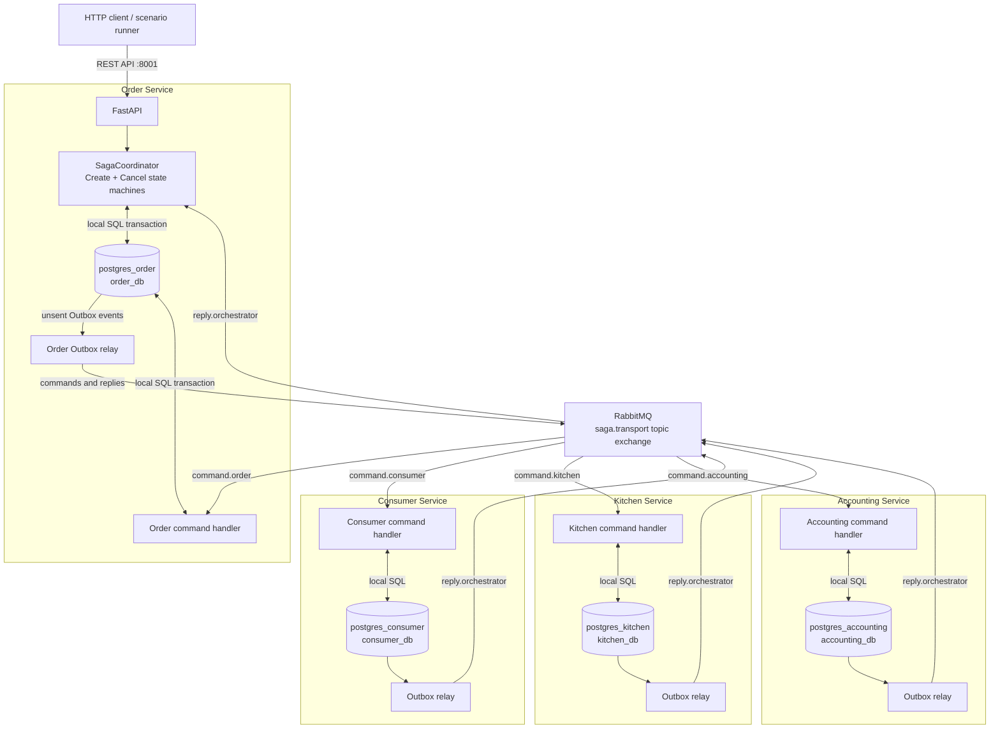
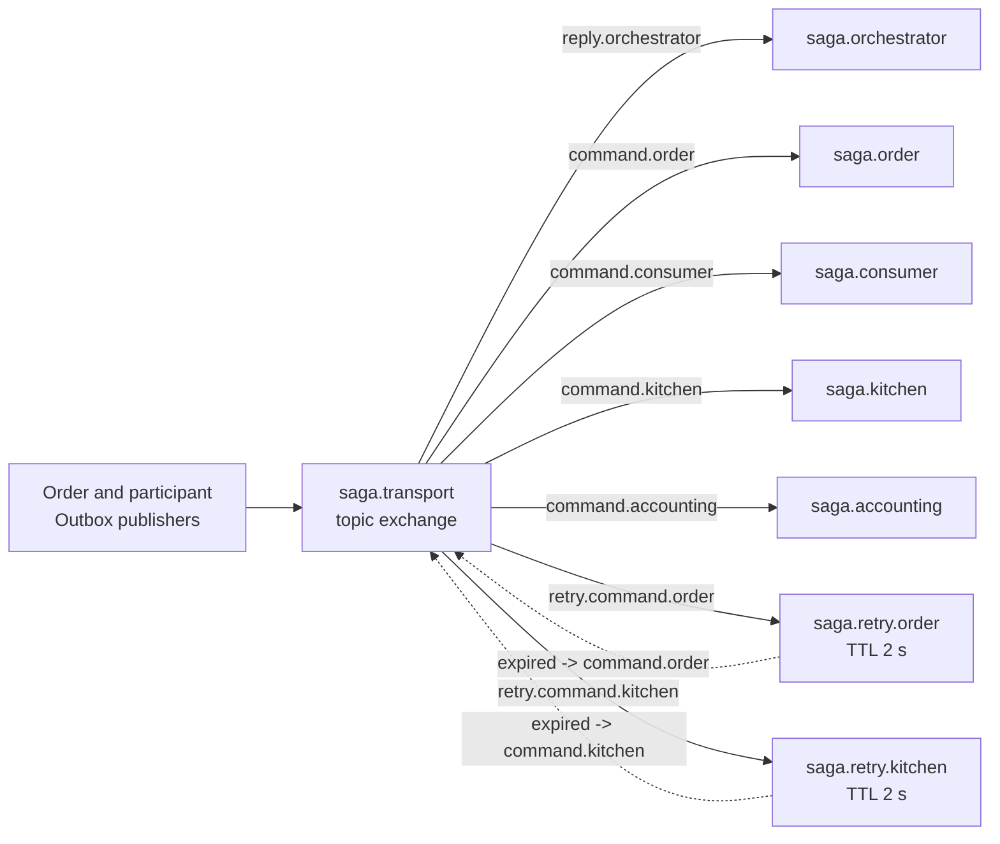
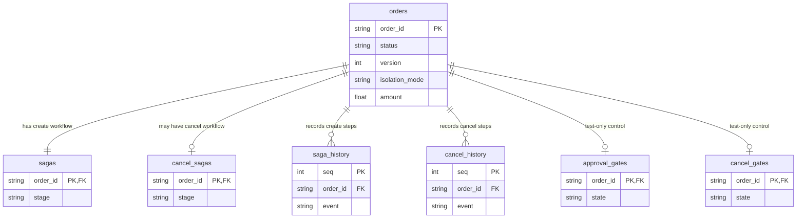
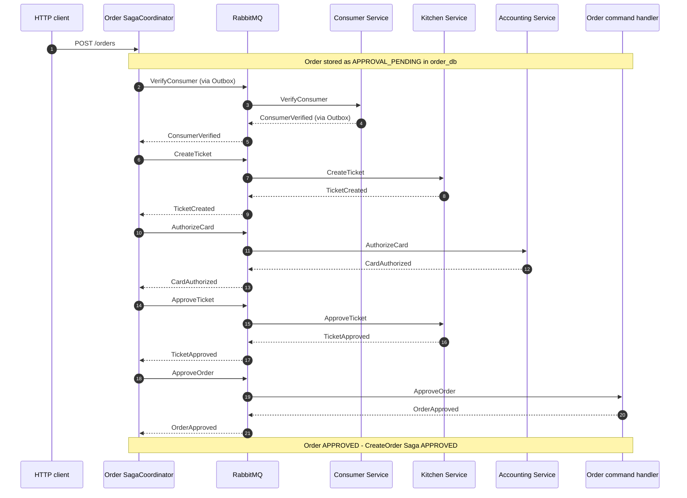
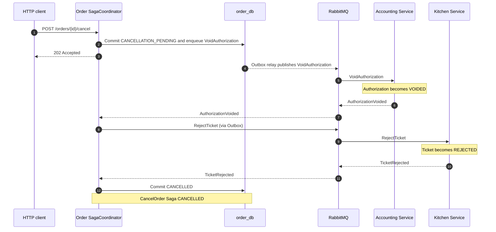
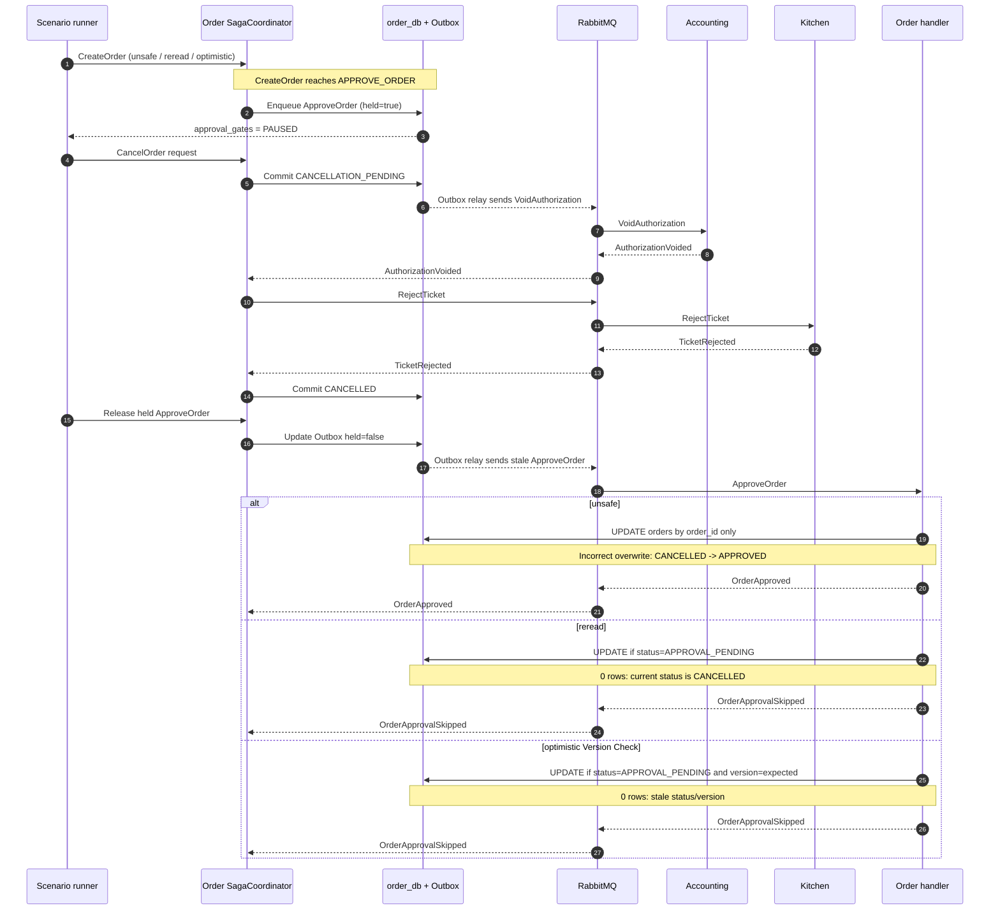
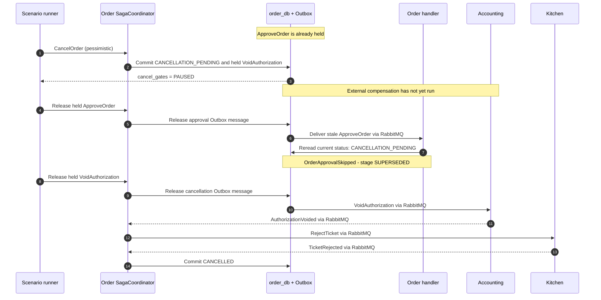
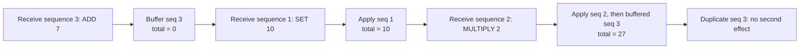

# Saga Isolation — Countermeasure Examples

A runnable **FastAPI + PostgreSQL + RabbitMQ** project that explores **isolation anomalies in orchestrated Sagas**. A `CreateOrder` workflow can overlap with a competing `CancelOrder` workflow, even though every participating service uses local ACID transactions. Four services own four independent PostgreSQL databases; **Transactional Outbox**, **idempotent Inbox** processing, and RabbitMQ connect their operations without a global transaction.

The code follows **Hexagonal Architecture (Ports & Adapters)**: domain state machines and policies in `app/domain/`, workflow use cases in `app/application/`, persistence contracts in `app/ports/`, and database/messaging implementations in `app/adapters/`.

The project uses **current-state SQL persistence**, not Event Sourcing. Its independent Version File example stores a sequenced operation buffer, **not** the authoritative event stream of an Order aggregate.

## What this project demonstrates

- A **lost-update anomaly across Saga steps**, despite correct local database transactions.
- **Semantic Lock**, **Pessimistic View**, **Commutative Updates**, **Reread Value**, **Version File**, and **By Value** as different ways to reduce specific concurrency risks.
- **Version Check** as an additional optimistic-concurrency example, distinct from Version File.
- Durable messaging boundaries using **Outbox/Inbox**, local transactions, message identifiers, and idempotent handlers.
- A concrete **Ports & Adapters** implementation without coupling the domain logic to PostgreSQL or RabbitMQ.

## Prerequisites and quick start

Install Docker with **Compose v2**, `make`, and Python 3 on the host. Run this stack separately from other Compose projects that may bind the same host ports.

```bash
make up       # Start Order, Consumer, Kitchen, Accounting and their dependencies
make status   # Inspect container status
make demo     # Run all scenarios and check their expected outcomes
make down     # Stop containers while preserving volumes
```

All scenarios are **automated and noninteractive**: they create fresh orders, hold selected outgoing messages, release them in a controlled sequence, and assert the final states. This controlled timing makes concurrent outcomes reproducible without leaving SQL transactions or RabbitMQ deliveries open.

For a smaller set, use `make demo-saga` (competing Saga scenarios) or `make demo-extra` (the independent PostgreSQL credit and Version File examples). Individual targets are listed in [Run and inspect](#run-and-inspect).

### Scenario synchronization gates (test-only instrumentation)

The **gate is not a Saga pattern, an isolation countermeasure, or a business lock**. It exists solely to control message timing for reproducible concurrency scenarios:

1. The scenario runner waits until `ApproveOrder` (or `VoidAuthorization`) has been committed to the **Outbox**, with `outbox.held = true`. The relay ignores held rows.
2. `approval_gates` and `cancel_gates` record which simulated delivery is paused; they are scenario-control tables, **not** business-domain state.
3. The runner releases the selected message using the `release` or `release-cancel` endpoint. The relay can then publish the already-committed message to RabbitMQ.

The **actual isolation behavior** comes from the domain and persistence rules: `APPROVAL_PENDING` for **Semantic Lock**, `CANCELLATION_PENDING` for **Pessimistic View**, current-state predicates for **Reread Value**, and version predicates for **Version Check**. A gate merely creates time to observe those rules; it prevents no business anomaly by itself. In particular, `CANCELLATION_PENDING` is a real order state, while `cancel_gates` is only a synchronization control.

The gates are included in the sample application's runtime to support the automated scenarios. They are **not intended for production deployment**, are not an authorization boundary, and do not implement a long-held database transaction, a distributed lock, or an open AMQP acknowledgement. The regular `normal` flow does not use them. See `demo/run_scenario.py`, `app/application/saga_coordinator.py`, and `app/adapters/outbound/postgres_store.py` for the implementation.

## Countermeasure summary and commands

The following examples are independent entry points that can be run after `make up`.

| Concept / scenario | Command | Mechanism | Expected result | Implementation |
|---|---|---|---|---|
| **Unsafe baseline: lost update** | `make unsafe` | A deliberately unguarded approval overwrites a completed cancellation. | Order becomes `APPROVED`, even though Accounting is `VOIDED` and Kitchen is `REJECTED`. | [`unsafe_approve()`](app/adapters/outbound/postgres_store.py) |
| **Semantic Lock** | `make semantic` | `APPROVAL_PENDING` is a business-state lock; cancellation is refused while creation is pending. | Concurrent cancellation returns HTTP `409`; cancellation can succeed after creation. | [`cancel_order()`](app/application/saga_coordinator.py) |
| **Commutative Updates** | `make commutative` | Atomic relative credit updates (`balance = balance + delta`) with a unique operation ID. | `+25, -10` and `-10, +25` both yield `115`; duplicate operations do not apply twice. | [`adjust_credit()`](app/adapters/outbound/postgres_store.py) |
| **Pessimistic View** | `make pessimistic` | Commit `CANCELLATION_PENDING` before compensating external actions; use the scenario-only message hold to observe that intermediate state. | The protective status is visible before authorization is voided; the order eventually becomes `CANCELLED`. | [`cancel_order()`](app/application/saga_coordinator.py), [`start_cancellation()`](app/adapters/outbound/postgres_store.py) |
| **Reread Value** | `make reread` | Atomic conditional approval tests the order's **current** status. | A stale `ApproveOrder` is skipped; the order remains `CANCELLED`. | [`reread_approve()`](app/adapters/outbound/postgres_store.py) |
| **Version Check (optimistic concurrency)** | `make optimistic` | Atomic approval compares the expected version **and** current status. | A late approval is rejected after a competing cancellation updates the version. | [`optimistic_approve()`](app/adapters/outbound/postgres_store.py) |
| **Version File** | `make version-file` | Durable per-stream operation log buffers gaps and applies noncommutative operations in sequence order. | Operations arrive `3,1,2` but execute `1,2,3`, producing `27` instead of `20`. | [`apply_versioned()`](app/adapters/outbound/postgres_store.py) |
| **By Value** | `make by-value` | Selects a concurrency strategy from a simplified order-value threshold. | Amount `42` selects `reread`; `90` selects `semantic`. | [`select_isolation_mode()`](app/domain/isolation_policy.py) |

**Important distinctions:** Pessimistic View does **not** by itself reject an outdated approval: the implementation also checks the current status with **Reread Value**. Version Check and Version File solve **different problems**. By Value is **policy selection**, not a standalone isolation primitive.

### Version Check vs Version File

Version Check protects one state transition using an optimistic compare-and-set. The actual approval is based on an atomic conditional update equivalent to:

```sql
UPDATE orders
   SET status = 'APPROVED', version = version + 1
 WHERE order_id = :id
   AND status = 'APPROVAL_PENDING'
   AND version = :expected_version;
```

When this statement affects **zero rows**, the approval handler returns `OrderApprovalSkipped` and the CreateOrder workflow becomes `SUPERSEDED`. Both predicates are evaluated in the **same SQL operation**, avoiding a check-then-write race. Version File, by contrast, stores and **orders** operations that may arrive out of sequence; it is not a variant of compare-and-set and is not Event Sourcing.

## Architecture: Hexagonal (Ports & Adapters)



**Ports and adapters in the running example**

| Layer | Files | Responsibility |
|---|---|---|
| Domain | `app/domain/state_machine.py`, `cancel_state_machine.py`, `isolation_policy.py` | Pure transitions and policy selection; no SQL or RabbitMQ imports |
| Application | `app/application/saga_coordinator.py`, `saga_participant_handler.py` | Orchestration, command handling, local consistency boundaries |
| Port | `app/ports/storage.py` | `SagaStore` and transaction-scoped `SagaTransaction` protocols |
| Inbound adapters | `app/main.py`, `app/adapters/inbound/rabbitmq_consumer.py` | HTTP requests and AMQP deliveries |
| Outbound adapters | `app/adapters/outbound/postgres_store.py`, `rabbitmq_transport.py` | Transactional persistence and broker publication |
| Composition root | `app/main.py` | Connects concrete adapters to application services by service role |

The two handlers in the Order Service are not separate microservices: they
share `order_db`. Each other participant owns **its own database**. All outgoing
messages are recorded in the **same local database transaction** as their
business updates, then sent asynchronously by a relay. Each receiving service
uses its Inbox and idempotency records to handle at-least-once delivery.
There is **no cross-database ACID transaction**.

### RabbitMQ topology and retry queues



| Queue | Binding key | Consumer / purpose |
|---|---|---|
| `saga.orchestrator` | `reply.orchestrator` | Order SagaCoordinator |
| `saga.order` | `command.order` | Order command handler |
| `saga.consumer` | `command.consumer` | Consumer command handler |
| `saga.kitchen` | `command.kitchen` | Kitchen command handler |
| `saga.accounting` | `command.accounting` | Accounting command handler |
| `saga.retry.order` | `retry.command.order` | 2-second delay; dead-letters back as `command.order` |
| `saga.retry.kitchen` | `retry.command.kitchen` | 2-second delay; dead-letters back as `command.kitchen` |

`app/topology.py` declares the exchange and queues. RabbitMQ connections and
channels are **local to their consumer/publisher threads**; Pika's
`BlockingConnection` is not shared across threads. These retry queues provide
controlled delays, **not** a complete dead-letter/recovery strategy.

## Persistence boundaries and schema

The following simplified ER diagram covers **only the Order Service database**.
It shows the actual foreign-key relationships involved in the main Saga
examples. The three participant databases do not have cross-database foreign
keys to `orders`.



The Order database also contains the generic `inbox` and `outbox` tables, and
two **independent example datasets**:

| Standalone example | Order-database tables | Purpose |
|---|---|---|
| Commutative Updates | `credit_balances`, `credit_adjustments` | Additive credit changes and deduplication by operation ID |
| Version File | `version_file_states`, `version_file_events` | Persistent per-stream operation sequencing and buffering |

The Credit and Version File examples do **not** modify orders, tickets, card
authorizations, or either Saga state machine. `outbox.gate_order_id` is used by
the scenario runner to locate held messages; it is **not** a declared foreign key.
`approval_gates`, `cancel_gates`, and `outbox.held` are test-only scenario controls,
not consistency guarantees or part of the business domain model.

## Sequence diagrams: CreateOrder, CancelOrder, and competing Sagas

### Normal CreateOrder flow (successful path)



### Normal CancelOrder flow (compensating steps)



`CANCELLATION_PENDING` is committed **before** asynchronous compensations are
published. This ordering is used for every successful cancellation, and is
made especially visible in `make pessimistic` using a scenario-only gate. `VoidAuthorization` cancels an
**authorization**, not a settled-card refund.

### Competing Sagas: stale approval (unsafe vs protected)

The following sequence diagram covers `make unsafe`, `make reread`, and
`make optimistic`. The scenario runner first lets CreateOrder reach `APPROVE_ORDER`
but holds its outgoing `ApproveOrder` in the durable Outbox. CancelOrder then
finishes and the old approval is released. **The hold is scenario-only instrumentation:** no PostgreSQL transaction stays
open while that message is held.



| Mode | Final order status | Final CreateOrder stage | Cancellation stage | Accounting | Kitchen |
|---|---|---|---|---|---|
| `unsafe` | **APPROVED (incorrect)** | `APPROVED` | `CANCELLED` | `VOIDED` | `REJECTED` |
| `reread` | `CANCELLED` | `SUPERSEDED` | `CANCELLED` | `VOIDED` | `REJECTED` |
| `optimistic` | `CANCELLED` | `SUPERSEDED` | `CANCELLED` | `VOIDED` | `REJECTED` |

This is an intentional business-workflow anomaly, **not** a PostgreSQL dirty
read or local-transaction ACID failure. In `reread_approve()`, the status
predicate is evaluated **atomically with the update**. In
`optimistic_approve()`, the *same* update also checks a previously captured
version. A failed protected approval emits `OrderApprovalSkipped` and moves
the CreateOrder state machine to `SUPERSEDED`.

### Semantic Lock and Pessimistic View: different timing

**Semantic Lock:** `make semantic` refuses cancellation with HTTP `409` while
the order is `APPROVAL_PENDING`. The scenario runner releases approval, waits for
`APPROVED`, and only then cancels the order. The **Semantic Lock** is the
status-based refusal of cancellation, **not** the release mechanism.

**Pessimistic View:** `make pessimistic` starts cancellation even though the old
approval message is held. It commits `CANCELLATION_PENDING`, then **temporarily holds
`VoidAuthorization` as test instrumentation**, exposing the protective status
before the external actions. The scenario runner releases the stale approval first (rejected
by **Reread Value**) and then releases the compensating command.



This diagram deliberately shows the effective delivery steps rather than
individual queues at every hop. **Pessimistic View is a sequencing
countermeasure, not a global lock**: rejection of the stale command also
relies on `reread_approve()`.

## Independent data-operation examples

### Commutative Updates (`make commutative`)

For each of two independent credit accounts starting at `100`, PostgreSQL
performs **relative** updates: `balance = balance + delta`.

```text
Account A: +25, -10 -> 115
Account B: -10, +25 -> 115
Duplicate +25 (same operation_id) -> unchanged 115
Compensate account A with -25 -> 90
```

This illustrates commutativity of additive adjustments and message
idempotency. It does **not** mean that real spending constraints (such as
preventing a negative balance) are automatically order-independent. The
credit-account example is not part of the Accounting Service's card
authorization workflow. The PostgreSQL adapter claims each unique operation
with `INSERT ... ON CONFLICT DO NOTHING RETURNING`. Only a new claim applies
an atomic relative balance update using `UPDATE ... RETURNING`; duplicates
leave the balance unchanged. The command validates the intermediate balances
and prints their actual values if the outcome diverges.

### Version File (`make version-file`)

Unlike Version Check, **Version File persists operations with sequence numbers
and applies them in logical order**, buffering missing predecessors. The demo
uses intentionally **noncommutative** operations:



Without sequencing, processing in arrival order `ADD 7`, `SET 10`,
`MULTIPLY 2` would instead yield **20**. If a missing sequence never arrives, this example
remains buffered until some external recovery policy intervenes; no such policy
is implemented. This is **not Event Sourcing**: the
Order aggregate is not reconstructed from this event log; the demo implements
a narrow, durable reordering mechanism.

### By Value (`make by-value`)

`select_isolation_mode()` uses a deliberately simple business threshold:

| Order amount | Selected mechanism | Behavior |
|---|---|---|
| `42` (below `75`) | `reread` | Concurrency allowed; stale approval is rejected. |
| `90` (at least `75`) | `semantic` | Cancellation while creation is pending gets HTTP `409`. |

This demonstrates **choosing** a consistency policy according to business
risk; it does **not** implement a risk model or distributed transactions.

The amount threshold is deliberately minimal: amounts **below 75** use `reread`,
while amounts **75 or above** use `semantic`. This is not a complete business-risk
assessment.

## Run and inspect

### Start the stack and run scenarios

Requires **Docker Compose v2**, Docker, `make`, and **Python 3** on the host
(the scenario client uses Python's standard library). The default host ports
are `8001` (Order API), `8082` (Adminer), and `15673` (RabbitMQ management).
Stop any other Compose project using those ports before starting.

```bash
make up
make status
make demo       # Full automatic sequence: unsafe -> semantic -> pessimistic
                # -> commutative -> reread -> optimistic -> version-file -> by-value
```

Run individual scenarios independently:

```bash
make unsafe
make semantic
make pessimistic
make commutative
make reread
make optimistic
make version-file
make by-value
```

`make demo-saga` runs only the competing-Saga examples; `make demo-extra` runs
only the two independent PostgreSQL examples. For compact stdout in an
individual Saga run, use `python3 demo/run_scenario.py optimistic --summary`.
The script creates a **new order for every Saga run**, polls the persisted gates,
releases held messages automatically, and checks the final state. The command
exits nonzero if an expected transition does not occur.

Other useful commands:

```bash
make logs                         # Stream container logs
make order ORDER_ID=<uuid>        # Show current order state
make history ORDER_ID=<uuid>      # CreateOrder Saga transitions
make cancel-history ORDER_ID=<uuid>  # CancelOrder Saga transitions
make gate ORDER_ID=<uuid>         # Approval gate state
make cancel-gate ORDER_ID=<uuid>  # Cancellation gate state
make help                         # Command index
make down                         # Stop containers, preserve data
make reset                        # DANGER: erase persistent Docker volumes
```

For additional CreateOrder scenarios, `make approve`, `make decline`,
`make invalid`, `make retry`, and `make ticket-failure` are also available.
The Swagger UI is at <http://localhost:8001/docs>.

### Inspect PostgreSQL using Adminer

Open <http://localhost:8082>; select PostgreSQL and use username `demo` and
password `demo`. Choose the relevant server/database pair:

| Server | Database | Important tables |
|---|---|---|
| `postgres_order` | `order_db` | `orders`, `sagas`, `saga_history`, `cancel_sagas`, `cancel_history`, `approval_gates`, `cancel_gates`, `inbox`, `outbox`, `credit_balances`, `credit_adjustments`, `version_file_states`, `version_file_events` |
| `postgres_consumer` | `consumer_db` | `inbox`, `outbox`, `command_results`, `command_attempts` |
| `postgres_kitchen` | `kitchen_db` | `tickets`, `inbox`, `outbox`, `command_results`, `command_attempts` |
| `postgres_accounting` | `accounting_db` | `authorizations`, `inbox`, `outbox`, `command_results`, `command_attempts` |

Useful read-only queries on `order_db`:

```sql
SELECT order_id, status, version, isolation_mode FROM orders ORDER BY order_id;
SELECT order_id, stage FROM sagas;
SELECT order_id, stage FROM cancel_sagas;
SELECT order_id, state FROM approval_gates;
SELECT order_id, state FROM cancel_gates;
SELECT routing_key, held, sent, payload FROM outbox ORDER BY created_at;
SELECT order_id, event, to_stage FROM saga_history ORDER BY seq DESC;
SELECT order_id, event, to_stage FROM cancel_history ORDER BY seq DESC;
SELECT account_id, balance FROM credit_balances ORDER BY account_id;
SELECT operation_id, account_id, delta FROM credit_adjustments ORDER BY operation_id;
SELECT stream_id, next_sequence, total FROM version_file_states;
SELECT stream_id, sequence, operation, value, applied
  FROM version_file_events ORDER BY stream_id, sequence;
```

To compare the unsafe outcome across services, inspect `tickets` in
`kitchen_db` and `authorizations` in `accounting_db` (both keyed by
`order_id`). This is a **cross-service comparison for observation**, not a
cross-database SQL join.

## Code map, tests, and limitations

| Path | Responsibility |
|---|---|
| `app/domain/state_machine.py` | CreateOrder transitions (`APPROVED`, `REJECTED`, `SUPERSEDED`) |
| `app/domain/cancel_state_machine.py` | CancelOrder sequence and compensations |
| `app/domain/isolation_policy.py` | By Value threshold and strategy selection |
| `app/application/saga_coordinator.py` | Starts and advances Sagas; semantic lock and cancellations; scenario-control hooks |
| `app/application/saga_participant_handler.py` | Handles commands, safe/unsafe approvals, and replies |
| `app/ports/storage.py` | Persistence port independent of SQLAlchemy |
| `app/adapters/outbound/postgres_store.py` | Tables, atomic local transactions, state/version guards, credit, and version log |
| `app/adapters/outbound/rabbitmq_transport.py` | AMQP transport with publisher confirms |
| `app/adapters/inbound/rabbitmq_consumer.py` | Command/reply consumers and ACKs |
| `app/topology.py` | Exchange, queues, and bindings |
| `app/demo_countermeasures.py` | Standalone Commutative Updates / Version File scripts |
| `demo/run_scenario.py` | Repeatable concurrency scenarios, test-only gate control, and assertions |
| `tests/` | Broker-free tests plus optional PostgreSQL tests |

Run static checks and unit tests:

```bash
python3 -m pip install -r requirements.txt
make verify
```

The tests run **without RabbitMQ**. Three optional PostgreSQL integration
tests require a disposable database configured with `TEST_DATABASE_URL` and
may be skipped by default. `make demo` exercises **Docker-based end-to-end scenarios**, not unit tests. If Docker is unavailable, those distributed
scenarios cannot be validated by the local test suite alone.

**Verification status of the packaged project:** the last local run reported
**29 passing tests, 3 skipped PostgreSQL integration tests, and no failures**.
Those integration tests require `TEST_DATABASE_URL` pointing to an isolated
database. Full Docker Compose execution was **not verified** in that run; the
commands above should be executed in the target environment. Source files and
tests are unchanged by this README cleanup. If ports `8001`, `8082`, or `15673`
are already occupied, stop the conflicting stack. `make reset` **deletes the
persisted Docker volumes**.

**Scope and caveats**

- The `unsafe` branch is an intentional fault and must never be
  enabled in production.
- `APPROVAL_PENDING` is a **semantic business lock**, not a SQL row lock held
  across the lifetime of a Saga.
- Saga compensation is not distributed rollback; a failed compensating
  command may leave cancellation in `CANCELLATION_PENDING`. The repo does not
  implement a complete production-grade recovery/DLQ workflow.
- The Outbox/Inbox design provides local atomicity and at-least-once
  messaging with idempotency, **not global transaction isolation**.
- Version Check is an optimistic compare-and-set; Version File is an
  operation-ordering log. Neither is presented as full Event Sourcing.
- By Value selects among demonstrated local countermeasures and is **not**
  itself an isolation technique or a promise of strong consistency.
- The gate tables and message holds are **test-only synchronization instrumentation**,
  **not** a Saga isolation technique. The sample exposes gate controls for
  reproducibility; remove or disable them before any production use.
