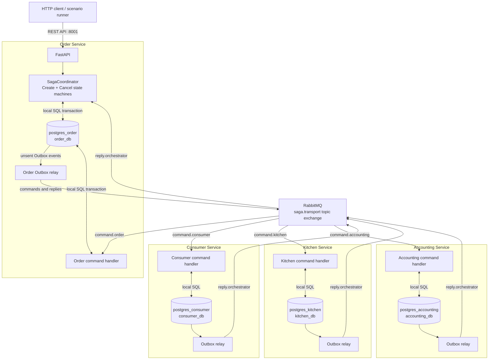
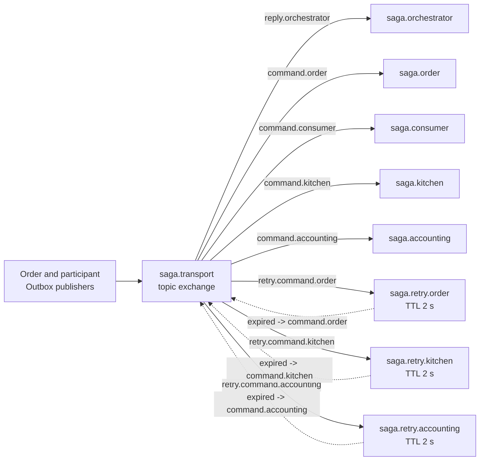
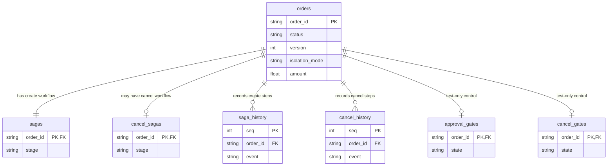
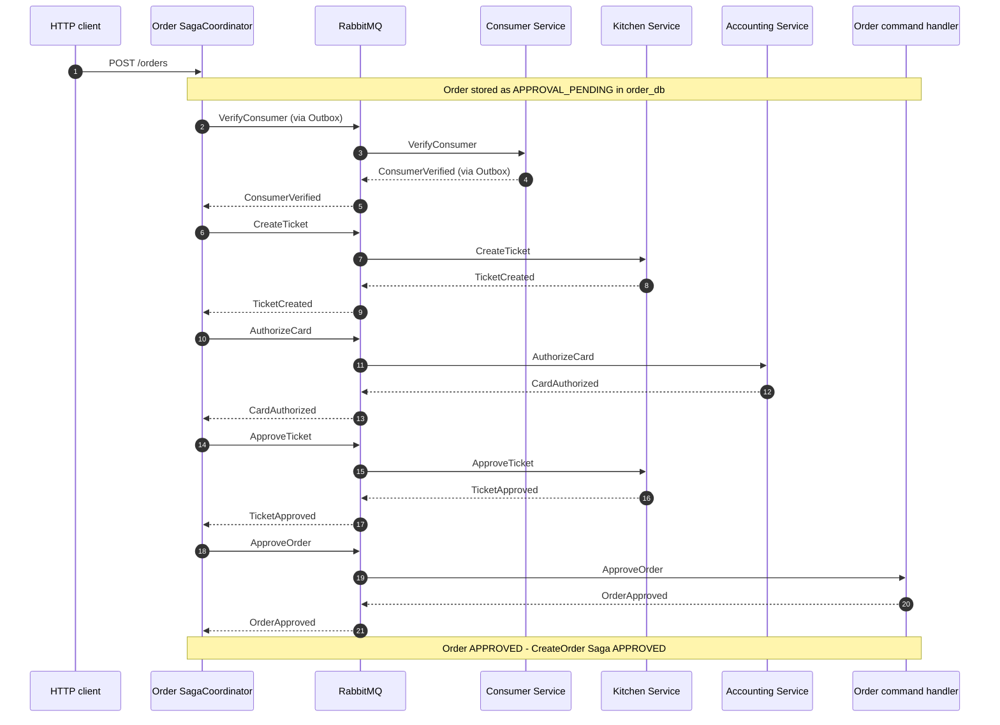
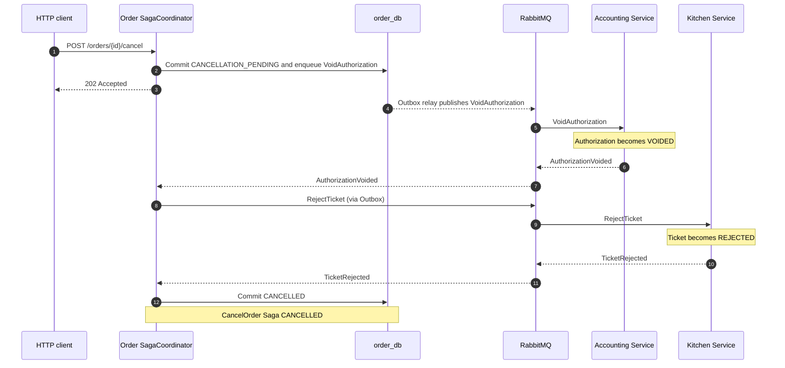
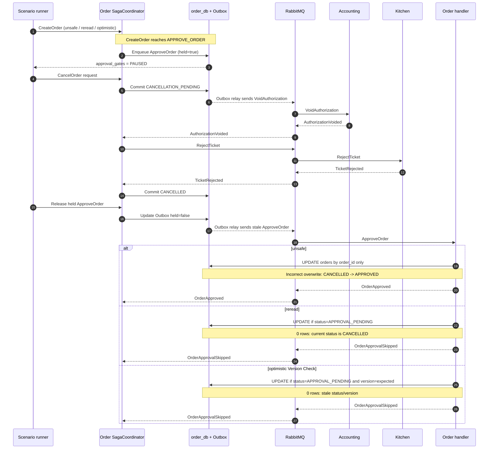
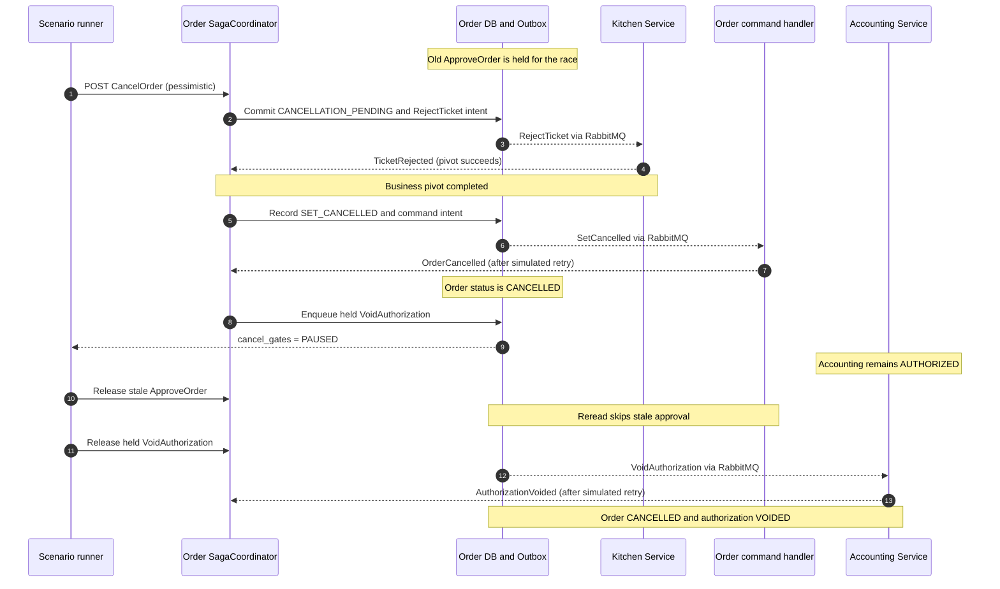
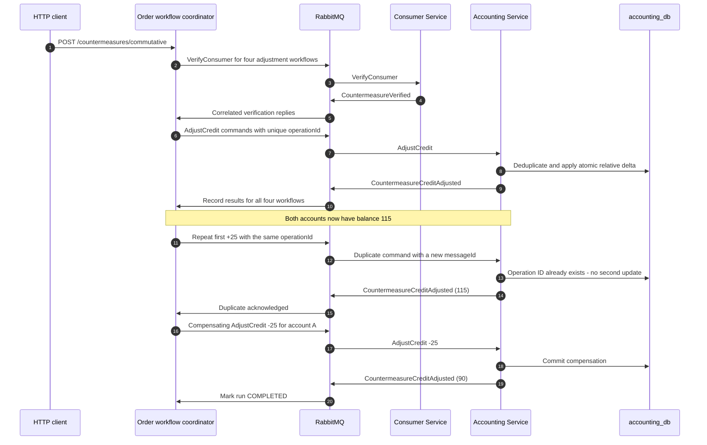
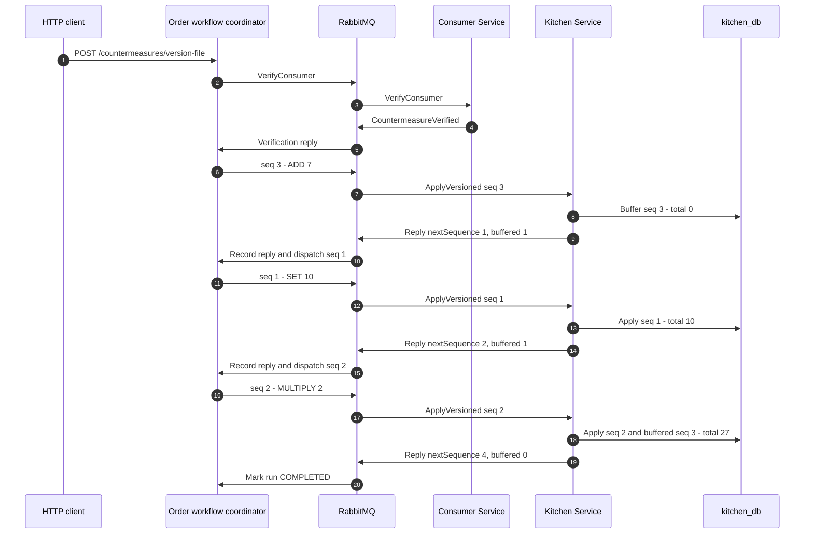

# Saga Isolation — Countermeasure Examples

A runnable **FastAPI + PostgreSQL + RabbitMQ** project that explores **isolation anomalies in orchestrated Sagas**. A `CreateOrder` workflow can overlap with a competing `CancelOrder` workflow, even though every participating service uses local ACID transactions. Four services own four independent PostgreSQL databases; **Transactional Outbox**, **idempotent Inbox** processing, and RabbitMQ connect their operations without a global transaction.

The code follows **Hexagonal Architecture (Ports & Adapters)**: domain state machines and policies in `app/domain/`, workflow use cases in `app/application/`, persistence contracts in `app/ports/`, and database/messaging implementations in `app/adapters/`.

The project uses **current-state SQL persistence**, not Event Sourcing. The Version File workflow persists a sequenced operation buffer in the **Kitchen Service**, not an authoritative event stream for the Order aggregate.

## What this project demonstrates

- A **lost-update anomaly across Saga steps**, despite correct local database transactions.
- **Semantic Lock**, **Pessimistic View**, **Commutative Updates**, **Reread Value**, **Version File**, and **By Value** as different ways to reduce specific concurrency risks.
- **Version Check** as an additional optimistic-concurrency example, distinct from Version File.
- Durable messaging boundaries using **Outbox/Inbox**, local transactions, message identifiers, and idempotent handlers.
- A concrete **Ports & Adapters** implementation without coupling the domain logic to PostgreSQL or RabbitMQ.

## Prerequisites and quick start

Install Docker with **Compose v2**, `make`, and Python 3 on the host. Run this stack separately from other Compose projects that may bind the same host ports.

```bash
make up       # Start Order, Consumer, Kitchen, Accounting and their dependencies
make status   # Inspect container status
make demo     # Run all scenarios and check their expected outcomes
make down     # Stop containers while preserving volumes
```

All scenarios are **automated and noninteractive**. The competing-Order-Saga scenarios hold and release selected Outbox messages to reproduce timing conflicts. **Commutative Updates and Version File use no gates**: they run separate coordinated workflows over REST, RabbitMQ, the Consumer Service, and the respective participant database.

For a smaller set, use `make demo-saga` (competing Order Saga scenarios) or `make demo-extra` (distributed credit and Version File workflows). Individual targets are listed in [Run and inspect](#run-and-inspect).

### Scenario synchronization gates (test-only instrumentation)

The **gate is not a Saga pattern, an isolation countermeasure, or a business lock**. It exists solely to control message timing for reproducible concurrency scenarios:

1. The scenario runner waits until `ApproveOrder` has been committed to the **Outbox** and held. In Pessimistic View, it additionally waits until **after the Kitchen pivot and the committed `CANCELLED` state**, then observes a held `VoidAuthorization`. The relay ignores held rows.
2. `approval_gates` and `cancel_gates` record which simulated delivery is paused; they are scenario-control tables, **not** business-domain state.
3. The runner releases the selected message using the `release` or `release-cancel` endpoint. The relay can then publish the already-committed message to RabbitMQ.

The **actual isolation behavior** comes from the domain and persistence rules: `APPROVAL_PENDING` for **Semantic Lock**, a **reordered cancellation workflow** for **Pessimistic View**, current-state predicates for **Reread Value**, and version predicates for **Version Check**. Pessimistic View starts with the real state `CANCELLATION_PENDING`, successfully rejects the Kitchen ticket at the pivot, commits `CANCELLED`, and only then voids the authorization. A gate only controls message timing; it prevents no business anomaly by itself. `cancel_gates` is a synchronization control, not a domain state.

The gates are included in the sample application's runtime to support the automated scenarios. They are **not intended for production deployment**, are not an authorization boundary, and do not implement a long-held database transaction, a distributed lock, or an open AMQP acknowledgement. The regular `normal` flow does not use them. See `demo/run_scenario.py`, `app/application/saga_coordinator.py`, and `app/adapters/outbound/postgres_store.py` for the implementation.

## Countermeasure summary and commands

The following examples are independent entry points that can be run after `make up`.

| Concept / scenario | Command | Mechanism | Expected result | Implementation |
|---|---|---|---|---|
| **Unsafe baseline: lost update** | `make unsafe` | A deliberately unguarded approval overwrites a completed cancellation. | Order becomes `APPROVED`, even though Accounting is `VOIDED` and Kitchen is `REJECTED`. | [`unsafe_approve()`](app/adapters/outbound/postgres_store.py) |
| **Semantic Lock** | `make semantic` | `APPROVAL_PENDING` is a business-state lock; cancellation is refused while creation is pending. | Concurrent cancellation returns HTTP `409`; cancellation can succeed after creation. | [`cancel_order()`](app/application/saga_coordinator.py) |
| **Commutative Updates** | `make commutative` | REST initiates four credit-adjustment workflows, each verified by Consumer before sending a durable RabbitMQ command to Accounting. Accounting applies relative updates and deduplicates by operation ID. | Both accounts reach `115`; a repeated `+25` is ignored and a compensating `-25` leaves Account A at `90`. | [`CountermeasureWorkflows`](app/application/countermeasure_workflows.py), [`adjust_credit()`](app/adapters/outbound/postgres_store.py) |
| **Pessimistic View** | `make pessimistic` | Commit `CANCELLATION_PENDING` (compensatable), succeed at the Kitchen `RejectTicket` pivot, set `CANCELLED` (retriable), **then** void Accounting's authorization (retriable). | The order is `CANCELLED` while Accounting is still `AUTHORIZED` at the test-only gate; after release Accounting becomes `VOIDED`. | [`CancelOrderStateMachine`](app/domain/cancel_state_machine.py), [`SagaCoordinator`](app/application/saga_coordinator.py), [`set_cancelled_after_pivot()`](app/adapters/outbound/postgres_store.py) |
| **Reread Value** | `make reread` | Atomic conditional approval tests the order's **current** status. | A stale `ApproveOrder` is skipped; the order remains `CANCELLED`. | [`reread_approve()`](app/adapters/outbound/postgres_store.py) |
| **Version Check (optimistic concurrency)** | `make optimistic` | Atomic approval compares the expected version **and** current status. | A late approval is rejected after a competing cancellation updates the version. | [`optimistic_approve()`](app/adapters/outbound/postgres_store.py) |
| **Version File** | `make version-file` | REST initiates a verified workflow, then RabbitMQ delivers `3 → 1 → 2` to Kitchen. Kitchen persists gaps and applies noncommutative operations in sequence order. | Operations arrive `3,1,2` but execute `1,2,3`, producing `27` instead of `20`. | [`CountermeasureWorkflows`](app/application/countermeasure_workflows.py), [`apply_versioned()`](app/adapters/outbound/postgres_store.py) |
| **By Value** | `make by-value` | Selects a concurrency strategy from a simplified order-value threshold. | Amount `42` selects `reread`; `90` selects `semantic`. | [`select_isolation_mode()`](app/domain/isolation_policy.py) |

**Important distinctions:** Pessimistic View does **not** by itself reject an outdated approval: the implementation also checks the current status with **Reread Value**. Version Check and Version File solve **different problems**. By Value is **policy selection**, not a standalone isolation primitive.

### Version Check vs Version File

Version Check protects one state transition using an optimistic compare-and-set. The actual approval is based on an atomic conditional update equivalent to:

```sql
UPDATE orders
   SET status = 'APPROVED', version = version + 1
 WHERE order_id = :id
   AND status = 'APPROVAL_PENDING'
   AND version = :expected_version;
```

When this statement affects **zero rows**, the approval handler returns `OrderApprovalSkipped` and the CreateOrder workflow becomes `SUPERSEDED`. Both predicates are evaluated in the **same SQL operation**, avoiding a check-then-write race. Version File, by contrast, stores and **orders** operations that may arrive out of sequence; it is not a variant of compare-and-set and is not Event Sourcing.

## Architecture: Hexagonal (Ports & Adapters)



**Ports and adapters in the running example**

| Layer | Files | Responsibility |
|---|---|---|
| Domain | `app/domain/state_machine.py`, `cancel_state_machine.py`, `isolation_policy.py` | Pure transitions and policy selection; no SQL or RabbitMQ imports |
| Application | `app/application/saga_coordinator.py`, `saga_participant_handler.py` | Orchestration, command handling, local consistency boundaries |
| Port | `app/ports/storage.py` | `SagaStore` and transaction-scoped `SagaTransaction` protocols |
| Inbound adapters | `app/main.py`, `app/adapters/inbound/rabbitmq_consumer.py` | HTTP requests and AMQP deliveries |
| Outbound adapters | `app/adapters/outbound/postgres_store.py`, `rabbitmq_transport.py` | Transactional persistence and broker publication |
| Composition root | `app/main.py` | Connects concrete adapters to application services by service role |

The two handlers in the Order Service are not separate microservices: they
share `order_db`. Each other participant owns **its own database**. All outgoing
messages are recorded in the **same local database transaction** as their
business updates, then sent asynchronously by a relay. Each receiving service
uses its Inbox and idempotency records to handle at-least-once delivery.
There is **no cross-database ACID transaction**.

### RabbitMQ topology and retry queues



| Queue | Binding key | Consumer / purpose |
|---|---|---|
| `saga.orchestrator` | `reply.orchestrator` | Order SagaCoordinator |
| `saga.order` | `command.order` | Order command handler |
| `saga.consumer` | `command.consumer` | Consumer command handler |
| `saga.kitchen` | `command.kitchen` | Kitchen command handler |
| `saga.accounting` | `command.accounting` | Accounting command handler |
| `saga.retry.order` | `retry.command.order` | 2-second delay; dead-letters back as `command.order` |
| `saga.retry.kitchen` | `retry.command.kitchen` | 2-second delay; dead-letters back as `command.kitchen` |
| `saga.retry.accounting` | `retry.command.accounting` | 2-second delay; dead-letters back as `command.accounting` |

`app/topology.py` declares the exchange and queues. RabbitMQ connections and
channels are **local to their consumer/publisher threads**; Pika's
`BlockingConnection` is not shared across threads. These retry queues provide
controlled delays, **not** a complete dead-letter/recovery strategy.

## Persistence boundaries and schema

The following simplified ER diagram covers **only the Order Service database**.
It shows the actual foreign-key relationships involved in the main Saga
examples. The three participant databases do not have cross-database foreign
keys to `orders`.



The credit and Version File data belong to their **participant databases**, not
`order_db`. The Order database persists coordination progress and outgoing
command intent; each participant commits its own state, Inbox entry, and reply
intent in one local transaction.

| Database | Tables | Purpose |
|---|---|---|
| `order_db` | `countermeasure_runs`, `countermeasure_steps` | Durable progress for credit and Version File workflows |
| `accounting_db` | `credit_balances`, `credit_adjustments` | Atomic relative balances and operation-ID deduplication |
| `kitchen_db` | `version_file_states`, `version_file_events` | Buffered and applied per-stream operations |

These workflows leave the ordinary Order records, Kitchen tickets, and card
authorizations untouched. They **do** use the same real REST, RabbitMQ, Outbox,
and Inbox infrastructure as the CreateOrder and CancelOrder Sagas. They do not
claim to be a distributed ACID transaction or a fully compensating production Saga.

`outbox.gate_order_id` is used by
the scenario runner to locate held messages; it is **not** a declared foreign key.
`approval_gates`, `cancel_gates`, and `outbox.held` are test-only scenario controls,
not consistency guarantees or part of the business domain model.

## Sequence diagrams: CreateOrder, CancelOrder, and competing Sagas

### Normal CreateOrder flow (successful path)



### Normal CancelOrder flow (compensating steps)



`CANCELLATION_PENDING` is committed before asynchronous compensations in the **ordinary cancellation** flow above. **Pessimistic View intentionally uses a different order:** Kitchen pivot, then commit `CANCELLED`, then void Accounting. `VoidAuthorization` cancels an **authorization**, not a settled-card refund.

### Competing Sagas: stale approval (unsafe vs protected)

The following sequence diagram covers `make unsafe`, `make reread`, and
`make optimistic`. The scenario runner first lets CreateOrder reach `APPROVE_ORDER`
but holds its outgoing `ApproveOrder` in the durable Outbox. CancelOrder then
finishes and the old approval is released. **The hold is scenario-only instrumentation:** no PostgreSQL transaction stays
open while that message is held.



| Mode | Final order status | Final CreateOrder stage | Cancellation stage | Accounting | Kitchen |
|---|---|---|---|---|---|
| `unsafe` | **APPROVED (incorrect)** | `APPROVED` | `CANCELLED` | `VOIDED` | `REJECTED` |
| `reread` | `CANCELLED` | `SUPERSEDED` | `CANCELLED` | `VOIDED` | `REJECTED` |
| `optimistic` | `CANCELLED` | `SUPERSEDED` | `CANCELLED` | `VOIDED` | `REJECTED` |

This is an intentional business-workflow anomaly, **not** a PostgreSQL dirty
read or local-transaction ACID failure. In `reread_approve()`, the status
predicate is evaluated **atomically with the update**. In
`optimistic_approve()`, the *same* update also checks a previously captured
version. A failed protected approval emits `OrderApprovalSkipped` and moves
the CreateOrder state machine to `SUPERSEDED`.

### Semantic Lock and Pessimistic View: different timing

**Semantic Lock:** `make semantic` refuses cancellation with HTTP `409` while
the order is `APPROVAL_PENDING`. The scenario runner releases approval, waits for
`APPROVED`, and only then cancels the order. The **Semantic Lock** is the
status-based refusal of cancellation, **not** the release mechanism.

**Pessimistic View:** `make pessimistic` keeps `CANCELLATION_PENDING` as the
initial **compensatable** order status, but deliberately reorders the Saga:

1. **Compensatable:** the Order Service commits `CANCELLATION_PENDING` and an
   Outbox intent to send `RejectTicket` to Kitchen.
2. **Pivot:** Kitchen confirms `TicketRejected`. For this simplified example,
   its success is the decisive business point: the cancellation is now committed
   to completion. The example does not implement a Kitchen business refusal or
   a rollback of the initial pending status.
3. **Retriable 1:** the Order Service handles `SetCancelled` and commits the
   order status `CANCELLED` via a guarded, idempotent local transaction.
4. **Retriable 2:** Accounting handles `VoidAuthorization` and changes the
   authorization to `VOIDED`, after the order has already become `CANCELLED`.

The two post-pivot commands have a **deliberate one-time transient failure**
followed by durable Outbox and RabbitMQ TTL-queue retry (2 seconds). A test-only
Outbox gate holds the last `VoidAuthorization` **after `CANCELLED` has been
committed**, so the intermediate result can be inspected. The scenario runner
releases the old `ApproveOrder` first, which is separately rejected by
**Reread Value**, and only then releases the final Accounting command.



The Order status can be `CANCELLED` while the **CancelOrder Saga** remains in
`VOID_AUTHORIZATION_RETRIABLE`. Pessimistic View is about **the order of
business operations**, not a database pessimistic lock or the test-only gate.
The stale approval is rejected by an additional Reread Value check.

## Distributed countermeasure workflows

Unlike the Order cancellation race scenarios, **neither workflow uses a test
synchronization gate**. Start each from the public Order Service API, which
writes command intent into its SQL Outbox. Messages travel through RabbitMQ;
participants commit local business data, Inbox IDs, and reply intent. The Order
Service records the correlated replies as durable workflow progress.

Both commands are run through the API by the supplied Python HTTP clients:

```bash
make commutative
make version-file
```

You can also start and inspect the workflows in Swagger at
<http://localhost:8001/docs>:

```http
POST /countermeasures/commutative
POST /countermeasures/version-file
GET /countermeasures/{run_id}
```

The POST response is HTTP `202` and contains a `runId`. The GET response shows
`status`, individual `sagaId` values, dispatched operations, and their replies.
A workflow ends with `COMPLETED` (or `REJECTED` if verification fails).

### Commutative Updates (`make commutative`)

Two independent credit adjustment workflows act on each of two Accounting
accounts starting from `100`: one adds `+25`, and the other subtracts `-10`.
Each adjustment is verified by Consumer before an `AdjustCredit` command is
sent asynchronously to Accounting. The workflows can interleave, but integer
addition is commutative. Accounting commits the operation ID and a relative
`UPDATE balance = balance + delta` in the same transaction.



Expected results:

```text
Account A: 100 + 25 - 10 = 115
Account B: 100 - 10 + 25 = 115
Duplicate +25 (same operationId) does not reapply: 115
Compensate account A with -25: 90
```

This example demonstrates both **commutativity** and **idempotency**, which are
independent properties. Arbitrary business rules (such as rejecting negative
balances) need not commute. Credit adjustments are a separate example ledger
in the actual Accounting Service, not changes to its card authorizations.

### Version File (`make version-file`)

The Order workflow coordinator first verifies the customer through Consumer,
then **intentionally dispatches** three noncommutative commands through
RabbitMQ in the order `3 → 1 → 2`. It waits for the reply to each command
before dispatching the next, so the arrival order is deterministic without a
gate. Kitchen persists each command in `version_file_events`; missing earlier
sequences remain buffered in its own PostgreSQL database.



Without ordering, processing `ADD 7`, `SET 10`, `MULTIPLY 2` in arrival order
would yield **20**, rather than **27**. The stored operation IDs and sequence
constraints prevent repeated effects. A missing sequence remains buffered until
it arrives; timeout/recovery for permanently missing steps is beyond the scope
of this runnable example. Version File is **not** Version Check, and neither
pattern makes this an Event-Sourced Order Service.

### By Value (`make by-value`)

`select_isolation_mode()` uses a deliberately simple business threshold:

| Order amount | Selected mechanism | Behavior |
|---|---|---|
| `42` (below `75`) | `reread` | Concurrency allowed; stale approval is rejected. |
| `90` (at least `75`) | `semantic` | Cancellation while creation is pending gets HTTP `409`. |

This demonstrates **choosing** a consistency policy according to business
risk; it does **not** implement a risk model or distributed transactions.

The amount threshold is deliberately minimal: amounts **below 75** use `reread`,
while amounts **75 or above** use `semantic`. This is not a complete business-risk
assessment.

## Run and inspect

### Start the stack and run scenarios

Requires **Docker Compose v2**, Docker, `make`, and **Python 3** on the host
(the scenario client uses Python's standard library). The default host ports
are `8001` (Order API), `8082` (Adminer), and `15673` (RabbitMQ management).
Stop any other Compose project using those ports before starting.

```bash
make up
make status
make demo       # Full automatic sequence: unsafe -> semantic -> pessimistic
                # -> commutative -> reread -> optimistic -> version-file -> by-value
```

Run individual scenarios independently:

```bash
make unsafe
make semantic
make pessimistic
make commutative
make reread
make optimistic
make version-file
make by-value
```

`make demo-saga` runs only the competing-Order-Saga examples; `make demo-extra` runs
the two distributed countermeasure workflows. For compact stdout in an
individual Saga run, use `python3 demo/run_scenario.py optimistic --summary`.
The competing-Saga runner creates a **new order for every Saga run**, polls the persisted gates,
releases held messages automatically, and checks the final state. The command
exits nonzero if an expected transition does not occur.

Other useful commands:

```bash
make logs                         # Stream container logs
make order ORDER_ID=<uuid>        # Show current order state
make history ORDER_ID=<uuid>      # CreateOrder Saga transitions
make cancel-history ORDER_ID=<uuid>  # CancelOrder Saga transitions
make gate ORDER_ID=<uuid>         # Approval gate state
make cancel-gate ORDER_ID=<uuid>  # Cancellation gate state
make help                         # Command index
make down                         # Stop containers, preserve data
make reset                        # DANGER: erase persistent Docker volumes
```

For additional CreateOrder scenarios, `make approve`, `make decline`,
`make invalid`, `make retry`, and `make ticket-failure` are also available.
The Swagger UI is at <http://localhost:8001/docs>.

### Inspect PostgreSQL using Adminer

Open <http://localhost:8082>; select PostgreSQL and use username `demo` and
password `demo`. Choose the relevant server/database pair:

| Server | Database | Important tables |
|---|---|---|
| `postgres_order` | `order_db` | `orders`, `sagas`, `saga_history`, `cancel_sagas`, `cancel_history`, `approval_gates`, `cancel_gates`, `countermeasure_runs`, `countermeasure_steps`, `inbox`, `outbox` |
| `postgres_consumer` | `consumer_db` | `inbox`, `outbox`, `command_results`, `command_attempts` |
| `postgres_kitchen` | `kitchen_db` | `tickets`, `version_file_states`, `version_file_events`, `inbox`, `outbox`, `command_results`, `command_attempts` |
| `postgres_accounting` | `accounting_db` | `authorizations`, `credit_balances`, `credit_adjustments`, `inbox`, `outbox`, `command_results`, `command_attempts` |

Useful read-only queries on `order_db`:

```sql
SELECT order_id, status, version, isolation_mode FROM orders ORDER BY order_id;
SELECT order_id, stage FROM sagas;
SELECT order_id, stage FROM cancel_sagas;
SELECT order_id, state FROM approval_gates;
SELECT order_id, state FROM cancel_gates;
SELECT routing_key, held, sent, payload FROM outbox ORDER BY created_at;
SELECT order_id, event, to_stage FROM saga_history ORDER BY seq DESC;
SELECT order_id, event, to_stage FROM cancel_history ORDER BY seq DESC;
SELECT run_id, kind, stage FROM countermeasure_runs ORDER BY created_at DESC;
SELECT run_id, step_id, name, status FROM countermeasure_steps ORDER BY created_at DESC;
```


For Commutative Updates, run these queries on **`accounting_db`**:

```sql
SELECT account_id, balance FROM credit_balances ORDER BY account_id;
SELECT operation_id, account_id, delta FROM credit_adjustments ORDER BY operation_id;
```

For Version File, run these queries on **`kitchen_db`**:

```sql
SELECT stream_id, next_sequence, total FROM version_file_states;
SELECT stream_id, sequence, operation, value, applied
  FROM version_file_events ORDER BY stream_id, sequence;
```

To compare the unsafe outcome across services, inspect `tickets` in
`kitchen_db` and `authorizations` in `accounting_db` (both keyed by
`order_id`). This is a **cross-service comparison for observation**, not a
cross-database SQL join.

## Code map, tests, and limitations

| Path | Responsibility |
|---|---|
| `app/domain/state_machine.py` | CreateOrder transitions (`APPROVED`, `REJECTED`, `SUPERSEDED`) |
| `app/domain/cancel_state_machine.py` | CancelOrder sequence and compensations |
| `app/domain/isolation_policy.py` | By Value threshold and strategy selection |
| `app/application/saga_coordinator.py` | Starts and advances CreateOrder/CancelOrder Sagas; semantic lock and cancellations; scenario-control hooks |
| `app/application/countermeasure_workflows.py` | Coordinates durable, correlated credit and Version File workflows |
| `app/application/saga_participant_handler.py` | Handles commands, safe/unsafe approvals, and replies |
| `app/ports/storage.py` | Persistence port independent of SQLAlchemy |
| `app/adapters/outbound/postgres_store.py` | Tables, atomic local transactions, state/version guards, credit, and version log |
| `app/adapters/outbound/rabbitmq_transport.py` | AMQP transport with publisher confirms |
| `app/adapters/inbound/rabbitmq_consumer.py` | Command/reply consumers and ACKs |
| `app/topology.py` | Exchange, queues, and bindings |
| `demo/run_countermeasure.py` | REST client that starts workflows, polls for replies, and asserts results |
| `demo/run_scenario.py` | Repeatable concurrency scenarios, test-only gate control, and assertions |
| `tests/` | Broker-free tests plus optional PostgreSQL tests |

Run static checks and unit tests:

```bash
python3 -m pip install -r requirements.txt
make verify
```

The offline tests use four separate in-memory stores and a broker-free
message pump to verify the coordinator and participant command handlers.
Four optional PostgreSQL integration tests require a disposable database
configured with `TEST_DATABASE_URL` and are skipped by default. `make demo` exercises **Docker-based end-to-end scenarios**, not unit tests. If Docker is unavailable, those distributed
scenarios cannot be validated by the local test suite alone.

**Verification status:** 39 tests executed, 35 passed and 4 optional PostgreSQL
tests skipped. The offline suite exercises the new multi-service command/reply
flow, duplicate handling, Version File ordering, and post-pivot Pessimistic View retries. This environment has no
Docker executable, so **RabbitMQ/Compose end-to-end execution has not been
verified here**. Use `make up`, then `make pessimistic`, `make commutative`, and
`make version-file` on the target machine. Existing `order_db` volumes may retain now-unused credit
and Version File tables from an older release; new participant tables are
created automatically without deleting existing data.

**Scope and caveats**

- The `unsafe` branch is an intentional fault and must never be
  enabled in production.
- `APPROVAL_PENDING` is a **semantic business lock**, not a SQL row lock held
  across the lifetime of a Saga.
- Saga compensation is not distributed rollback. The Pessimistic View path
  models a successful Kitchen pivot and demonstrates one retry for each
  post-pivot command; it does not cover a business rejection at the pivot,
  indefinitely recurring failures, or a complete production-grade recovery/DLQ workflow.
- The Outbox/Inbox design provides local atomicity and at-least-once
  messaging with idempotency, **not global transaction isolation**.
- Version Check is an optimistic compare-and-set; Version File is an
  operation-ordering log. Neither is presented as full Event Sourcing.
- By Value selects among demonstrated local countermeasures and is **not**
  itself an isolation technique or a promise of strong consistency.
- The gate tables and message holds are **test-only synchronization instrumentation**,
  **not** a Saga isolation technique. The sample exposes gate controls for
  reproducibility; remove or disable them before any production use.
