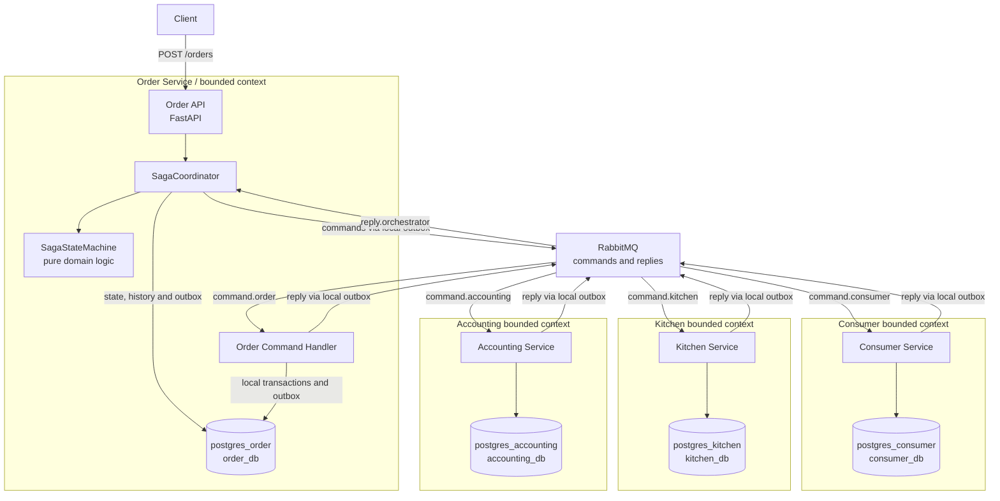
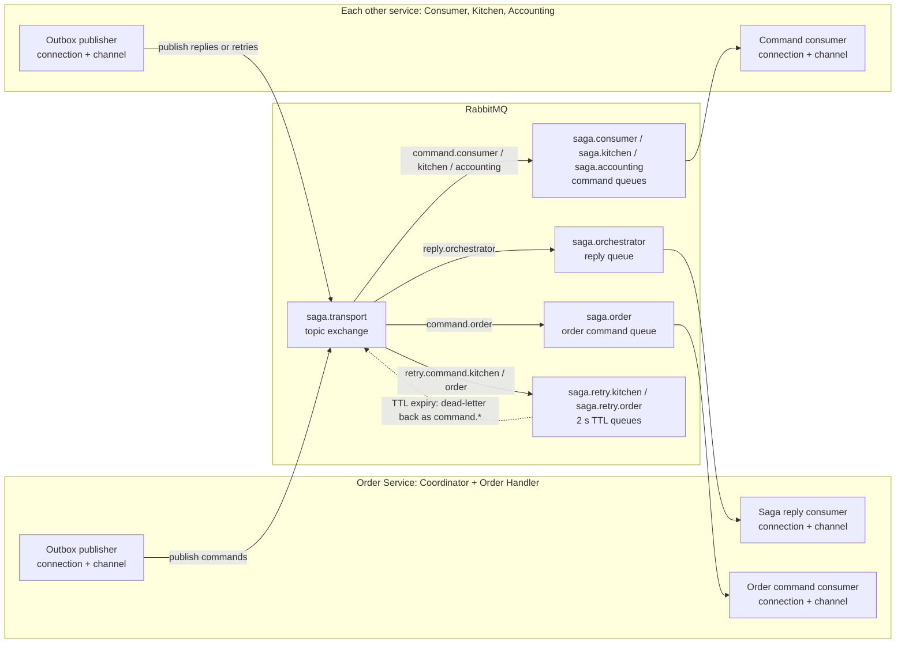

# Saga Orchestration — Explicit State Machine

A small **Create Order Saga** written in Python with **hexagonal architecture**. The lab matches the *Orchestration-Based Saga: State Diagram* slide: the coordinator owns the state machine, RabbitMQ carries commands and replies, and each participant commits local data and its outgoing reply to a transactional outbox.

The architecture is intentionally implemented **without Temporal**: students can inspect every transition and every compensation. There are four logical services—Order, Consumer, Kitchen, Accounting. The **Order Command Handler** and the **Saga Coordinator** run inside the *same Order Service* (same PostgreSQL `order_db` database), not as an additional microservice.

## 1. Architecture overview and files

The **Order Service** contains the REST API, `SagaCoordinator`, `SagaStateMachine`, and **Order Command Handler**. These are components of the same logical service (although the command handler runs as a separate worker process), and they share its **own** PostgreSQL `order_db`. Consumer, Kitchen and Accounting are independent services, each with its own PostgreSQL instance.



**Read this as a logical architecture diagram:** arrows to RabbitMQ represent messages published by each service's **Outbox publisher**, and arrows from RabbitMQ represent delivery to AMQP consumers. The Order Command Handler and Saga Coordinator are **not separate microservices**. The next diagram describes the actual exchange, queues, connections/channels and delayed-retry routing.

| Module | Responsibility |
|---|---|
| `app/domain/state_machine.py` | Pure `SagaStateMachine` and transition table (no I/O) |
| `app/domain/policy.py` | Eligibility and credit-authorization rules |
| `app/application/saga_coordinator.py` | `SagaCoordinator`: transitions and outgoing commands |
| `app/application/saga_participant_handler.py` | `SagaParticipantHandler`: local transactions, idempotence, replies and simulated retries |
| `app/ports/storage.py` | Persistence interfaces required by the application |
| `app/adapters/outbound/postgres_store.py` | Transactional persistence, inbox, outbox, transition history |
| `app/adapters/outbound/rabbitmq_transport.py` | Durable publishing with RabbitMQ publisher confirms |
| `app/adapters/inbound/rabbitmq_consumer.py` | Incoming messages and acknowledgment after local commit |
| `app/topology.py` | Durable queues and TTL-based retry routing |
| `app/main.py` | FastAPI and dependency composition |

This demo uses **four independent PostgreSQL containers**, one per service: `postgres_order` (`order_db`), `postgres_consumer` (`consumer_db`), `postgres_kitchen` (`kitchen_db`), and `postgres_accounting` (`accounting_db`). Each instance has its own persistent Docker volume and database lifecycle. There are no cross-service joins or distributed SQL transactions. The Order Service runs both the `SagaCoordinator` and the Order Command Handler against its **own** `order_db` (not a fifth microservice). An external payment is *not* charged: `AuthorizeCard` is a simulated business decision (`amount <= 100` succeeds). The original saga has a **semantic lock**: new orders stay `APPROVAL_PENDING` until the saga concludes.

### RabbitMQ connections, channels, and routing

`app/topology.py` declares one durable **topic exchange**, `saga.transport`. The same exchange carries commands, participant replies and controlled retry messages; **routing keys select queues**, not AMQP channels. Each Pika consumer or Outbox publisher uses a separate `BlockingConnection` and an AMQP channel. The topology initializer opens a temporary connection/channel to declare bindings.



**Actual queue bindings** from `app/topology.py`:

| Queue | Exchange | Binding routing key | Consumer / purpose |
|---|---|---|---|
| `saga.orchestrator` | `saga.transport` (topic) | `reply.orchestrator` | Order Service's Saga Coordinator |
| `saga.order` | `saga.transport` (topic) | `command.order` | Order Service's Order Command Handler |
| `saga.consumer` | `saga.transport` (topic) | `command.consumer` | Consumer Service |
| `saga.kitchen` | `saga.transport` (topic) | `command.kitchen` | Kitchen Service |
| `saga.accounting` | `saga.transport` (topic) | `command.accounting` | Accounting Service |
| `saga.retry.kitchen` | `saga.transport` (topic) | `retry.command.kitchen` | 2-second delay, then dead-letter to `command.kitchen` |
| `saga.retry.order` | `saga.transport` (topic) | `retry.command.order` | 2-second delay, then dead-letter to `command.order` |

**Per-service channel count in this demo:** Order Service opens **three** long-lived AMQP connection/channel pairs (one publisher, two consumers); each other service opens **two** (one publisher, one consumer). These are runtime connections, not extra microservices. A channel can publish multiple kinds of commands or replies. There is **no separate DLQ for unexpected failures** in this lab: the two `saga.retry.*` queues are delay queues whose TTL and dead-letter routing implement the controlled post-pivot retry. See the retry section below for failure semantics.

## 2. State machine: compare with the slide

In `app/domain/state_machine.py`, the model is a mapping:

`(current stage, reply event) -> (next stage, message route, command)`.

**Successful order:**

```text
START / VerifyConsumer
VERIFY_CONSUMER --ConsumerVerified / CreateTicket--> CREATE_TICKET
CREATE_TICKET --TicketCreated / AuthorizeCard--> AUTHORIZE_CARD
AUTHORIZE_CARD --CardAuthorized / ApproveTicket--> APPROVE_TICKET
APPROVE_TICKET --TicketApproved / ApproveOrder--> APPROVE_ORDER
APPROVE_ORDER --OrderApproved--> APPROVED
```

**Failure and compensation:**

```text
VERIFY_CONSUMER --ConsumerRejected / RejectOrder--> REJECT_ORDER
CREATE_TICKET --TicketCreationFailed / RejectOrder--> REJECT_ORDER
AUTHORIZE_CARD --CardDeclined / RejectTicket--> REJECT_TICKET
REJECT_TICKET --TicketRejected / RejectOrder--> REJECT_ORDER
REJECT_ORDER --OrderRejected--> REJECTED
```

Unlike the previous version, `APPROVE_ORDER` and `REJECT_ORDER` are **waiting stages**. The coordinator does **not** mark an order approved or rejected directly: it sends a command to the Order Command Handler, waits for `OrderApproved` or `OrderRejected`, and *only then* enters the terminal saga stage. If ticket creation fails, the saga first enters `REJECT_ORDER`; it does not jump directly to `REJECTED`.

The orchestrator persists each accepted transition in the `saga_history` table.

## 3. Start the lab

Requirements: Docker Compose, Make, curl. For tests on the host, first install `pip install -r requirements.txt`. The RabbitMQ Management UI is at [http://localhost:15673](http://localhost:15673) (`student` / `student`); the Order API is at [http://localhost:8001/docs](http://localhost:8001/docs); **Adminer** is at [http://localhost:8082](http://localhost:8082). In the Server field select the PostgreSQL server (`postgres_order`, `postgres_consumer`, `postgres_kitchen`, or `postgres_accounting`), user/password `demo` / `demo`, and the matching database (`order_db`, `consumer_db`, `kitchen_db`, or `accounting_db`).

```bash
make up
make approve
make logs
```

The `make approve` response contains an `orderId`. Query the current state and transition history:

```bash
curl http://localhost:8001/orders/<orderId>
curl http://localhost:8001/orders/<orderId>/history
```

The state-machine definition can also be inspected without reading source:

```bash
curl http://localhost:8001/saga/transitions
```

`history` shows every **accepted saga transition** including the received event and the command issued, so it can be compared line-by-line with the slide's arrows. Retries that occur *within a waiting stage* are instead visible in the `[flow]` logs and the participant's `command_attempts` database table.

### Demo A — normal success

```bash
make approve
```

Expect `APPROVED`, with stages `VERIFY_CONSUMER → CREATE_TICKET → AUTHORIZE_CARD → APPROVE_TICKET → APPROVE_ORDER → APPROVED`.

### Demo B — card failure requires compensation

```bash
make decline
```

Amounts above `100` are declined. Expect `AUTHORIZE_CARD → REJECT_TICKET → REJECT_ORDER → REJECTED`. The Kitchen Service's ticket is marked `REJECTED` as a **business compensation**, not by rolling back a transaction spanning services.

### Demo C — rejection before ticket creation

```bash
make invalid
```

`CUST_INVALID` causes `VERIFY_CONSUMER → REJECT_ORDER → REJECTED`, with no Kitchen ticket created.

### Demo D — ticket creation fails

```bash
make ticket-failure
```

The `CreateTicket` handler reports `TicketCreationFailed`; the coordinator issues `RejectOrder` and **waits** for `OrderRejected`. No Kitchen ticket is created.

## 4. Retriable transactions and idempotence

In Saga terminology, **post-pivot retriable steps** should be designed so that a transient failure can be followed by another execution safely. Here, `ApproveTicket` and `ApproveOrder` are the illustrative retriable steps following the successful simulated card authorization.

To observe a reproducible failure and recovery:

```bash
make retry
make logs
```

The returned `orderId` identifies the saga. For **each** of `ApproveTicket` (Kitchen) and `ApproveOrder` (Order):

1. **Attempt 0:** a *simulated transient exception* aborts and **rolls back** the local business transaction; no approval is committed.
2. A separate short transaction records the failed attempt, acknowledges the original command, and atomically writes a new retry command into the participant's **outbox**.
3. The outbox relay publishes the retry message to `saga.retry.kitchen` or `saga.retry.order`. RabbitMQ holds it for **2 seconds** (queue TTL), then dead-letters it back to the primary command queue.
4. **Attempt 1:** the participant applies the approval and records the command result and reply in the same local transaction; the saga continues.

Expected log sequence (the identifier varies):

```text
[flow] ... kitchen ApproveTicket attempt=0 ROLLBACK; delayed retry scheduled
[flow] ... kitchen ApproveTicket attempt=1 -> TicketApproved
[flow] ... order ApproveOrder attempt=0 ROLLBACK; delayed retry scheduled
[flow] ... order ApproveOrder attempt=1 -> OrderApproved
[flow] ... APPROVE_ORDER --OrderApproved--> APPROVED
```

**Idempotence is demonstrated separately from retry:**

- `inbox` deduplicates redeliveries using `messageId`.
- `command_results` has a unique `(order_id, action)` key, so a repeated business command **even with a different `messageId`** does not reapply the business update. Replaying a cached reply is safe: the coordinator rejects stale replies for its current stage.
- SQL operations (such as guarded Order status updates and one ticket per order) are designed to be safe if repeated.
- Tests assert exactly **one recorded successful business command** while a simulated transient failure and a retry have occurred.

Run the **fast domain/application tests** without a broker or database; they use an in-memory implementation of the storage port rather than SQLite:

```bash
make test
```

`test_retriable_steps_fail_then_succeed_once` (using an in-memory test double of the storage port) validates the failed first attempt, the successful second attempt, and idempotent completion. `test_duplicate_message_id_is_idempotent` and `test_duplicate_semantic_command_with_new_message_id_has_no_new_business_effect` validate both kinds of duplicates.

### Delayed retry queues are not DLQs for failed messages

The retry mechanism deliberately uses RabbitMQ **dead-letter routing**, but with a different purpose from the DLQs in the Choreography lab:

| Queue | Role in this lab |
|---|---|
| `saga.retry.kitchen`, `saga.retry.order` | **Delay queues**: keep a retry command for 2 seconds, then forward it via TTL expiration to `command.kitchen` or `command.order`. |
| `saga.kitchen`, `saga.order`, other primary queues | **Work queues**: deliver commands or replies to the services. They are **not configured with a final dead-letter queue** in this lab. |

The simulated transient failure is handled inside `SagaParticipantHandler`: its first business transaction rolls back, then a **separate committed transaction** records the retry intent in the local outbox before the original message is acknowledged. A retry message gets a new `messageId`; `(order_id, action)` idempotence prevents applying the business effect twice.

**Limit:** the inbound RabbitMQ adapter currently sends `basic_nack(requeue=False)` for an **unexpected** handler exception. Since the primary queues do not have a final DLX configured, such messages can be **discarded** rather than retained for diagnosis. Do not confuse the demonstrated **controlled retry** with general-purpose reliable handling of poison messages. A production implementation would add final DLQs, classification of transient/permanent failures and a bounded retry policy.

**Scope of the demonstration:** the injected failure and delayed resubmission are deliberately deterministic. This lab does *not* provide a generic production retry engine for arbitrary database errors, permanent errors, arbitrary retry limits, or external payment gateways. A real retriable operation needs a well-defined retry policy (timeouts, exponential backoff, maximum attempts, DLQ, observability) and truly idempotent external side effects. No global exactly-once delivery is claimed.

## 5. Recovering after participant downtime

```bash
docker compose stop kitchen
make approve
# The saga remains in CREATE_TICKET while waiting for the reply.
docker compose start kitchen
# The queued command is processed and the saga resumes.
```

The `saga.transport` exchange and queues are durable, messages are persistent and local outboxes use publisher confirms. Message acknowledgments are sent only after the local transaction commits. Stale replies and duplicate commands do not generate duplicate business effects. Each service uses its **own PostgreSQL container and named volume**; no shared database server or cross-service SQL access is required. The `demo` / `demo` credentials are replicated per instance only for classroom simplicity; production environments should use distinct secrets and restricted accounts. Adminer can connect to each instance independently.

## 6. Inspect saga state using PostgreSQL and Adminer

Open **http://localhost:8082**, select **PostgreSQL**, and log in with:

| Adminer field | Value |
|---|---|
| Server | `postgres_order`, `postgres_consumer`, `postgres_kitchen`, or `postgres_accounting` |
| Username | `demo` |
| Password | `demo` |
| Database | Database owned by the selected server: `order_db`, `consumer_db`, `kitchen_db`, or `accounting_db` |

The **Order Service** (`order_db`) contains `orders`, `sagas`, `saga_history`, `inbox`, `outbox`, `command_attempts`, and `command_results`. The **Consumer Service** (`consumer_db`) uses its own `inbox`, `outbox`, `command_attempts`, and `command_results`. The **Kitchen Service** (`kitchen_db`) also owns `tickets`; **Accounting** (`accounting_db`) owns `authorizations`.

Useful read-only queries (select the correct DB in Adminer):

```sql
-- order_db: inspect current state and the machine's progression
SELECT order_id, status FROM orders;
SELECT order_id, stage, updated_at FROM sagas;
SELECT order_id, from_stage, event, to_stage, command
  FROM saga_history ORDER BY seq;
SELECT order_id, action, attempt, outcome
  FROM command_attempts ORDER BY seq;

-- kitchen_db: inspect ticket compensation and retriable approval
SELECT order_id, state FROM tickets;
SELECT order_id, action, attempt, outcome
  FROM command_attempts ORDER BY seq;
```

Or use `make db-order`, `make db-consumer`, `make db-kitchen`, or `make db-accounting` to open `psql` in the corresponding PostgreSQL **container**. The commands `make approve`, `make decline`, `make invalid`, `make ticket-failure` and `make retry` exercise the existing workflow without changes to the API.

**Persistence adapter:** `app/adapters/outbound/postgres_store.py` uses SQLAlchemy Core and `psycopg` (PostgreSQL protocol). Transaction scopes are defined using `engine.begin()`: data changes, inbox acknowledgments, saga transitions, and outgoing outbox writes commit or roll back together. The state machine itself is pure Python (`app/domain/state_machine.py`). For concurrent replies, `get_stage()` locks the saga row using `SELECT ... FOR UPDATE`.

**Testing levels:** `make test` runs fast tests without Docker (including PostgreSQL DDL/schema compilation and application-level tests with an in-memory port adapter). A real PostgreSQL transaction/rollback test is available with `TEST_DATABASE_URL`, using a *disposable database created for testing*; it is skipped otherwise. A full end-to-end RabbitMQ + PostgreSQL Compose run is a separate validation step.

**Storage layout:** four independent PostgreSQL containers (`postgres_order`, `postgres_consumer`, `postgres_kitchen`, `postgres_accounting`) and four named volumes. RabbitMQ and Adminer are shared *infrastructure*, not shared service databases. Run `docker compose ps` to see all four servers, or connect to each via Adminer. This is a demonstrative deployment; the state machine and ports are unchanged.

## 7. Clean up

```bash
make down
make reset   # DANGER: deletes local broker/database volumes
```


**Migrating from the previous SQLite version:** run `make reset` before `make up` if the old stack is still running. This removes **local lab volumes and data** and initializes the four PostgreSQL databases on separate containers; do not run it against data you want to keep. The educational lab does not provide a data-migration script from old SQLite files.
